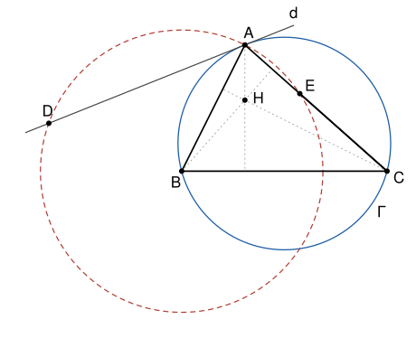

## Statement

Soit $ABC$ un triangle sans angle droit, $H$ son orthocentre, $\Gamma$ son cercle circonscrit et $d$ la tangente à $\Gamma$ en $A$. Le cercle de centre $B$ passant par $A$ recoupe la droite $d$ en $D$ et la droite $(AC)$ en $E$.

Montrer que les points $D$, $E$ et $H$ sont alignés.

## Hints

1. Les points $A$ et $D$ sont sur un cercle de centre $B$. Où se trouve le pied de la perpendiculaire à $d$ issue de $B$ ? Même question pour $A$, $E$ et la droite $(AC)$.
2. Prends un repère orthonormé dont l'origine est le pied de la hauteur issue de $A$, avec $A(0\,;\,h)$, $B(-p\,;\,0)$ et $C(q\,;\,0)$. Calcule les coordonnées de $H$ et du centre $O$ de $\Gamma$.
3. La droite $d$ est perpendiculaire à $(OA)$. Trouve un vecteur directeur $\vec{u}$ de $d$, puis $\overrightarrow{AD}$ avec un projeté orthogonal. Fais de même pour $\overrightarrow{AE}$.
4. Montre que $\overrightarrow{DH}$ et $\overrightarrow{DE}$ sont colinéaires.

## Solution

### Étape 1 : une remarque

Soit $M$ un point d'une droite $\ell$ passant par $A$, avec $BM = BA$. Soit $K$ le pied de la perpendiculaire à $\ell$ issue de $B$. Le triangle $BAM$ est isocèle en $B$, donc sa hauteur issue de $B$ est aussi une médiane : **$K$ est le milieu de $[AM]$**, et $\overrightarrow{AM} = 2\,\overrightarrow{AK}$.

Or le projeté orthogonal $K$ de $B$ sur une droite passant par $A$ de vecteur directeur $\vec{v}$ vérifie
$$\overrightarrow{AK} = \frac{\overrightarrow{AB} \cdot \vec{v}}{\vec{v} \cdot \vec{v}}\;\vec{v}, \qquad \text{donc} \qquad \overrightarrow{AM} = \frac{2\,\overrightarrow{AB} \cdot \vec{v}}{\vec{v} \cdot \vec{v}}\;\vec{v} .$$
On utilise cette formule pour $D$, sur la droite $d$, et pour $E$, sur la droite $(AC)$.

### Étape 2 : le repère

Soit l'origine au pied de la hauteur issue de $A$, l'axe des abscisses porté par $(BC)$ et l'axe des ordonnées par cette hauteur :
$$A(0\,;\,h), \qquad B(-p\,;\,0), \qquad C(q\,;\,0) ,$$
avec $h > 0$, $p + q > 0$, et $p \neq 0$, $q \neq 0$ puisque les angles en $B$ et en $C$ ne sont pas droits. On a $\overrightarrow{AB}(-p\,;\,-h)$, $\overrightarrow{AC}(q\,;\,-h)$ et $\overrightarrow{AB} \cdot \overrightarrow{AC} = h^2 - pq$, qui n'est pas nul puisque l'angle en $A$ n'est pas droit. On pose
$$N = h^2 + q^2 = AC^2 .$$

**L'orthocentre.** Le point $H$ est sur la hauteur issue de $A$, donc $H(0\,;\,y)$. La droite $(BH)$ est perpendiculaire à $(AC)$ : $\overrightarrow{BH} \cdot \overrightarrow{AC} = pq - hy = 0$. Ainsi
$$H\left(0\,;\,\frac{pq}{h}\right), \qquad \overrightarrow{AH}\left(0\,;\,\frac{pq - h^2}{h}\right) .$$

**Le centre du cercle.** Le centre $O$ est sur la médiatrice de $[BC]$, donc son abscisse est la moyenne $x$ de $-p$ et de $q$, avec $2x = q - p$. L'égalité $OA^2 = OB^2$ s'écrit $x^2 + (y - h)^2 = (x + p)^2 + y^2$, soit $h^2 - 2hy = 2px + p^2 = pq$. On obtient
$$O\left(\frac{q - p}{2}\,;\,\frac{h^2 - pq}{2h}\right), \qquad \overrightarrow{OA}\left(\frac{p - q}{2}\,;\,\frac{h^2 + pq}{2h}\right) .$$

### Étape 3 : le point $D$

La tangente $d$ est perpendiculaire au rayon $(OA)$. Le vecteur
$$\vec{u}\,(h^2 + pq\,;\,h\,(q - p))$$
est orthogonal à $\overrightarrow{OA}$, car
$$\overrightarrow{OA} \cdot \vec{u} = \frac{(p - q)(h^2 + pq)}{2} + \frac{(h^2 + pq)\,h\,(q - p)}{2h} = 0 .$$
C'est donc un vecteur directeur de $d$. On calcule
$$\overrightarrow{AB} \cdot \vec{u} = -p\,(h^2 + pq) - h^2\,(q - p) = -p^2 q - h^2 q = -q\,(p^2 + h^2) ,$$
$$\vec{u} \cdot \vec{u} = (h^2 + pq)^2 + h^2\,(q - p)^2 = h^4 + p^2 q^2 + h^2 q^2 + h^2 p^2 = (h^2 + p^2)(h^2 + q^2) .$$
La formule de l'étape 1 donne
$$\overrightarrow{AD} = \frac{-2q\,(p^2 + h^2)}{(h^2 + p^2)\,N}\;\vec{u} = -\frac{2q}{N}\;\vec{u} .$$

### Étape 4 : le point $E$

Avec $\vec{v} = \overrightarrow{AC}$, de norme au carré $N$, la formule de l'étape 1 donne
$$\overrightarrow{AE} = \frac{2\,(h^2 - pq)}{N}\;\overrightarrow{AC} .$$

### Étape 5 : l'alignement

**Le vecteur $\overrightarrow{DE}$.** On a $\overrightarrow{DE} = \overrightarrow{AE} - \overrightarrow{AD}$, donc
$$\overrightarrow{DE} = \frac{2}{N}\left((h^2 - pq)\,(q\,;\,-h) + q\,(h^2 + pq\,;\,h\,(q - p))\right) .$$
L'abscisse entre les grandes parenthèses vaut $q h^2 - pq^2 + q h^2 + pq^2 = 2qh^2$. L'ordonnée vaut $-h^3 + hpq + hq^2 - hpq = h\,(q^2 - h^2)$. Ainsi
$$\overrightarrow{DE} = \frac{2h}{N}\;\vec{w}, \qquad \text{avec} \qquad \vec{w}\,(2qh\,;\,q^2 - h^2) .$$
Le vecteur $\vec{w}$ n'est pas nul, car $q \neq 0$. Donc $D \neq E$.

**Le vecteur $\overrightarrow{DH}$.** On a $\overrightarrow{DH} = \overrightarrow{AH} - \overrightarrow{AD}$. Son abscisse est
$$\frac{2q\,(h^2 + pq)}{N} .$$
Son ordonnée est
$$\frac{pq - h^2}{h} + \frac{2qh\,(q - p)}{N} = \frac{(pq - h^2)(h^2 + q^2) + 2q^2 h^2 - 2pqh^2}{hN} .$$
Le numérateur vaut $pqh^2 + pq^3 - h^4 - h^2 q^2 + 2q^2 h^2 - 2pqh^2 = pq^3 - pqh^2 + h^2 q^2 - h^4$, c'est-à-dire
$$pq\,(q^2 - h^2) + h^2\,(q^2 - h^2) = (q^2 - h^2)(h^2 + pq) .$$
Ainsi
$$\overrightarrow{DH} = \frac{h^2 + pq}{hN}\,(2qh\,;\,q^2 - h^2) = \frac{h^2 + pq}{hN}\;\vec{w} .$$

Les vecteurs $\overrightarrow{DH}$ et $\overrightarrow{DE}$ sont tous les deux colinéaires à $\vec{w}$. **Les points $D$, $E$ et $H$ sont alignés.**

## Going further

- La remarque de l'étape 1 dit en particulier que la hauteur $(BH)$ est la médiatrice de $[AE]$, donc $HA = HE$. Le corrigé officiel part de là et fait une chasse aux angles : sur la figure, montre que $\widehat{HEA} = 90° - \widehat{ACB}$, puis que $\widehat{DEA} = 90° - \widehat{ACB}$ en utilisant l'angle entre la tangente et la corde $[AB]$.
- Le calcul n'utilise nulle part l'hypothèse $AB < AC$ de l'énoncé original. Que devient la figure quand $AB = AC$ ?
- Quand $h^2 + pq = 0$, le calcul donne $D = H$. Montre que, dans ce cas, la tangente $d$ est la hauteur issue de $A$.
