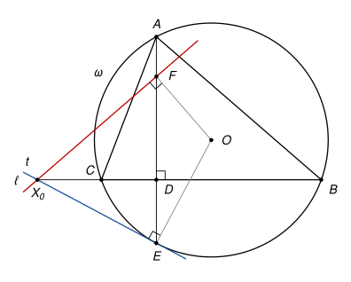

## Statement

Soit $ABC$ un triangle dont les trois angles sont aigus, avec $AB \neq AC$. On note $\omega$ son cercle circonscrit et $O$ le centre de $\omega$.

- La perpendiculaire à $(BC)$ passant par $A$ coupe $(BC)$ en $D$, et recoupe $\omega$ en $E$.
- Soit $F$ le point du segment $[AE]$ tel que $2 \times FD = AE$.
- Soit $\ell$ la droite perpendiculaire à $(OF)$ passant par $F$.

Montrer que la droite $\ell$, la droite $(BC)$ et la tangente à $\omega$ en $E$ passent par un même point.

![Le triangle ABC, son cercle circonscrit ω de centre O, la hauteur [AD] prolongée jusqu'au point E du cercle, et le point F](10249-figure-1.svg)

## Hints

1. Une méthode sûre ici est le calcul en coordonnées. Quel repère rend les points $A$, $B$, $C$ et $D$ très simples ?
2. Prenez $D$ comme origine, $(BC)$ comme axe des abscisses et $(AD)$ comme axe des ordonnées, avec $A(0\,;\,a)$, $B(b\,;\,0)$ et $C(c\,;\,0)$. Cherchez une équation de $\omega$ de la forme $x^2 + y^2 + px + qy + r = 0$, puis les coordonnées de $O$, de $E$ et de $F$.
3. Pour un point $X$ de la droite $(BC)$, comparez les produits scalaires $\overrightarrow{EX} \cdot \overrightarrow{EO}$ et $\overrightarrow{FX} \cdot \overrightarrow{FO}$.

## Solution

On travaille dans un repère orthonormé d'origine $D$, dont l'axe des abscisses est la droite $(BC)$ et l'axe des ordonnées la droite $(AD)$. On note

$$A(0\,;\,a), \qquad B(b\,;\,0), \qquad C(c\,;\,0), \qquad \text{avec } a > 0.$$

Les angles en $B$ et en $C$ sont aigus, donc le pied $D$ de la hauteur est strictement entre $B$ et $C$. Quitte à échanger les noms de $B$ et $C$, on a $c < 0 < b$. On pose $k = -bc$, qui est strictement positif, et $h = \frac{k}{a}$, lui aussi strictement positif.

**Étape 1 : une équation du cercle $\omega$.** Considérons l'équation

$$x^2 + y^2 - (b + c)\,x - (a - h)\,y - k = 0.$$

Elle est vérifiée par $B$ : $b^2 - (b + c)\,b - k = -bc - k = 0$. De même pour $C$. Et par $A$ : $a^2 - (a - h)\,a - k = ah - k = 0$, puisque $ah = k$. En la réécrivant

$$\left(x - \frac{b + c}{2}\right)^2 + \left(y - \frac{a - h}{2}\right)^2 = \left(\frac{b + c}{2}\right)^2 + \left(\frac{a - h}{2}\right)^2 + k,$$

on voit que c'est l'équation d'un cercle, qui passe par $A$, $B$ et $C$. Un seul cercle passe par trois points non alignés, c'est donc $\omega$, et son centre est

$$O\left(\frac{b + c}{2}\,;\,\frac{a - h}{2}\right).$$

**Étape 2 : le point $E$.** Le point $E$ est sur l'axe des ordonnées, donc $x = 0$, et son ordonnée vérifie $y^2 - (a - h)\,y - ah = 0$, c'est-à-dire $(y - a)(y + h) = 0$. La solution $y = a$ donne le point $A$, donc

$$E(0\,;\,-h).$$

**Étape 3 : le point $F$.** On a $AE = a + h$, donc $FD = \frac{a + h}{2}$. Le point $F$ est sur l'axe des ordonnées, avec une ordonnée égale à $\frac{a + h}{2}$ ou à $-\frac{a + h}{2}$. La seconde valeur est impossible. En effet $F$ est sur $[AE]$, donc son ordonnée est au moins $-h$, et $-\frac{a + h}{2} \geq -h$ voudrait dire $a \leq h$, c'est-à-dire $a^2 \leq k$. Or l'angle en $A$ est aigu, donc

$$\overrightarrow{AB} \cdot \overrightarrow{AC} = bc + a^2 = a^2 - k > 0.$$

Ainsi $a^2 > k$ et

$$F\left(0\,;\,\frac{a + h}{2}\right).$$

**Étape 4 : le calcul clé.** Soit $X(x\,;\,0)$ un point quelconque de la droite $(BC)$. On calcule les coordonnées des vecteurs :

$$\overrightarrow{EX}\,(x\,;\,h), \qquad \overrightarrow{EO}\left(\frac{b + c}{2}\,;\,\frac{a + h}{2}\right), \qquad \overrightarrow{FX}\left(x\,;\,-\frac{a + h}{2}\right), \qquad \overrightarrow{FO}\left(\frac{b + c}{2}\,;\,-h\right).$$

Pour $\overrightarrow{EO}$, on a utilisé $\frac{a - h}{2} + h = \frac{a + h}{2}$, et pour $\overrightarrow{FO}$, on a utilisé $\frac{a - h}{2} - \frac{a + h}{2} = -h$. Alors

$$\overrightarrow{EX} \cdot \overrightarrow{EO} = \frac{(b + c)\,x}{2} + \frac{h(a + h)}{2} \quad \text{et} \quad \overrightarrow{FX} \cdot \overrightarrow{FO} = \frac{(b + c)\,x}{2} + \frac{h(a + h)}{2}.$$

Les deux produits scalaires sont égaux, pour tout point $X$ de $(BC)$.

**Étape 5 : conclusion.** La tangente $t$ à $\omega$ en $E$ est la droite perpendiculaire au rayon $(OE)$ en $E$. Un point $X$ de $(BC)$ est donc sur $t$ si et seulement si $\overrightarrow{EX} \cdot \overrightarrow{EO} = 0$.

Comme $AB \neq AC$, le théorème de Pythagore dans les triangles $ADB$ et $ADC$ donne $DB \neq DC$, donc $b \neq -c$, c'est-à-dire $b + c \neq 0$. L'équation $\frac{(b + c)\,x}{2} + \frac{h(a + h)}{2} = 0$ a donc une unique solution $x_0$, et le point $X_0(x_0\,;\,0)$ est le point d'intersection de $t$ et de $(BC)$.

D'après l'étape 4, on a aussi $\overrightarrow{FX_0} \cdot \overrightarrow{FO} = 0$. Le point $F$ n'est pas sur $(BC)$, car son ordonnée est strictement positive, donc $X_0 \neq F$, et la droite $(FX_0)$ est perpendiculaire à $(FO)$ en $F$ : c'est la droite $\ell$. Ainsi $X_0$ est sur $\ell$.

**Les trois droites $\ell$, $(BC)$ et $t$ passent par le point $X_0$.**

*Remarques.*

- Si le triangle est isocèle en $A$, on a $b + c = 0$, et les trois droites sont toutes perpendiculaires à $(AD)$ : elles sont parallèles et ne se coupent pas. C'est pourquoi l'énoncé doit supposer $AB \neq AC$, ce que le texte original oublie.
- Le point $F$ a un sens simple. Le symétrique de l'orthocentre $H$ du triangle par rapport à $(BC)$ est sur le cercle circonscrit, c'est le point $E$, donc $DH = DE = h$. Le point $F\left(0\,;\,\frac{a + h}{2}\right)$ est donc le milieu de $[AH]$.
- L'étape 4 dit, en fait, que $F$ et $E$ sont sur un même cercle de diamètre $[OX_0]$. On peut le voir sans calcul : avec le milieu $M$ de $[BC]$, le quadrilatère $OFEM$ est un trapèze isocèle, donc inscrit dans un cercle, et ce cercle passe aussi par $X_0$, puisque les angles en $E$ et en $M$ sont droits. C'est la piste que les correcteurs signalent comme la plus élémentaire. Le corrigé officiel, lui, vérifie $X_0O^2 = X_0F^2 + FO^2$ avec le théorème de Pythagore et la puissance du point $F$.

## Going further

1. Montrer que $OFEM$ est un trapèze isocèle, où $M$ est le milieu de $[BC]$. On pourra calculer les coordonnées de $M$ et comparer $FO$ et $EM$.
2. Que devient la conclusion si l'angle en $A$ est obtus ? Y a-t-il encore un point $F$ sur $[AE]$ tel que $2 \times FD = AE$ ?
