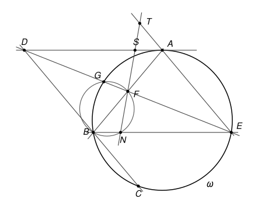

## Statement

Soit $ABC$ un triangle tel que $AB < AC$, et soit $\omega$ son cercle circonscrit.

- La tangente à $\omega$ en $A$ coupe la droite $(BC)$ en un point $D$.
- La parallèle à $(AD)$ passant par $B$ recoupe $\omega$ en un point $E$, autre que $B$.
- La droite $(DE)$ coupe la droite $(AB)$ en un point $F$, et recoupe $\omega$ en un point $G$, autre que $E$.
- La droite $(BE)$ recoupe le cercle circonscrit au triangle $BFG$ en un point $N$, autre que $B$.
- Enfin, la droite $(NF)$ coupe les droites $(AD)$ et $(AE)$ en deux points notés $S$ et $T$.

Démontrer que les points $D$, $G$, $S$ et $T$ sont cocycliques.

## Hints

1. Selon la forme du triangle, les points changent beaucoup de place : $T$ peut être sur le segment $[AE]$ ou au-delà de $A$, $S$ d'un côté ou de l'autre de $A$... Les angles orientés de droites évitent d'avoir à traiter chaque cas.
2. Commencez par un autre quadrilatère : montrez que les points $G$, $N$, $E$ et $T$ sont cocycliques. Pour comparer $(EG, ET)$ et $(NG, NT)$, passez par le point $B$.
3. Pour finir, utilisez le cercle passant par $G$, $N$, $E$, $T$ et le fait que $(AD)$ est parallèle à $(BE)$.

## Solution

Dans toute la solution, on suppose que les points de l'énoncé sont deux à deux distincts, ce qui est le cas en général.

### Deux outils : les angles orientés de droites

Pour deux droites $d_1$ et $d_2$, on note $(d_1, d_2)$ l'angle dont il faut faire tourner $d_1$, dans le sens direct, pour la rendre parallèle à $d_2$. Cet angle est compté **à $180^\circ$ près** : tourner une droite de $180^\circ$ la ramène sur elle-même. Ces angles suivent des règles simples.

- **Relation de Chasles** : $(d_1, d_3) = (d_1, d_2) + (d_2, d_3)$.
- $(d_1, d_2) = 0$ si et seulement si $d_1$ et $d_2$ sont parallèles (ou confondues). En particulier, si $d_2$ et $d_3$ sont parallèles, alors $(d_1, d_2) = (d_1, d_3)$.
- Une droite peut être nommée par deux quelconques de ses points : par exemple $(AE) = (AT) = (ET)$.

Le théorème de l'angle inscrit et sa réciproque prennent alors une forme qui ne dépend plus de la figure.

**Angle inscrit.** Si $W$, $X$, $Y$, $Z$ sont quatre points d'un même cercle, alors $(ZX, ZY) = (WX, WY)$.

En effet, notons $\theta = \widehat{XZY}$. Si $Z$ et $W$ sont du même côté de la droite $(XY)$, le théorème de l'angle inscrit donne $\widehat{XWY} = \theta$, et les deux rotations, de $[ZX)$ vers $[ZY)$ et de $[WX)$ vers $[WY)$, tournent dans le même sens : les deux angles orientés sont égaux. Si $Z$ et $W$ sont de part et d'autre de $(XY)$, on a $\widehat{XWY} = 180^\circ - \theta$, et les deux rotations tournent en sens contraires. Si la première vaut $\theta$, la seconde vaut $-(180^\circ - \theta) = \theta - 180^\circ$, c'est-à-dire $\theta$ à $180^\circ$ près.

**Réciproque.** Soit $W$, $X$, $Y$, $Z$ quatre points tels que ni $Z$ ni $W$ ne soit sur la droite $(XY)$. Si $(ZX, ZY) = (WX, WY)$, alors ces quatre points sont sur un même cercle.

En effet, on refait le raisonnement à l'envers. Si $Z$ et $W$ sont du même côté de $(XY)$, les deux rotations tournent dans le même sens, donc $\widehat{XZY} = \widehat{XWY}$ : les deux points voient le segment $[XY]$ sous le même angle, du même côté, donc ils sont sur un même arc de cercle d'extrémités $X$ et $Y$. Si $Z$ et $W$ sont de part et d'autre de $(XY)$, les rotations tournent en sens contraires, donc $\widehat{XZY} + \widehat{XWY} = 180^\circ$, et $W$ est sur l'arc qui complète, de l'autre côté de $(XY)$, le cercle passant par $X$, $Y$ et $Z$.

### Étape 1 : les points G, N, E et T sont cocycliques

On part de l'angle en $E$ et on change de sommet deux fois :

$$(EG, ET) = (EG, EA) = (BG, BA) = (BG, BF) = (NG, NF) = (NG, NT).$$

Justifions chaque égalité :

- $(ET) = (EA)$, car $T$ est sur la droite $(AE)$ ;
- $(EG, EA) = (BG, BA)$ par le théorème de l'angle inscrit dans $\omega$, qui passe par $A$, $B$, $E$ et $G$ ;
- $(BA) = (BF)$, car $F$ est sur la droite $(AB)$ ;
- $(BG, BF) = (NG, NF)$ par le théorème de l'angle inscrit dans le cercle circonscrit à $BFG$, qui passe aussi par $N$ ;
- $(NF) = (NT)$, car $T$ est sur la droite $(NF)$.

Ainsi $(EG, ET) = (NG, NT)$ : d'après la réciproque, **les points $G$, $T$, $E$ et $N$ sont cocycliques**.

### Étape 2 : les points D, G, S et T sont cocycliques

On part maintenant de l'angle en $T$ :

$$(TG, TS) = (TG, TN) = (EG, EN) = (DG, DS).$$

En effet :

- $(TS) = (TN)$, car $S$ est sur la droite $(NF)$, qui passe par $T$ et par $N$ ;
- $(TG, TN) = (EG, EN)$ par le théorème de l'angle inscrit dans le cercle de l'étape 1 ;
- $(EG) = (DG)$, car $D$, $G$ et $E$ sont sur une même droite ; et $(EN) = (BE)$ est parallèle à $(AD) = (DS)$. Donc $(EG, EN) = (DG, DS)$.

Ainsi $(TG, TS) = (DG, DS)$. D'après la réciproque, **les points $D$, $G$, $S$ et $T$ sont cocycliques**, ce qu'il fallait démontrer.

## Going further

1. Le point $C$ ne sert qu'à placer $D$. Mais en relisant la solution, on voit que le fait que $(AD)$ soit tangente à $\omega$ n'a jamais servi non plus ! Vérifiez que le résultat reste vrai si $(AD)$ est une droite quelconque passant par $A$ et $D$ un point quelconque de cette droite, les autres points étant construits de la même façon.
2. À quoi sert l'hypothèse $AB < AC$ de l'énoncé ? Que se passe-t-il pour la tangente en $A$ et la droite $(BC)$ lorsque $AB = AC$ ?
