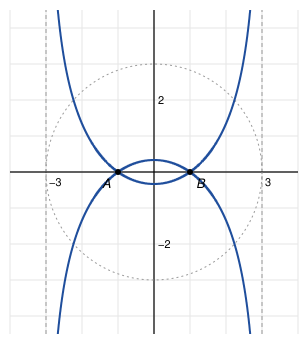
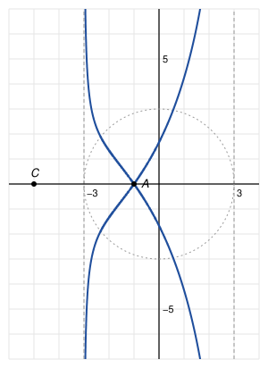

## Statement

Dans tout l'exercice, $ABC$ est un triangle non aplati, et l'on note $a = BC$, $b = CA$ et $c = AB$.
On dit que le triangle $ABC$ est **de type $\mathcal{W}$** si ses médianes issues de $A$ et de $B$
sont perpendiculaires.

On admet le résultat suivant, démontré dans une partie précédente : **un triangle non aplati $ABC$
est de type $\mathcal{W}$ si et seulement si $a^2 + b^2 = 5c^2$.**

On travaille dans un repère orthonormé d'origine $O$.

1. **On fixe $A$ et $B$.** On prend $A(-1\,;0)$ et $B(1\,;0)$, et l'on note $\Gamma$ l'ensemble des
   points $C$ tels que $ABC$ soit de type $\mathcal{W}$.

   a) Montrer que $\Gamma$ est le cercle de centre $O$ et de rayon $3$, privé de deux points que
   l'on précisera.

   b) Déterminer une fonction $f$ telle que l'ensemble des orthocentres $H$ des triangles $ABC$,
   lorsque $C$ décrit $\Gamma$, soit la réunion des deux courbes d'équations $y = f(x)$ et
   $y = -f(x)$. Représenter cet ensemble.

2. **On fixe $A$ et $C$.** On prend $A(-1\,;0)$ et $C(-5\,;0)$, et l'on note $\Gamma'$ l'ensemble des
   points $B$ tels que $ABC$ soit de type $\mathcal{W}$.

   a) Déterminer $\Gamma'$.

   b) Déterminer toutes les valeurs que peut prendre le rapport $\frac{a}{b}$ lorsque $B$ décrit
   $\Gamma'$.

   c) Parmi ces triangles, déterminer ceux dont le cercle circonscrit a le plus petit rayon possible.

   d) Représenter l'ensemble des orthocentres $H$ des triangles $ABC$ lorsque $B$ décrit $\Gamma'$.

La calculatrice est autorisée.

## Hints

1. **Questions 1 a) et 2 a).** Écrire $a^2$, $b^2$ et $c^2$ avec les coordonnées du point mobile,
   puis traduire $a^2 + b^2 = 5c^2$.
2. **Question 1 b).** La droite $(AB)$ est l'axe des abscisses : la hauteur issue de $C$ est donc
   verticale. Il reste à écrire que $\overrightarrow{AH}$ et $\overrightarrow{BC}$ sont orthogonaux.
3. **Question 1 b).** Pour savoir comment varie $f$ sur $[0, 3[$, poser $s = \sqrt{9 - x^2}$ et
   écrire $f(x)$ à l'aide de $s$ seulement.
4. **Question 2 b).** Exprimer $a^2$ en fonction de l'abscisse $x$ de $B$ seulement.
5. **Question 2 c).** Le segment $[AC]$ est une corde du cercle circonscrit. Comment se compare une
   corde au diamètre ?
6. **Question 2 c).** Le rayon vaut $\frac{AC}{2}$ exactement quand $[AC]$ est un diamètre, donc
   quand l'angle en $B$ est droit. Existe-t-il un tel point $B$ sur $\Gamma'$ ?

## Solution

**1. a)** Pour un point $C(x\,;y)$, on a $c = AB = 2$ et
$$a^2 + b^2 = (x - 1)^2 + y^2 + (x + 1)^2 + y^2 = 2x^2 + 2y^2 + 2 .$$
Le triangle est non aplati exactement quand $C$ n'est pas sur la droite $(AB)$, c'est-à-dire quand
$y \neq 0$. Pour $y \neq 0$, d'après le résultat admis :
$$ABC \text{ de type } \mathcal{W} \iff 2x^2 + 2y^2 + 2 = 20 \iff x^2 + y^2 = 9 .$$

**Conclusion :** $\Gamma$ est le cercle de centre $O$ et de rayon $3$, privé des points $(-3\,;0)$ et
$(3\,;0)$.

**b)** Soit $C(x_0\,;y_0)$ un point de $\Gamma$ : $x_0^2 + y_0^2 = 9$ et $y_0 \neq 0$, donc
$-3 < x_0 < 3$.

La hauteur issue de $C$ est perpendiculaire à $(AB)$, qui est l'axe des abscisses : c'est la droite
d'équation $x = x_0$. L'orthocentre est donc un point $H(x_0\,;Y)$. Il est aussi sur la hauteur issue
de $A$, donc $\overrightarrow{AH} \cdot \overrightarrow{BC} = 0$. Avec
$\overrightarrow{AH}(x_0 + 1\,;Y)$ et $\overrightarrow{BC}(x_0 - 1\,;y_0)$ :
$$(x_0 + 1)(x_0 - 1) + Y y_0 = 0, \qquad \text{donc} \qquad Y = \frac{1 - x_0^2}{y_0} .$$
Or $y_0 = \sqrt{9 - x_0^2}$ ou $y_0 = -\sqrt{9 - x_0^2}$, et quand $C$ décrit $\Gamma$, le nombre $x_0$
prend toutes les valeurs strictement comprises entre $-3$ et $3$, chacune avec les deux signes possibles de $y_0$.

**Conclusion :** l'ensemble des orthocentres est la réunion des courbes $y = f(x)$ et $y = -f(x)$ pour
$-3 < x < 3$, avec
$$f(x) = \frac{1 - x^2}{\sqrt{9 - x^2}} .$$

*Allure de la courbe de $f$.*

- $f$ est paire, $f(0) = \frac{1}{3}$, et $f(x) = 0$ pour $x = \pm 1$ : la courbe passe par $A$ et
  par $B$. En effet, si $x_0 = -1$, le triangle est rectangle en $A$, et son orthocentre est $A$.
- $f(x) > 0$ pour $-1 < x < 1$, et $f(x) < 0$ pour $1 < \lvert x \rvert < 3$.
- *Variations sur $[0, 3[$.* Posons $s = \sqrt{9 - x^2}$. Alors $1 - x^2 = s^2 - 8$, donc
  $f(x) = \frac{s^2 - 8}{s} = s - \frac{8}{s}$. La fonction $s \mapsto s - \frac{8}{s}$ est croissante
  sur $]0, 3]$, et $s$ diminue quand $x$ augmente de $0$ vers $3$. Donc $f$ est décroissante sur
  $[0, 3[$, et croissante sur l'intervalle de $-3$ (exclu) à $0$ par parité.
- Quand $x$ s'approche de $3$, $s$ s'approche de $0$ et $-\frac{8}{s}$ devient très grand en valeur
  absolue : $f(x)$ tend vers $-\infty$. Les droites $x = 3$ et $x = -3$ sont des asymptotes.

Quelques valeurs : $f(\text{0,5}) \approx \text{0,25}$, $f(2) \approx \text{−1,34}$,
$f(\text{2,5}) \approx \text{−3,17}$, $f(\text{2,9}) \approx \text{−9,6}$.

La courbe $y = -f(x)$ est la symétrique de la première par rapport à l'axe des abscisses. Les deux
courbes se coupent en $A$ et en $B$.

**2. a)** Pour un point $B(x\,;y)$, on a $b = AC = 4$, $c^2 = (x + 1)^2 + y^2$ et
$a^2 = (x + 5)^2 + y^2$. Le triangle est non aplati quand $y \neq 0$, et dans ce cas :
$$a^2 + b^2 = 5c^2 \iff x^2 + 10x + 25 + y^2 + 16 = 5x^2 + 10x + 5 + 5y^2 \iff 4x^2 + 4y^2 = 36 \iff x^2 + y^2 = 9 .$$

**Conclusion :** $\Gamma'$ est le cercle de centre $O$ et de rayon $3$, privé des points $(-3\,;0)$ et
$(3\,;0)$. Sans repère : le centre $O$ est le point de la droite $(AC)$ tel que $A$ soit entre $C$ et
$O$ avec $AO = \frac{1}{4}AC$, et le rayon vaut $\frac{3}{4}AC$.

**b)** Pour $B(x\,;y)$ sur $\Gamma'$, $a^2 = x^2 + y^2 + 10x + 25 = 34 + 10x$. Quand $B$ décrit
$\Gamma'$, $x$ prend toutes les valeurs strictement comprises entre $-3$ et $3$, donc $a^2$ prend toutes les valeurs de
$]4, 64[$ et $a$ toutes celles de $]2, 8[$. Comme $b = 4$ :

**Conclusion :** $\frac{a}{b}$ prend toutes les valeurs de l'intervalle $]\frac{1}{2}, 2[$, et seulement
celles-là.

**c)** Soit $R$ le rayon du cercle circonscrit à $ABC$. Le segment $[AC]$ est une corde de ce cercle,
et une corde est au plus égale à un diamètre : $AC \leq 2R$, donc $R \geq 2$. On a $R = 2$ exactement
quand $[AC]$ est un diamètre du cercle circonscrit, c'est-à-dire quand l'angle $\widehat{ABC}$ est
droit, c'est-à-dire quand $B$ est sur le cercle de diamètre $[AC]$, de centre $(-3\,;0)$ et de rayon
$2$.

Cherchons les points $B(x\,;y)$ de $\Gamma'$ sur ce cercle :
$$x^2 + y^2 = 9 \quad \text{et} \quad (x + 3)^2 + y^2 = 4 .$$
En soustrayant, $6x + 9 = -5$, donc $x = -\frac{7}{3}$, puis $y^2 = 9 - \frac{49}{9} = \frac{32}{9}$,
donc $y = \frac{4\sqrt{2}}{3}$ ou $y = -\frac{4\sqrt{2}}{3}$. Ces deux points ne sont pas sur l'axe des
abscisses : ils sont bien dans $\Gamma'$.

**Conclusion :** le plus petit rayon possible est $R = 2 = \frac{AC}{2}$. Il est atteint pour deux
triangles, symétriques par rapport à $(AC)$, obtenus avec $B\left(-\frac{7}{3}\,;\frac{4\sqrt{2}}{3}\right)$
et $B\left(-\frac{7}{3}\,;-\frac{4\sqrt{2}}{3}\right)$. Ce sont les triangles de type $\mathcal{W}$
rectangles en $B$.

Pour ces triangles, $c^2 = \frac{16}{9} + \frac{32}{9} = \frac{16}{3}$, $a^2 = \frac{64}{9} + \frac{32}{9} = \frac{32}{3}$
et $b^2 = 16$, donc $c^2 = \frac{a^2}{2} = \frac{b^2}{3}$.

**d)** Soit $B(x_0\,;y_0)$ un point de $\Gamma'$. La hauteur issue de $B$ est perpendiculaire à
$(AC)$, qui est l'axe des abscisses : c'est la droite $x = x_0$, et l'orthocentre est un point
$H(x_0\,;Y)$. Il est sur la hauteur issue de $A$, donc
$\overrightarrow{AH} \cdot \overrightarrow{CB} = 0$, avec $\overrightarrow{AH}(x_0 + 1\,;Y)$ et
$\overrightarrow{CB}(x_0 + 5\,;y_0)$ :
$$(x_0 + 1)(x_0 + 5) + Y y_0 = 0, \qquad \text{donc} \qquad Y = -\frac{(x_0 + 1)(x_0 + 5)}{y_0} .$$
Comme à la question 1 b), $y_0 = \pm\sqrt{9 - x_0^2}$ et $x_0$ prend toutes les valeurs strictement comprises entre $-3$ et $3$.

**Conclusion :** l'ensemble des orthocentres est la réunion des courbes $y = g(x)$ et $y = -g(x)$ pour
$-3 < x < 3$, avec
$$g(x) = \frac{(x + 1)(x + 5)}{\sqrt{9 - x^2}} .$$

*Allure.* $g(-1) = 0$ : la courbe passe par $A$ (si $x_0 = -1$, le triangle est rectangle en $A$).
$g(x) < 0$ pour $-3 < x < -1$ et $g(x) > 0$ pour $-1 < x < 3$. Quand $x$ s'approche de $3$, le
numérateur s'approche de $32$ et le dénominateur de $0$ : $g(x)$ tend vers $+\infty$. Quand $x$
s'approche de $-3$, le numérateur s'approche de $-4$ : $g(x)$ tend vers $-\infty$. Quelques valeurs :
$g(\text{−2,5}) \approx \text{−2,26}$, $g(-2) \approx \text{−1,34}$, $g(0) = \frac{5}{3}$,
$g(1) \approx \text{4,24}$, $g(2) \approx \text{9,39}$. La courbe $y = -g(x)$ est sa symétrique par
rapport à l'axe des abscisses, et les deux courbes se coupent en $A$.

**Bilan.** Dans les deux cas, la relation $a^2 + b^2 = 5c^2$ montre que le sommet mobile décrit un
cercle, privé de ses deux points sur l'axe. Quand $A$ et $C$ sont fixés, le côté $a$ varie entre
$\frac{b}{2}$ et $2b$, bornes exclues, et le cercle circonscrit est le plus petit pour les deux
triangles rectangles en $B$. Les orthocentres décrivent des courbes qui partent à l'infini quand le
triangle s'aplatit.

## Going further

- Les triangles de la question 2 c) vérifient $c^2 = \frac{a^2}{2} = \frac{b^2}{3}$ : ce sont, au nom
  des sommets près, les triangles rectangles de type $\mathcal{W}$ trouvés au début du sujet (voir
  l'exercice 40203). Montrer directement qu'un triangle de type $\mathcal{W}$ ne peut être rectangle
  qu'en $A$ ou en $B$, jamais en $C$.
- En classe de terminale, on peut calculer la dérivée de $g$ et vérifier que $g$ est croissante pour
  $-3 < x < 3$ : la dérivée a le signe de $-x^3 + 23x + 54$.
