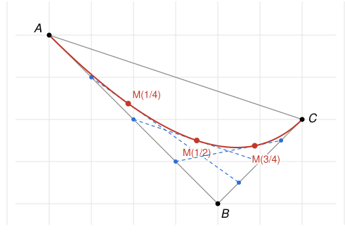

## Statement

On munit le plan d'un repère orthonormé $(O, I, J)$. Pour $p$ dans l'intervalle $[0, 1]$, on
utilise les polynômes suivants (ce sont les *polynômes de Bernstein* de degré 0, 1 et 2) :

- degré 0 : $B_{0,0}(p) = 1$ ;
- degré 1 : $B_{1,0}(p) = 1 - p$ et $B_{1,1}(p) = p$ ;
- degré 2 : $B_{2,0}(p) = (1-p)^2$, $B_{2,1}(p) = 2p(1-p)$ et $B_{2,2}(p) = p^2$.

Pour chaque degré, ces polynômes sont positifs ou nuls sur $[0, 1]$ et leur somme vaut $1$.

Soit $n \in \{0, 1, 2\}$ et $P_0, \ldots, P_n$ des points du plan. La *courbe de Bézier* de degré
$n$ et de points de contrôle $P_0, \ldots, P_n$ est l'ensemble des points $M(p)$, pour $p$
décrivant $[0, 1]$, tels que

$$\overrightarrow{OM(p)} = B_{n,0}(p)\,\overrightarrow{OP_0} + B_{n,1}(p)\,\overrightarrow{OP_1} + \cdots + B_{n,n}(p)\,\overrightarrow{OP_n}.$$

On se donne trois points $A$, $B$, $C$ non alignés.

1. Reconnaître :

   a) la courbe de Bézier de degré 0 et de point de contrôle $A$ ;

   b) la courbe de Bézier de degré 1 et de points de contrôle $B$ et $C$.

2. On s'intéresse désormais à la courbe de Bézier $\mathcal{C}$ de degré 2 et de points de
   contrôle $A$, $B$ et $C$.

   a) Justifier que les points $A$ et $C$ appartiennent à $\mathcal{C}$. Le point $B$
   appartient-il à $\mathcal{C}$ ?

   b) Dans cette question, $A(-2 ; 5)$, $B(2 ; 1)$ et $C(4 ; 3)$. Proposer une construction
   géométrique des points de $\mathcal{C}$ pour $p = \frac{1}{4}$, $p = \frac{1}{2}$ et
   $p = \frac{3}{4}$. Tracer la courbe à main levée.

3. Démontrer que la courbe $\mathcal{C}$ est contenue dans le triangle $ABC$ (bords compris).

4. Quelle est la nature géométrique de la courbe $\mathcal{C}$ ? Justifier.

## Hints

1. **Question 2.** Comme $(1-p)^2 + 2p(1-p) + p^2 = 1$, on peut écrire
   $\overrightarrow{OM(p)} - \overrightarrow{OA}$ à l'aide de $\overrightarrow{AB}$ et
   $\overrightarrow{AC}$ seulement.
2. **Question 2 b.** Placer le point $Q$ de $[AB]$ tel que $\overrightarrow{AQ} = p\,\overrightarrow{AB}$,
   le point $R$ de $[BC]$ tel que $\overrightarrow{BR} = p\,\overrightarrow{BC}$, puis le point de
   $[QR]$ qui le partage dans la même proportion. Vérifier que c'est $M(p)$.
3. **Question 3.** Écrire $\overrightarrow{AM(p)} = u\,\overrightarrow{AB} + v\,\overrightarrow{AC}$
   et montrer que $u \geqslant 0$, $v \geqslant 0$ et $u + v \leqslant 1$.
4. **Question 3.** Lorsque $u + v = s > 0$, considérer le point $N$ tel que
   $\overrightarrow{AN} = \frac{1}{s}\overrightarrow{AM(p)}$. Où se trouve $N$ ?
5. **Question 4.** Faire le calcul de la question 2 b) pour un $p$ quelconque : dans $x(p)$ et
   $y(p)$, quelle combinaison de $x$ et $y$ fait disparaître $p^2$ ?
6. **Question 4.** En général, écrire
   $\overrightarrow{AM(p)} = 2p\,\overrightarrow{AB} + p^2\,\overrightarrow{W}$ avec
   $\overrightarrow{W} = \overrightarrow{BA} + \overrightarrow{BC}$, puis choisir un repère
   orthonormé dont un axe est parallèle à $\overrightarrow{W}$.

## Solution

**1.** a) En degré 0, $\overrightarrow{OM(p)} = 1 \times \overrightarrow{OA}$, donc $M(p) = A$
pour tout $p$ : la courbe est réduite au point $A$.

b) En degré 1, $\overrightarrow{OM(p)} = (1-p)\,\overrightarrow{OB} + p\,\overrightarrow{OC}$,
c'est-à-dire $\overrightarrow{BM(p)} = \overrightarrow{OM(p)} - \overrightarrow{OB} = p\,(\overrightarrow{OC} - \overrightarrow{OB}) = p\,\overrightarrow{BC}$.
Quand $p$ décrit $[0, 1]$, $M(p)$ décrit tout le segment $[BC]$ : la courbe est le segment
$[BC]$.

**2.** a) Pour $p = 0$, $\overrightarrow{OM(0)} = \overrightarrow{OA}$, donc $M(0) = A$. Pour
$p = 1$, $\overrightarrow{OM(1)} = \overrightarrow{OC}$, donc $M(1) = C$. Ainsi $A$ et $C$ sont
sur $\mathcal{C}$.

Puisque $(1-p)^2 + 2p(1-p) + p^2 = 1$, on peut soustraire $\overrightarrow{OA}$ :

$$\overrightarrow{AM(p)} = 2p(1-p)\,\overrightarrow{AB} + p^2\,\overrightarrow{AC}. \qquad (\star)$$

Si $M(p) = B$, alors $\overrightarrow{AM(p)} = \overrightarrow{AB}$, donc
$(2p(1-p) - 1)\overrightarrow{AB} + p^2\,\overrightarrow{AC} = \vec{0}$. Les vecteurs
$\overrightarrow{AB}$ et $\overrightarrow{AC}$ ne sont pas colinéaires ($A$, $B$, $C$ ne sont pas
alignés), donc les deux coefficients sont nuls : $p^2 = 0$ et $2p(1-p) = 1$. La première
égalité donne $p = 0$, et alors la seconde devient $0 = 1$ : c'est impossible. **Le point $B$
n'appartient pas à $\mathcal{C}$.**

b) *Construction.* Pour $p$ fixé, soit $Q$ le point de $[AB]$ et $R$ le point de $[BC]$ tels que
$\overrightarrow{AQ} = p\,\overrightarrow{AB}$ et $\overrightarrow{BR} = p\,\overrightarrow{BC}$,
puis $N$ le point de $[QR]$ tel que $\overrightarrow{QN} = p\,\overrightarrow{QR}$. Alors
$\overrightarrow{OQ} = (1-p)\overrightarrow{OA} + p\,\overrightarrow{OB}$,
$\overrightarrow{OR} = (1-p)\overrightarrow{OB} + p\,\overrightarrow{OC}$ et

$$\overrightarrow{ON} = (1-p)\,\overrightarrow{OQ} + p\,\overrightarrow{OR} = (1-p)^2\,\overrightarrow{OA} + 2p(1-p)\,\overrightarrow{OB} + p^2\,\overrightarrow{OC},$$

donc $N = M(p)$. Pour $p = \frac{1}{2}$, ce sont trois milieux : $Q$ milieu de $[AB]$, $R$
milieu de $[BC]$, $M(\frac{1}{2})$ milieu de $[QR]$. Pour $p = \frac{1}{4}$ et
$p = \frac{3}{4}$, on partage les segments au quart et aux trois quarts (en partant de $A$, de
$B$ puis de $Q$).

*Coordonnées.* Avec les coefficients $(1-p)^2$, $2p(1-p)$, $p^2$ :

| $p$ | $Q$ | $R$ | $M(p)$ |
|---|---|---|---|
| $\frac{1}{4}$ | $(-1 ; 4)$ | $(\frac{5}{2} ; \frac{3}{2})$ | $(-\frac{1}{8} ; \frac{27}{8})$ |
| $\frac{1}{2}$ | $(0 ; 3)$ | $(3 ; 2)$ | $(\frac{3}{2} ; \frac{5}{2})$ |
| $\frac{3}{4}$ | $(1 ; 2)$ | $(\frac{7}{2} ; \frac{5}{2})$ | $(\frac{23}{8} ; \frac{19}{8})$ |

Par exemple, pour $p = \frac{1}{4}$ :
$x = \frac{9}{16}(-2) + \frac{6}{16} \times 2 + \frac{1}{16} \times 4 = -\frac{1}{8}$ et
$y = \frac{9}{16} \times 5 + \frac{6}{16} \times 1 + \frac{1}{16} \times 3 = \frac{27}{8}$.

La courbe part de $A$ en direction de $B$, passe par les trois points calculés et arrive en $C$
en venant de la direction de $B$ (en traits pointillés, les segments $[QR]$) :

**3.** D'après $(\star)$, $\overrightarrow{AM(p)} = u\,\overrightarrow{AB} + v\,\overrightarrow{AC}$
avec $u = 2p(1-p) \geqslant 0$ et $v = p^2 \geqslant 0$ pour $p \in [0, 1]$, et

$$u + v = 2p - p^2 = 1 - (1-p)^2 \leqslant 1.$$

Montrons qu'un tel point $M$ est dans le triangle $ABC$. Si $u + v = 0$, alors $M = A$. Sinon,
posons $s = u + v$, avec $0 < s \leqslant 1$, et soit $N$ le point tel que
$\overrightarrow{AN} = \frac{u}{s}\overrightarrow{AB} + \frac{v}{s}\overrightarrow{AC}$. Comme
$\frac{u}{s} + \frac{v}{s} = 1$,

$$\overrightarrow{BN} = \overrightarrow{AN} - \overrightarrow{AB} = \frac{v}{s}(\overrightarrow{AC} - \overrightarrow{AB}) = \frac{v}{s}\,\overrightarrow{BC}, \qquad 0 \leqslant \frac{v}{s} \leqslant 1,$$

donc $N$ est sur le côté $[BC]$. Enfin $\overrightarrow{AM} = s\,\overrightarrow{AN}$ avec
$0 < s \leqslant 1$, donc $M$ est sur le segment $[AN]$, qui joint le sommet $A$ à un point du
côté opposé : il est contenu dans le triangle.

**Conclusion :** tous les points $M(p)$ sont dans le triangle $ABC$ (bords compris).

**4.** **C'est un arc de parabole.**

*Ce que l'on doit montrer.* Une parabole est la courbe représentative d'une fonction du second
degré $X \mapsto aX^2 + bX + c$, avec $a \neq 0$, tracée dans un repère orthonormé. Il faut donc
trouver un repère orthonormé dans lequel les coordonnées $(X ; Y)$ des points de $\mathcal{C}$
vérifient une telle relation.

*Sur l'exemple.* Les coordonnées de $M(p)$ sont

$$x(p) = -2 + 8p - 2p^2, \qquad y(p) = 5 - 8p + 6p^2.$$

La combinaison $3x + y = -1 + 16p$ ne contient plus $p^2$. On peut donc exprimer $p$ en fonction
de $3x + y$, et $y$ devient une fonction du second degré de $3x + y$. Pour en faire une vraie
parabole, il faut une coordonnée dans un repère orthonormé : c'est ce que fait le cas général.

*Cas général.* En développant,
$(1-p)^2\overrightarrow{OA} + 2p(1-p)\overrightarrow{OB} + p^2\overrightarrow{OC} = \overrightarrow{OA} + 2p\,(\overrightarrow{OB} - \overrightarrow{OA}) + p^2\,(\overrightarrow{OA} - 2\overrightarrow{OB} + \overrightarrow{OC})$, d'où

$$\overrightarrow{AM(p)} = 2p\,\overrightarrow{AB} + p^2\,\overrightarrow{W}, \qquad \text{avec } \overrightarrow{W} = \overrightarrow{BA} + \overrightarrow{BC}.$$

Le vecteur $\overrightarrow{W}$ n'est pas nul : sinon $B$ serait le milieu de $[AC]$ et les trois
points seraient alignés. Soit $\vec{w}$ le vecteur unitaire de même sens que $\overrightarrow{W}$,
et $\vec{u}$ un vecteur unitaire orthogonal à $\vec{w}$. Dans le repère orthonormé
$(A ; \vec{u}, \vec{w})$, les coordonnées de $M(p)$ sont

$$X = \overrightarrow{AM(p)} \cdot \vec{u} = 2p\,\alpha, \qquad Y = \overrightarrow{AM(p)} \cdot \vec{w} = 2p\,\beta + p^2\,\lVert \overrightarrow{W} \rVert,$$

où $\alpha = \overrightarrow{AB} \cdot \vec{u}$ et $\beta = \overrightarrow{AB} \cdot \vec{w}$
(on a utilisé $\overrightarrow{W} \cdot \vec{u} = 0$ et $\overrightarrow{W} \cdot \vec{w} = \lVert \overrightarrow{W} \rVert$).
En effet, si $\overrightarrow{AM} = X\,\vec{u} + Y\,\vec{w}$, alors
$\overrightarrow{AM} \cdot \vec{u} = X$ et $\overrightarrow{AM} \cdot \vec{w} = Y$, puisque
$\vec{u} \cdot \vec{u} = \vec{w} \cdot \vec{w} = 1$ et $\vec{u} \cdot \vec{w} = 0$.

Le nombre $\alpha$ n'est pas nul. Sinon $\overrightarrow{AB}$ serait colinéaire à $\vec{w}$,
donc à $\overrightarrow{W}$, et $\overrightarrow{BC} = \overrightarrow{W} + \overrightarrow{AB}$
aussi : $A$, $B$, $C$ seraient alignés. On peut donc écrire $p = \frac{X}{2\alpha}$, et

$$Y = \frac{\lVert \overrightarrow{W} \rVert}{4\alpha^2}\, X^2 + \frac{\beta}{\alpha}\, X.$$

Dans le repère orthonormé $(A ; \vec{u}, \vec{w})$, tous les points de $\mathcal{C}$ sont donc sur
la courbe d'une fonction du second degré (son coefficient de $X^2$ n'est pas nul, car
$\overrightarrow{W} \neq \vec{0}$) : une parabole, dont l'axe est parallèle à
$\overrightarrow{W}$. Quand $p$ décrit $[0, 1]$, $X = 2p\alpha$ décrit l'intervalle d'extrémités
$0$ et $2\alpha$, et chaque valeur de $X$ correspond à un seul point. La courbe $\mathcal{C}$ est
l'arc de cette parabole compris entre $A$ et $C$.

**Bilan.** La courbe de Bézier de degré 2 de points de contrôle $A$, $B$, $C$ va de $A$ à $C$
sans passer par $B$. Elle reste dans le triangle $ABC$, se construit par trois partages
successifs dans la même proportion, et c'est un arc de parabole dont l'axe est parallèle à
$\overrightarrow{BA} + \overrightarrow{BC}$.

## Going further

- Le vecteur $\overrightarrow{BA} + \overrightarrow{BC}$ est le double du vecteur qui va de $B$ au
  milieu de $[AC]$ : l'axe de la parabole est parallèle à la médiane issue de $B$. Vérifiez-le
  sur l'exemple.
- Sur l'exemple, calculer $x'(0)$ et $y'(0)$, puis $x'(1)$ et $y'(1)$. Le vecteur de coordonnées
  $(x'(0) ; y'(0))$ est colinéaire à $\overrightarrow{AB}$, et celui de coordonnées
  $(x'(1) ; y'(1))$ à $\overrightarrow{BC}$ : la courbe est tangente en $A$ à la droite $(AB)$ et
  en $C$ à la droite $(BC)$. C'est vrai en général, et
  c'est pour cela qu'un logiciel de dessin n'a besoin que de trois points pour tracer un bel arc.
- La construction de la question 2 b), répétée, s'appelle l'*algorithme de De Casteljau*. Elle
  marche en tout degré, grâce à la relation
  $B_{n,i}(p) = (1-p)B_{n-1,i}(p) + p\,B_{n-1,i-1}(p)$ (voir l'exercice 40641).
