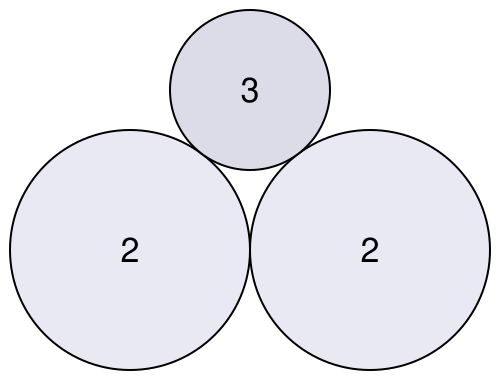

## Statement

En 1643, la princesse Élisabeth de Bohême posa à René Descartes la question suivante : étant donné trois cercles deux à deux tangents, comment trouver le cercle qui se glisse entre eux en les touchant tous les trois ?

Descartes trouva une réponse remarquablement simple, à condition de parler non pas du rayon, mais de la **courbure** d'un cercle, c'est-à-dire l'inverse de son rayon :
$$k = \frac{1}{r} .$$

Un gros cercle a une petite courbure, un petit cercle une grosse courbure.

**Formule de Descartes.** Si quatre cercles sont deux à deux tangents, leurs courbures $k_1$, $k_2$, $k_3$, $k_4$ vérifient
$$2\left(k_1^2 + k_2^2 + k_3^2 + k_4^2\right) = \left(k_1 + k_2 + k_3 + k_4\right)^2 .$$

Avec une convention de signe : un cercle qui **contient** les autres et les touche de l'intérieur reçoit une courbure **négative**.

1. Trois cercles deux à deux tangents ont pour courbures $2$, $2$ et $3$. Écrire l'équation vérifiée par la courbure $k$ d'un cercle tangent aux trois, et la résoudre.
2. Interpréter les deux solutions trouvées. Quels sont les rayons des deux cercles correspondants ?
3. On part maintenant des trois cercles de courbures $-1$, $2$ et $3$. Un cercle tangent aux trois est déjà connu : c'est le second cercle de courbure $2$. Sans refaire tout le calcul, trouver la courbure de l'autre.

## Hints

1. Pour la question 1, remplacer $k_1$, $k_2$, $k_3$ par $2$, $2$, $3$ et $k_4$ par $k$, puis tout développer. Les termes en $k^2$ ne disparaissent pas tous.
2. L'équation obtenue est du second degré. Ses coefficients sont petits, et les solutions entières.
3. Pour la question 2, une courbure négative correspond à un cercle qui contient les autres. Que vaut alors son rayon ?
4. Pour la question 3, penser à la **somme des racines** d'une équation du second degré. Développer la formule de Descartes en gardant $k_1$, $k_2$, $k_3$ comme lettres : quel est le coefficient de $k^2$ ? et celui de $k$ ?

## Solution

### Question 1 : l'équation

Posons $k_1 = 2$, $k_2 = 2$, $k_3 = 3$ et $k_4 = k$. La formule de Descartes donne
$$2\left(2^2 + 2^2 + 3^2 + k^2\right) = \left(2 + 2 + 3 + k\right)^2 ,$$
c'est-à-dire
$$2\left(17 + k^2\right) = (7 + k)^2 .$$

Développons les deux côtés :
$$34 + 2k^2 = 49 + 14k + k^2 ,$$
puis rassemblons tout à gauche :
$$k^2 - 14k - 15 = 0 .$$

Cherchons les racines. Leur somme vaut $14$ et leur produit $-15$ : les nombres $15$ et $-1$ conviennent. On peut d'ailleurs factoriser directement :
$$k^2 - 14k - 15 = (k - 15)(k + 1) .$$

Les deux solutions sont donc
$$k = 15 \qquad \text{et} \qquad k = -1 .$$

### Question 2 : ce que sont ces deux cercles

Il y a bien deux cercles tangents aux trois cercles de départ, et ils sont de nature très différente.

**$k = 15$.** La courbure est positive, donc le cercle est tangent extérieurement aux trois autres : c'est le petit cercle qui se glisse dans le creux entre eux, celui que cherchait la princesse Élisabeth. Son rayon vaut
$$r = \frac{1}{15} .$$

**$k = -1$.** La courbure est négative, donc ce cercle **contient** les trois autres et les touche de l'intérieur. Son rayon vaut
$$r = \frac{1}{|-1|} = 1 .$$

Autrement dit : les trois cercles de courbures $2$, $2$ et $3$ se logent exactement à l'intérieur d'un cercle de rayon $1$, en le touchant chacun en un point. C'est la figure du logo du San Joaquin Math Teachers' Circle, d'où vient ce problème.

### Question 3 : la deuxième racine, sans refaire le calcul

Reprenons la formule de Descartes en gardant $k_1$, $k_2$, $k_3$ comme lettres et en isolant $k$ :
$$2\left(k_1^2+k_2^2+k_3^2\right) + 2k^2 = \left(k_1+k_2+k_3\right)^2 + 2\left(k_1+k_2+k_3\right)k + k^2 .$$

En posant $s = k_1+k_2+k_3$, cela s'écrit
$$k^2 - 2s\,k + \left[2\left(k_1^2+k_2^2+k_3^2\right) - s^2\right] = 0 .$$

C'est une équation du second degré en $k$, de coefficient dominant $1$ et de coefficient en $k$ égal à $-2s$. **La somme de ses deux racines vaut donc $2s$**, quelles que soient les trois courbures de départ.

Ici $k_1 = -1$, $k_2 = 2$, $k_3 = 3$, donc $s = 4$ et la somme des deux racines vaut $8$. L'une d'elles est $2$ (le second cercle de courbure $2$), donc l'autre vaut
$$8 - 2 = 6 .$$

Il existe donc un cercle de courbure $6$, c'est-à-dire de rayon $\frac16$, tangent aux cercles de courbures $-1$, $2$ et $3$.

*(Vérification : $2(1 + 4 + 9 + 36) = 100$ et $(-1+2+3+6)^2 = 10^2 = 100$. La formule est bien satisfaite.)*

**La règle à retenir :** à partir de trois cercles deux à deux tangents, si $k$ est la courbure d'un cercle tangent aux trois, l'autre a pour courbure
$$k' = 2(k_1+k_2+k_3) - k .$$
C'est cette règle, appliquée encore et encore, qui engendre la figure fractale appelée **tamis d'Apollonius**, et qui explique pourquoi toutes les courbures y restent entières dès que les premières le sont.

## Going further

1. Continuer le long d'un « bras » du tamis. À partir de $(-1, 2, 3)$ on obtient $6$ ; à partir de $(-1, 2, 6)$ on retrouve $3$ ou l'on obtient un nouveau nombre. Poursuivre et retrouver la suite $2, 3, 6, 11, 18, 27, 38, \ldots$ du logo. Quelle formule donne son $n$-ième terme ?
2. Que devient la formule de Descartes si l'un des quatre cercles est remplacé par une **droite** ? (Une droite est un cercle de rayon infini, donc de courbure $0$.)
3. Avec deux cercles de rayons $1$ et $4$ posés sur une même droite et tangents entre eux, quel est le rayon du cercle glissé dans le creux, tangent aux deux cercles et à la droite ?
