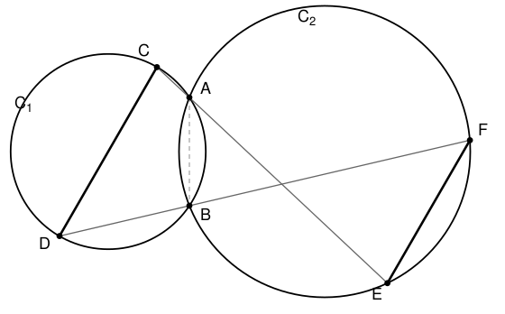

## Statement

Soient $\mathcal{C}_1$ et $\mathcal{C}_2$ deux cercles qui se coupent en deux points $A$ et $B$.

Soient $C$ et $D$ deux points de $\mathcal{C}_1$, placés comme sur la figure. La droite $(AC)$
recoupe $\mathcal{C}_2$ en un point $E$, et la droite $(BD)$ recoupe $\mathcal{C}_2$ en un point
$F$.

Montrer que les droites $(CD)$ et $(EF)$ sont parallèles.

## Hints

1. Les points $C$, $D$, $E$, $F$ ne sont reliés que par des cercles : le seul outil disponible
   est le théorème de l'angle inscrit, sous ses deux formes (angles inscrits interceptant le
   même arc, et angles opposés d'un quadrilatère inscrit).
2. Pour montrer que deux droites sont parallèles, il faut une **sécante commune** qui les coupe
   toutes les deux. En as-tu une sous la main ? Regarde la droite $(AC)$ : elle coupe $(CD)$ en
   $C$, et elle coupe $(EF)$ en $E$ (car $E$ est dessus).
3. Il suffit donc de prouver que $\widehat{DCA} = \widehat{FEA}$ : ce sont des angles
   alternes-internes.
4. Fais le tour par le point $B$ : relie $\widehat{DCA}$ à un angle en $B$ grâce au cercle
   $\mathcal{C}_1$, puis cet angle en $B$ à $\widehat{FEA}$ grâce au cercle $\mathcal{C}_2$.
5. Attention à un détail : sur la figure, $F$ n'est pas du même côté de $B$ que $D$. Les angles
   $\widehat{ABD}$ et $\widehat{ABF}$ sont donc supplémentaires, et non égaux.

## Solution

Sur la figure, la droite $(AC)$ contient les trois points $C$, $A$ et $E$ dans cet ordre. C'est
elle qui va servir de sécante commune.

**Étape 1 : dans le cercle $\mathcal{C}_1$.**

Les quatre points $A$, $C$, $D$, $B$ sont sur $\mathcal{C}_1$, et sur la figure ils se
succèdent dans cet ordre sur le cercle : $ACDB$ est un quadrilatère inscrit.

Dans un quadrilatère inscrit dans un cercle, deux angles opposés sont supplémentaires. Les
angles en $C$ et en $B$ sont opposés, donc
$$\widehat{ACD} + \widehat{DBA} = 180^\circ . \qquad (1)$$

**Étape 2 : on passe de $D$ à $F$.**

Le point $F$ est sur la droite $(BD)$, mais de l'autre côté de $B$ par rapport à $D$ (voir la
figure). Les demi-droites $[BD)$ et $[BF)$ sont donc opposées, et les angles $\widehat{DBA}$ et
$\widehat{ABF}$ sont supplémentaires :
$$\widehat{DBA} + \widehat{ABF} = 180^\circ . \qquad (2)$$

En comparant $(1)$ et $(2)$, il vient
$$\widehat{ABF} = \widehat{ACD} . \qquad (3)$$

**Étape 3 : dans le cercle $\mathcal{C}_2$.**

Les quatre points $A$, $B$, $E$, $F$ sont sur $\mathcal{C}_2$. Les angles $\widehat{ABF}$ et
$\widehat{AEF}$ sont deux angles inscrits qui interceptent la même corde $[AF]$, et sur la
figure $B$ et $E$ sont sur le même arc délimité par cette corde. Le théorème de l'angle inscrit
donne donc
$$\widehat{AEF} = \widehat{ABF} . \qquad (4)$$

**Étape 4 : on conclut.**

En rassemblant $(3)$ et $(4)$ :
$$\widehat{AEF} = \widehat{ACD} .$$

Or, sur la droite $(CAE)$ :

- au point $C$, l'angle $\widehat{ACD}$ est l'angle entre cette droite et la droite $(CD)$ ;
- au point $E$, l'angle $\widehat{AEF}$ est l'angle entre cette droite et la droite $(EF)$ ;
- les points $D$ et $F$ sont de part et d'autre de la droite $(CAE)$.

Ce sont donc deux angles **alternes-internes** déterminés par la sécante $(CAE)$ coupant les
droites $(CD)$ et $(EF)$. Comme ils sont égaux, les deux droites sont parallèles :
$$(CD) \parallel (EF) .$$

*Remarque sur les autres figures.* Si l'on déplace $C$ et $D$ sur $\mathcal{C}_1$, certains des
angles ci-dessus deviennent égaux là où ils étaient supplémentaires, et inversement : la chaîne
de raisonnement reste la même, mais les mots « égaux » et « supplémentaires » s'échangent. Les
olympiades règlent ce problème une fois pour toutes en travaillant avec des *angles orientés de
droites*, pour lesquels un seul calcul couvre toutes les positions.
