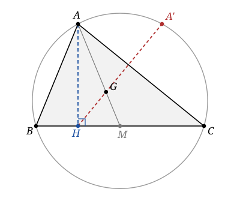

## Statement

Soit $ABC$ un triangle acutangle et non isocèle en $A$. On note :

- $G$ son centre de gravité, c'est-à-dire le point d'intersection de ses médianes ;
- $H$ le pied de la hauteur issue de $A$ ;
- $A'$ le second point d'intersection de la droite $(HG)$ avec le cercle circonscrit à $ABC$, celui qui se trouve sur l'arc $BC$ contenant $A$.

Montrer que la droite $(AA')$ est parallèle à $(BC)$.

## Hints

1. Il y a un point du cercle qui est évidemment sur une parallèle à $(BC)$ passant par $A$ : lequel ? Pense à une symétrie.
2. Appelle $A''$ le symétrique de $A$ par rapport à la médiatrice de $[BC]$. Pourquoi $A''$ est-il sur le cercle circonscrit ?
3. Il suffit donc de montrer que $A''$ est sur la droite $(HG)$. Là, un repère bien choisi fait tout le travail.
4. Prends $(BC)$ pour axe des abscisses et le milieu $M$ de $[BC]$ pour origine. Écris les coordonnées de $B$, $C$, $A$, puis celles de $H$, de $G$ et de $A''$.
5. Compare les vecteurs $\vec{HG}$ et $\vec{HA''}$.

## Solution

**L'idée : deviner $A'$.**

Sur le cercle circonscrit, il y a un point évident situé sur la parallèle à $(BC)$ passant par $A$ : le symétrique de $A$ par rapport à la **médiatrice de $[BC]$**. Appelons-le $A''$ et montrons que $A'' = A'$.

D'abord, $A''$ est bien sur le cercle. En effet, le centre $O$ du cercle circonscrit est équidistant de $B$ et de $C$, donc il est sur la médiatrice de $[BC]$. La symétrie par rapport à cette droite fixe $O$ et conserve les distances : elle transforme donc le cercle de centre $O$ et de rayon $OA$ en lui-même. Comme $A$ est sur ce cercle, $A''$ y est aussi.

Ensuite, $A$ et $A''$ ont la même distance à la droite $(BC)$ et sont du même côté, donc $(AA'')$ est parallèle à $(BC)$, et $A'' \neq A$ puisque le triangle n'est pas isocèle en $A$.

Il reste le point délicat : montrer que $A''$ appartient à la droite $(HG)$.

**Un repère.**

Prenons $(BC)$ comme axe des abscisses et le milieu $M$ de $[BC]$ comme origine. Notons $m = \dfrac{BC}{2}$. Alors

$$B(-m\,;\,0), \qquad C(m\,;\,0), \qquad A(a\,;\,h) ,$$

avec $h \neq 0$ (le triangle est non aplati) et $a \neq 0$ (il n'est pas isocèle en $A$, donc $A$ n'est pas sur la médiatrice de $[BC]$, qui est l'axe des ordonnées).

Dans ce repère, la médiatrice de $[BC]$ est l'axe des ordonnées, donc

$$A''(-a\,;\,h) .$$

Le pied de la hauteur issue de $A$ est le projeté orthogonal de $A$ sur l'axe des abscisses :

$$H(a\,;\,0) .$$

Le centre de gravité a pour coordonnées la moyenne de celles des trois sommets :

$$G\left(\frac{-m + m + a}{3}\ ;\ \frac{0 + 0 + h}{3}\right) = G\left(\frac{a}{3}\ ;\ \frac{h}{3}\right) .$$

**Les trois points sont alignés.**

Calculons deux vecteurs :

$$\vec{HG}\left(\frac{a}{3} - a\ ;\ \frac{h}{3} - 0\right) = \vec{HG}\left(-\frac{2a}{3}\ ;\ \frac{h}{3}\right), \qquad \vec{HA''}\left(-a - a\ ;\ h - 0\right) = \vec{HA''}(-2a\ ;\ h) .$$

On voit immédiatement que

$$\vec{HA''} = 3\,\vec{HG} .$$

Les points $H$, $G$ et $A''$ sont donc alignés, et $G$ est sur le segment $[HA'']$, au tiers à partir de $H$.

**Conclusion.**

Le point $A''$ est sur le cercle circonscrit et sur la droite $(HG)$. Il est du même côté de $(BC)$ que $A$, donc sur l'arc $BC$ contenant $A$. Comme le triangle est acutangle, $H$ est strictement entre $B$ et $C$, donc à l'intérieur du cercle : la droite $(HG)$ coupe alors le cercle en deux points situés de part et d'autre de $(BC)$, et un seul se trouve sur l'arc contenant $A$. C'est donc que $A'' = A'$.

Enfin, $A$ et $A'$ ont la même ordonnée $h$, donc

$$\boxed{\ (AA') \text{ est parallèle à } (BC).\ }$$

## Going further

Voici la même démonstration sans coordonnées. Soit $A''$ le symétrique de $A$ par rapport à la médiatrice de $[BC]$, et $M$ le milieu de $[BC]$. Les segments $[AA'']$ et $[HM]$ sont tous deux parallèles à $(BC)$, et l'on vérifie que

$$AA'' = 2\,HM .$$

En effet, la symétrie envoie $H$ sur le point $H''$, pied de la hauteur issue de $A''$, et l'on a $HH'' = AA''$ puisque $AHH''A''$ est un rectangle ; comme l'axe de symétrie passe par $M$, ce point est le milieu de $[HH'']$, donc $HM = \dfrac{HH''}{2} = \dfrac{AA''}{2}$.

Le quadrilatère $AA''MH$ est donc un trapèze dont les deux côtés parallèles mesurent $AA''$ et $HM$, dans le rapport $2$.

Or, dans un trapèze, les diagonales se coupent en un point qui les partage dans le rapport des côtés parallèles. Ici les diagonales sont $[AM]$ et $[A''H]$, et leur point d'intersection $X$ vérifie $XA = 2\,XM$ : c'est exactement le centre de gravité $G$, qui est sur la médiane $[AM]$ avec $AG = 2\,GM$. Donc $A''$, $G$ et $H$ sont alignés.
