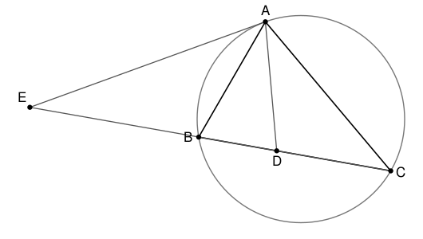

## Statement

$A$, $B$ et $C$ sont trois points d'un cercle $\Gamma$.

- La tangente à $\Gamma$ en $A$ recoupe la droite $(BC)$ en un point $E$.
- La bissectrice de l'angle $\widehat{BAC}$ coupe le segment $[BC]$ en un point $D$.

Montrer que le triangle $AED$ est isocèle.

## Hints

1. Pour montrer qu'un triangle est isocèle, il suffit de montrer que deux de ses angles sont égaux. Vise $\widehat{EAD}$ et $\widehat{ADE}$.
2. La tangente apporte une égalité d'angles bien précise : le **théorème de l'angle tangent** dit que l'angle entre la tangente en $A$ et la corde $[AB]$ est égal à l'angle inscrit $\widehat{ACB}$ qui intercepte cette même corde de l'autre côté.
3. L'angle $\widehat{ADE}$ est un angle extérieur du triangle $ADC$ en $D$. Or un angle extérieur vaut la somme des deux angles non adjacents.
4. Il ne reste plus qu'à utiliser que $(AD)$ est la bissectrice.

## Solution

### L'angle en $A$

D'après le **théorème de l'angle tangent**, l'angle formé en $A$ par la tangente et la corde $[AB]$ est égal à l'angle inscrit interceptant l'arc $AB$ de l'autre côté de la corde, c'est-à-dire $\widehat{ACB}$ :
$$\widehat{EAB} = \widehat{ACB} .$$

La demi-droite $[AD)$ est à l'intérieur de l'angle $\widehat{BAC}$, donc
$$\widehat{EAD} = \widehat{EAB} + \widehat{BAD} = \widehat{ACB} + \widehat{BAD} .$$

### L'angle en $D$

Le point $D$ est sur le segment $[BC]$, et $E$ est sur la droite $(BC)$, du côté de $B$. Les angles $\widehat{ADE}$ et $\widehat{ADC}$ sont donc supplémentaires : $\widehat{ADE}$ est l'angle **extérieur** en $D$ du triangle $ADC$.

Or un angle extérieur d'un triangle est égal à la somme des deux angles intérieurs non adjacents :
$$\widehat{ADE} = \widehat{DAC} + \widehat{ACD} .$$

Comme $D$ est sur $[BC]$, l'angle $\widehat{ACD}$ est exactement l'angle $\widehat{ACB}$ du triangle. Donc
$$\widehat{ADE} = \widehat{DAC} + \widehat{ACB} .$$

### On compare

La droite $(AD)$ est la bissectrice de $\widehat{BAC}$, donc
$$\widehat{BAD} = \widehat{DAC} .$$

En reportant dans les deux expressions obtenues :
$$\widehat{EAD} = \widehat{ACB} + \widehat{BAD} \qquad \text{et} \qquad \widehat{ADE} = \widehat{DAC} + \widehat{ACB} = \widehat{BAD} + \widehat{ACB} .$$

Les deux angles sont égaux :
$$\widehat{EAD} = \widehat{ADE} .$$

**Conclusion.** Le triangle $AED$ a deux angles égaux, ceux en $A$ et en $D$. Il est donc isocèle, et les côtés égaux sont ceux qui leur font face :
$$EA = ED .$$

### Une conséquence agréable

Le point $E$ est donc à égale distance de $A$ et de $D$ : c'est le centre du cercle passant par $A$ et $D$ et tangent à $\Gamma$ en $A$. Autrement dit, $E$ est sur la médiatrice de $[AD]$, ce qui donne une deuxième façon de retrouver la figure.

## Going further

Montrer que $EA^2 = EB \times EC$ (puissance du point $E$ par rapport à $\Gamma$), et en déduire que $ED^2 = EB \times EC$.
