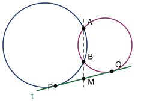

## Statement

Deux cercles $\Gamma_1$ et $\Gamma_2$ se coupent en deux points $A$ et $B$.

Une droite $t$ est tangente aux deux cercles à la fois : elle touche $\Gamma_1$ en $P$ et $\Gamma_2$ en $Q$.

La droite $(AB)$ coupe $t$ en un point $M$.

Montrer que $M$ est le **milieu** du segment $[PQ]$.

## Hints

1. Le point $M$ est sur la droite $(AB)$, donc la droite $(MA)$ recoupe **chacun** des deux cercles en $B$. Cela met $M$ dans la même situation vis-à-vis des deux cercles.
2. Dans le cercle $\Gamma_1$, compare le triangle $MPA$ et le triangle $MBP$. Ils partagent l'angle en $M$. Quel autre angle peux-tu comparer ?
3. L'angle entre la tangente $(MP)$ et la corde $[PA]$ est égal à l'angle inscrit qui intercepte la même corde de l'autre côté, c'est-à-dire $\widehat{PBA}$.
4. Deux triangles semblables donnent une égalité de rapports, donc un produit. Écris-la, puis recommence avec $\Gamma_2$.
5. Compare les deux résultats. Il restera à vérifier que $M$ est bien entre $P$ et $Q$.

## Solution

### L'outil : la relation tangente-sécante

Montrons d'abord le résultat suivant, dans le cercle $\Gamma_1$ :
$$MP^2 = MA \times MB .$$

Comparons les triangles $MPA$ et $MBP$.

- Ils ont l'angle en $M$ en commun, puisque $A$ et $B$ sont tous les deux sur la droite $(MA)$, du même côté de $M$.
- L'angle $\widehat{MPA}$ est l'angle entre la tangente $(PM)$ et la corde $[PA]$ du cercle $\Gamma_1$. Le théorème de l'angle tangent-corde dit qu'il est égal à l'angle inscrit $\widehat{PBA}$ interceptant la corde $[PA]$ depuis l'autre arc, c'est-à-dire à l'angle $\widehat{MBP}$.

Deux angles égaux deux à deux : les triangles $MPA$ et $MBP$ sont semblables. Les côtés homologues sont dans le même rapport :
$$\frac{MP}{MB} = \frac{MA}{MP} ,$$
d'où, en multipliant en croix,
$$MP^2 = MA \times MB .$$

### Le même travail dans le second cercle

Le raisonnement ne se sert que de trois choses : $M$ est sur la droite $(AB)$, $A$ et $B$ sont sur le cercle, et $(MP)$ est tangente au cercle en $P$. Toutes les trois sont également vraies pour $\Gamma_2$ avec le point de tangence $Q$. Donc
$$MQ^2 = MA \times MB .$$

### La conclusion

Les deux membres de droite sont **le même nombre**, donc
$$MP^2 = MQ^2 , \qquad \text{donc} \qquad MP = MQ$$
puisque ce sont des longueurs, donc des nombres positifs.

Il reste à voir que cela fait bien de $M$ le milieu. Les trois points $M$, $P$ et $Q$ sont sur la même droite $t$, et $P \neq Q$. Repérons-les par leurs abscisses $m$, $p$ et $q$ sur cette droite. L'égalité $MP = MQ$ s'écrit $|m - p| = |m - q|$, donc $m - p = m - q$ ou $m - p = -(m - q)$. La première possibilité donnerait $p = q$, exclue. Il reste la seconde, qui donne
$$m = \frac{p+q}{2} .$$
C'est exactement dire que $M$ est le milieu de $[PQ]$.

$$\boxed{M \text{ est le milieu de } [PQ].}$$

### Ce qui fait marcher la preuve

Tout tient en une phrase : le point $M$ « voit » les deux cercles à travers la **même** sécante, celle qui porte $A$ et $B$. Le produit $MA \times MB$ est donc commun aux deux cercles, et chacun le relie à la longueur de sa propre tangente. Les deux tangentes sont alors forcément égales.

## Going further

1. Que devient l'énoncé si les deux cercles sont **tangents** en un seul point au lieu de se couper en deux ?
2. Les deux cercles sécants ont deux tangentes communes. Montrer que la droite $(AB)$ coupe aussi la seconde en son milieu, et en déduire que les deux tangentes communes ont la même longueur entre leurs points de tangence.
3. La quantité $MA \times MB$ porte un nom : la puissance du point $M$ par rapport au cercle. Vérifier que pour un point $M$ **intérieur** au cercle, le produit $MA \times MB$ ne dépend pas non plus de la droite choisie passant par $M$.
