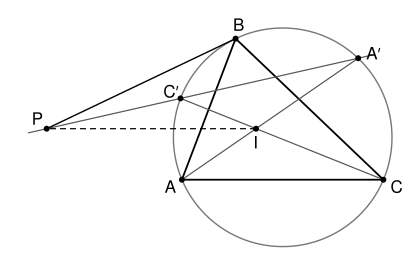

## Statement

$ABC$ est un triangle avec $BA \neq BC$, $\Gamma$ son cercle circonscrit et $I$ le centre de son cercle inscrit. La bissectrice de l'angle en $A$ recoupe $\Gamma$ en $A'$, et la bissectrice de l'angle en $C$ recoupe $\Gamma$ en $C'$. La parallèle à $(AC)$ passant par $I$ coupe la droite $(A'C')$ en un point $P$.

Montrer que la droite $(PB)$ est tangente au cercle $\Gamma$.

## Hints

1. Montre que le triangle $A'BI$ est isocèle en $A'$ : compare les angles $\widehat{A'BI}$ et $\widehat{A'IB}$, en les écrivant avec les angles du triangle $ABC$.
2. De même $C'B = C'I$. Que représente alors la droite $(A'C')$ pour le segment $[BI]$ ? Que peut-on dire de $PB$ et $PI$ ?
3. La droite $(BI)$ recoupe $\Gamma$ en $B'$, le milieu de l'arc $AC$. Pourquoi la tangente à $\Gamma$ en $B'$ est-elle parallèle à $(AC)$, donc à $(PI)$ ?
4. Compare la symétrie par rapport à la médiatrice de $[BI]$ et la symétrie par rapport à la médiatrice de $[BB']$ : leurs axes sont parallèles.

## Solution

On note $\alpha$, $\beta$, $\gamma$ les angles du triangle $ABC$ en $A$, $B$, $C$.

### Étape 1 : $A'B = A'I$

Comparons deux angles du triangle $A'BI$.

- Les angles inscrits $\widehat{A'BC}$ et $\widehat{A'AC}$ interceptent le même arc $A'C$, donc $\widehat{A'BC} = \widehat{A'AC} = \dfrac{\alpha}{2}$. Comme $(BI)$ est la bissectrice en $B$, on obtient
$$\widehat{A'BI} = \widehat{A'BC} + \widehat{CBI} = \frac{\alpha}{2} + \frac{\beta}{2} .$$
- L'angle $\widehat{A'IB}$ est un angle extérieur du triangle $ABI$ en $I$ (car $A$, $I$, $A'$ sont alignés). Il vaut donc la somme des deux autres angles de ce triangle :
$$\widehat{A'IB} = \widehat{IAB} + \widehat{IBA} = \frac{\alpha}{2} + \frac{\beta}{2} .$$

Les angles en $B$ et en $I$ du triangle $A'BI$ sont égaux : il est isocèle en $A'$, et $A'B = A'I$.

### Étape 2 : la droite $(A'C')$ est la médiatrice de $[BI]$

Le même raisonnement, avec $C$ à la place de $A$, donne $C'B = C'I$. Les points $A'$ et $C'$ sont donc tous les deux sur la médiatrice de $[BI]$, et cette médiatrice est la droite $(A'C')$. Notons-la $m_1$.

Notons $s_1$ la symétrie d'axe $m_1$. Elle échange $B$ et $I$, et elle laisse fixe le point $P$, qui est sur $m_1$. Elle envoie donc la droite $(PI)$ sur la droite $(PB)$.

### Étape 3 : la tangente au milieu de l'arc $AC$

La bissectrice $(BI)$ recoupe $\Gamma$ en un point $B'$. Comme $\widehat{ABB'} = \widehat{B'BC}$, les cordes $[AB']$ et $[B'C]$ interceptent des angles inscrits égaux, donc $B'A = B'C$. Le point $B'$ est sur la médiatrice de $[AC]$, qui passe aussi par le centre $O$ de $\Gamma$. Ainsi $(OB')$ est perpendiculaire à $(AC)$.

La tangente $t'$ à $\Gamma$ en $B'$ est perpendiculaire au rayon $(OB')$, donc elle est **parallèle à $(AC)$**, et donc parallèle à $(PI)$.

Soit maintenant $m_2$ la médiatrice de $[BB']$ et $s_2$ la symétrie d'axe $m_2$. Comme $OB = OB'$, l'axe $m_2$ passe par $O$, donc $s_2$ envoie le cercle $\Gamma$ sur lui-même. Elle échange $B$ et $B'$, donc elle envoie la tangente $t'$ en $B'$ sur la tangente $t$ en $B$.

### Étape 4 : les deux symétries

Les axes $m_1$ et $m_2$ sont tous les deux perpendiculaires à la droite $(BI)$, qui est aussi la droite $(BB')$. Ils sont donc parallèles. Or deux symétries d'axes parallèles envoient une même droite sur deux droites parallèles (passer de l'une à l'autre revient à faire une translation, et une translation ne change pas les directions). De plus, deux droites parallèles ont des images parallèles par une même symétrie.

- $s_1$ envoie $(PI)$ sur $(PB)$.
- $s_2$ envoie $t'$ sur $t$, et $t'$ est parallèle à $(PI)$.

Donc $(PB)$ et $t$ sont parallèles. Elles passent toutes les deux par $B$ : ce sont la même droite.

**Conclusion.** La droite $(PB)$ est la tangente à $\Gamma$ en $B$.

## Going further

Le résultat de l'étape 1 sert très souvent : le milieu $A'$ de l'arc $BC$ qui ne contient pas $A$ est à la même distance de $B$, de $C$ et de $I$. Autrement dit, le cercle de centre $A'$ passant par $B$ et $C$ passe aussi par $I$.
