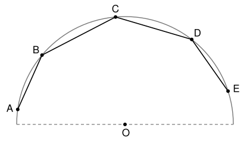

## Statement

Cinq points distincts $A$, $B$, $C$, $D$, $E$ sont placés dans cet ordre sur un demi-cercle de rayon $1$.

Démontrer que
$$AB^2 + BC^2 + CD^2 + DE^2 + AB \times BC \times CD + BC \times CD \times DE \leqslant 4 .$$

## Hints

1. Remplace $E$ par le point diamétralement opposé à $A$. Que devient la longueur $DE$ ? Et les autres longueurs ? Explique pourquoi il suffit alors de traiter le cas où $[AE]$ est un diamètre.
2. Dans ce cas, applique la formule d'Al-Kashi dans les triangles $ABC$ et $CDE$, et utilise le triangle $ACE$, rectangle en $C$.
3. Il reste à montrer que $CD \leqslant -2\cos\widehat{ABC}$. Compare $CD$ à $CE$, puis calcule $CE$ dans le triangle rectangle $ACE$ en utilisant le quadrilatère inscrit $ABCE$.

## Solution

On note $O$ le centre du cercle. On utilise trois outils.

- **Al-Kashi.** Dans un triangle $XYZ$, on a $XZ^2 = XY^2 + YZ^2 - 2\,XY \times YZ \times \cos\widehat{XYZ}$.
- **Angles inscrits.** Si $[XY]$ est un diamètre et $Z$ un autre point du cercle, le triangle $XYZ$ est rectangle en $Z$. Dans un quadrilatère convexe inscrit dans un cercle, deux angles opposés ont pour somme $180°$.
- **Longueur d'une corde.** Une corde $[XY]$ qui intercepte un arc d'angle au centre $\theta$, avec $0° \leqslant \theta \leqslant 180°$, a pour longueur $XY = 2\sin\dfrac{\theta}{2}$ dans un cercle de rayon $1$ : il suffit de couper le triangle isocèle $OXY$ par sa hauteur issue de $O$. Comme le sinus est croissant entre $0°$ et $90°$, **plus l'arc est grand, plus la corde est longue**, tant que l'arc ne dépasse pas un demi-cercle.

### Étape 1 : on peut supposer que $[AE]$ est un diamètre

Partons de $A$ et parcourons le cercle dans le sens qui mène à $B$. On rencontre $B$, $C$, $D$, puis $E$, et comme les cinq points sont sur un demi-cercle, l'arc de $A$ à $E$ ne dépasse pas $180°$. Soit $E'$ le point diamétralement opposé à $A$. On l'atteint après un demi-tour, donc $E'$ est égal à $E$ ou bien plus loin que $E$ : les points $A$, $B$, $C$, $D$, $E'$ sont encore dans cet ordre sur un demi-cercle.

L'arc de $D$ à $E$ est contenu dans l'arc de $D$ à $E'$, qui ne dépasse pas un demi-cercle. Donc $DE \leqslant DE'$.

Si l'on remplace $E$ par $E'$, la longueur $DE$ augmente ou reste la même, et $AB$, $BC$, $CD$ ne changent pas : le membre de gauche augmente ou reste le même. Il suffit donc de démontrer l'inégalité quand $[AE]$ est un diamètre, ce que l'on suppose désormais. Alors $AE = 2$.

### Étape 2 : on se ramène à deux inégalités plus simples

La formule d'Al-Kashi dans les triangles $ABC$ et $CDE$ donne
$$AB^2 + BC^2 = AC^2 + 2\,AB \times BC \times \cos\widehat{ABC},$$
$$CD^2 + DE^2 = CE^2 + 2\,CD \times DE \times \cos\widehat{CDE}.$$
Le point $C$ est sur le cercle de diamètre $[AE]$, donc le triangle $ACE$ est rectangle en $C$, et par le théorème de Pythagore $AC^2 + CE^2 = AE^2 = 4$. En additionnant :
$$AB^2 + BC^2 + CD^2 + DE^2 = 4 + 2\,AB \times BC \times \cos\widehat{ABC} + 2\,CD \times DE \times \cos\widehat{CDE}.$$
L'inégalité à démontrer devient donc
$$AB \times BC \times \left(CD + 2\cos\widehat{ABC}\right) + CD \times DE \times \left(BC + 2\cos\widehat{CDE}\right) \leqslant 0 .$$
Les produits $AB \times BC$ et $CD \times DE$ sont positifs. Il suffit donc de montrer que
$$CD \leqslant -2\cos\widehat{ABC} \qquad \text{et} \qquad BC \leqslant -2\cos\widehat{CDE} .$$

### Étape 3 : $CD \leqslant -2\cos\widehat{ABC}$

Les points $A$, $B$, $C$, $E$ sont dans cet ordre sur le cercle, donc $ABCE$ est un quadrilatère convexe inscrit, et ses angles opposés en $B$ et en $E$ ont pour somme $180°$ :
$$\cos\widehat{AEC} = \cos\left(180° - \widehat{ABC}\right) = -\cos\widehat{ABC} .$$
Dans le triangle $ACE$ rectangle en $C$, on a $CE = AE \times \cos\widehat{AEC} = 2\cos\widehat{AEC} = -2\cos\widehat{ABC}$.

Enfin $D$ est entre $C$ et $E$ sur le demi-cercle, donc l'arc de $C$ à $D$ est contenu dans l'arc de $C$ à $E$, et $CD \leqslant CE$. Ainsi $CD \leqslant -2\cos\widehat{ABC}$.

### Étape 4 : $BC \leqslant -2\cos\widehat{CDE}$

C'est le même raisonnement, en échangeant les rôles de $A$ et de $E$. Le quadrilatère $ACDE$ est inscrit, donc $\cos\widehat{CAE} = -\cos\widehat{CDE}$. Dans le triangle $ACE$ rectangle en $C$, on a $AC = AE \times \cos\widehat{CAE} = -2\cos\widehat{CDE}$. Et $B$ est entre $A$ et $C$, donc $BC \leqslant AC$.

**Conclusion.** Les deux inégalités de l'étape 2 sont vraies, donc
$$AB^2 + BC^2 + CD^2 + DE^2 + AB \times BC \times CD + BC \times CD \times DE \leqslant 4 .$$

## Going further

Comme $D \neq E$, l'arc de $C$ à $D$ est strictement plus petit que l'arc de $C$ à $E$, donc $CD < CE$ : l'inégalité est en fait stricte. Mais le nombre $4$ ne peut pas être remplacé par un nombre plus petit. Prends $[AE]$ diamètre, rapproche $B$ de $A$ et $D$ de $E$ : les longueurs $AB$ et $DE$ tendent vers $0$, et le membre de gauche tend vers $AC^2 + CE^2 = 4$.
