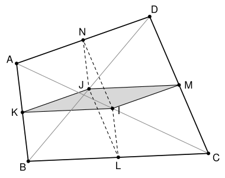

## Statement

Soit $ABCD$ un quadrilatère convexe. On note $I$ et $J$ les milieux des diagonales $[AC]$ et $[BD]$, et $K$, $L$, $M$, $N$ les milieux des côtés $[AB]$, $[BC]$, $[CD]$, $[DA]$.

On considère les deux quadrilatères $IKJM$ et $ILJN$. Chacun a pour sommets opposés les milieux $I$ et $J$ des diagonales, et pour deux autres sommets les milieux de deux côtés opposés de $ABCD$.

Montrer que $IKJM$ et $ILJN$ ont la même aire si et seulement si l'une au moins des deux diagonales de $ABCD$ le partage en deux triangles de même aire.

## Hints

1. Montre que $IKJM$ est un parallélogramme, et exprime ses côtés $\overrightarrow{KI}$ et $\overrightarrow{KJ}$ à l'aide de $\overrightarrow{BC}$ et de $\overrightarrow{AD}$.
2. L'aire d'un parallélogramme construit sur deux vecteurs $\vec{u}$ et $\vec{v}$ est la valeur absolue de leur déterminant $\det(\vec{u}, \vec{v})$. Pour le démontrer, compare $\det(\vec{u}, \vec{v})^2 + (\vec{u} \cdot \vec{v})^2$ et $\lVert\vec{u}\rVert^2 \lVert\vec{v}\rVert^2$.
3. La diagonale $(AC)$ partage $ABCD$ en deux triangles de même aire exactement quand le milieu $J$ de $[BD]$ est sur $(AC)$. Pourquoi ?
4. Avec $\vec{b} = \overrightarrow{AB}$, $\vec{c} = \overrightarrow{AC}$, $\vec{d} = \overrightarrow{AD}$, calcule $\det(\overrightarrow{AB}, \overrightarrow{CD}) + \det(\overrightarrow{BC}, \overrightarrow{AD})$ et $\det(\overrightarrow{AB}, \overrightarrow{CD}) - \det(\overrightarrow{BC}, \overrightarrow{AD})$.

## Solution

On travaille dans un repère orthonormé. Pour deux vecteurs $\vec{u}\,(a\,;\,b)$ et $\vec{v}\,(c\,;\,d)$, on note $\det(\vec{u}, \vec{v}) = ad - bc$. Ce nombre change de signe quand on échange $\vec{u}$ et $\vec{v}$, il est nul quand $\vec{u}$ et $\vec{v}$ sont colinéaires, et il se développe comme un produit : $\det(\vec{u}, \vec{v} + \vec{w}) = \det(\vec{u}, \vec{v}) + \det(\vec{u}, \vec{w})$, et de même à gauche.

### Rappel : le déterminant et l'aire

**L'aire du parallélogramme construit sur $\vec{u}$ et $\vec{v}$ est $|\det(\vec{u}, \vec{v})|$, et celle du triangle construit sur $\vec{u}$ et $\vec{v}$ est la moitié.**

En effet, en développant,
$$(ad - bc)^2 + (ac + bd)^2 = a^2d^2 + b^2c^2 + a^2c^2 + b^2d^2 = (a^2 + b^2)(c^2 + d^2),$$
c'est-à-dire $\det(\vec{u}, \vec{v})^2 + (\vec{u} \cdot \vec{v})^2 = \lVert\vec{u}\rVert^2\,\lVert\vec{v}\rVert^2$. Si $\theta$ est l'angle entre $\vec{u}$ et $\vec{v}$, on a $\vec{u} \cdot \vec{v} = \lVert\vec{u}\rVert\,\lVert\vec{v}\rVert\cos\theta$, donc
$$\det(\vec{u}, \vec{v})^2 = \lVert\vec{u}\rVert^2\,\lVert\vec{v}\rVert^2\,(1 - \cos^2\theta) = \left(\lVert\vec{u}\rVert\,\lVert\vec{v}\rVert\sin\theta\right)^2 .$$
Or $\lVert\vec{u}\rVert$ est une base du parallélogramme et $\lVert\vec{v}\rVert\sin\theta$ est la hauteur correspondante. D'où le rappel.

**Le signe du déterminant indique le côté.** Si $\overrightarrow{AC}\,(x\,;\,y)$, alors $\det(\overrightarrow{AC}, \overrightarrow{AP}) = \vec{n} \cdot \overrightarrow{AP}$ avec $\vec{n}\,(-y\,;\,x)$, qui est un vecteur normal à la droite $(AC)$. Deux points $P$ et $Q$ hors de $(AC)$ sont donc de part et d'autre de $(AC)$ exactement quand $\det(\overrightarrow{AC}, \overrightarrow{AP})$ et $\det(\overrightarrow{AC}, \overrightarrow{AQ})$ sont de signes contraires.

### Étape 1 : les aires des deux quadrilatères

Dans le triangle $ABC$, le théorème des milieux donne $\overrightarrow{KI} = \dfrac{1}{2}\overrightarrow{BC}$. Dans le triangle $DBC$, il donne $\overrightarrow{JM} = \dfrac{1}{2}\overrightarrow{BC}$. Donc $\overrightarrow{KI} = \overrightarrow{JM}$, et $IKJM$ est un parallélogramme (peut-être aplati). Dans le triangle $BAD$, on a aussi $\overrightarrow{KJ} = \dfrac{1}{2}\overrightarrow{AD}$. D'après le rappel,
$$\text{aire}(IKJM) = \left|\det\left(\frac{1}{2}\overrightarrow{BC}, \frac{1}{2}\overrightarrow{AD}\right)\right| = \frac{1}{4}\left|\det(\overrightarrow{BC}, \overrightarrow{AD})\right| .$$
De même, $\overrightarrow{LI} = \dfrac{1}{2}\overrightarrow{BA} = \overrightarrow{JN}$ et $\overrightarrow{LJ} = \dfrac{1}{2}\overrightarrow{CD}$, donc $ILJN$ est un parallélogramme et
$$\text{aire}(ILJN) = \frac{1}{4}\left|\det(\overrightarrow{BA}, \overrightarrow{CD})\right| = \frac{1}{4}\left|\det(\overrightarrow{AB}, \overrightarrow{CD})\right| .$$
On pose $X = \det(\overrightarrow{AB}, \overrightarrow{CD})$ et $Y = \det(\overrightarrow{BC}, \overrightarrow{AD})$. Les deux aires sont égales exactement quand $|X| = |Y|$, c'est-à-dire quand $X + Y = 0$ ou $X - Y = 0$.

### Étape 2 : quand une diagonale partage $ABCD$ en deux aires égales

Comme $ABCD$ est convexe, la diagonale $[AC]$ le partage en deux triangles $ABC$ et $ACD$, et les points $B$ et $D$ sont de part et d'autre de $(AC)$. D'après le rappel, $\det(\overrightarrow{AC}, \overrightarrow{AB})$ et $\det(\overrightarrow{AC}, \overrightarrow{AD})$ sont donc de signes contraires, et les deux triangles ont la même aire exactement quand
$$\det(\overrightarrow{AC}, \overrightarrow{AB}) = -\det(\overrightarrow{AC}, \overrightarrow{AD}), \quad \text{soit} \quad \det(\overrightarrow{AC}, \overrightarrow{AB} + \overrightarrow{AD}) = 0 .$$
Or $\overrightarrow{AB} + \overrightarrow{AD} = 2\,\overrightarrow{AJ}$. **La diagonale $(AC)$ partage $ABCD$ en deux aires égales exactement quand $\det(\overrightarrow{AC}, \overrightarrow{AJ}) = 0$, c'est-à-dire quand $J$ est sur $(AC)$.**

De la même façon, avec $\overrightarrow{BA} + \overrightarrow{BC} = 2\,\overrightarrow{BI}$ : **la diagonale $(BD)$ partage $ABCD$ en deux aires égales exactement quand $\det(\overrightarrow{BD}, \overrightarrow{BA} + \overrightarrow{BC}) = 0$, c'est-à-dire quand $I$ est sur $(BD)$.**

### Étape 3 : le calcul de $X + Y$ et de $X - Y$

On pose $\vec{b} = \overrightarrow{AB}$, $\vec{c} = \overrightarrow{AC}$, $\vec{d} = \overrightarrow{AD}$. Alors $\overrightarrow{CD} = \vec{d} - \vec{c}$ et $\overrightarrow{BC} = \vec{c} - \vec{b}$, et
$$X = \det(\vec{b}, \vec{d}) - \det(\vec{b}, \vec{c}), \qquad Y = \det(\vec{c}, \vec{d}) - \det(\vec{b}, \vec{d}) .$$

- **Somme.** $X + Y = \det(\vec{c}, \vec{d}) - \det(\vec{b}, \vec{c}) = \det(\vec{c}, \vec{d}) + \det(\vec{c}, \vec{b}) = \det(\vec{c}, \vec{b} + \vec{d})$. C'est $\det(\overrightarrow{AC}, \overrightarrow{AB} + \overrightarrow{AD})$.
- **Différence.** $X - Y = 2\det(\vec{b}, \vec{d}) - \det(\vec{b}, \vec{c}) - \det(\vec{c}, \vec{d})$. D'autre part, $\overrightarrow{BD} = \vec{d} - \vec{b}$ et $\overrightarrow{BA} + \overrightarrow{BC} = -\vec{b} + (\vec{c} - \vec{b}) = \vec{c} - 2\vec{b}$, donc
$$\det(\overrightarrow{BD}, \overrightarrow{BA} + \overrightarrow{BC}) = \det(\vec{d}, \vec{c}) - 2\det(\vec{d}, \vec{b}) - \det(\vec{b}, \vec{c}) + 2\det(\vec{b}, \vec{b}) .$$
Comme $\det(\vec{d}, \vec{c}) = -\det(\vec{c}, \vec{d})$, $\det(\vec{d}, \vec{b}) = -\det(\vec{b}, \vec{d})$ et $\det(\vec{b}, \vec{b}) = 0$, c'est exactement $X - Y$.

**Conclusion.** D'après l'étape 1, les aires de $IKJM$ et de $ILJN$ sont égales si et seulement si $X + Y = 0$ ou $X - Y = 0$. D'après l'étape 3, cela s'écrit $\det(\overrightarrow{AC}, \overrightarrow{AB} + \overrightarrow{AD}) = 0$ ou $\det(\overrightarrow{BD}, \overrightarrow{BA} + \overrightarrow{BC}) = 0$. D'après l'étape 2, cela veut dire que la diagonale $(AC)$, ou la diagonale $(BD)$, partage $ABCD$ en deux triangles de même aire.

## Going further

- La preuve montre aussi que les deux aires sont égales exactement quand $J$ est sur $(AC)$ ou $I$ est sur $(BD)$. Si $ABCD$ est un parallélogramme, $I = J$, les deux quadrilatères sont aplatis, et les deux diagonales partagent $ABCD$ en deux aires égales.
- Le quadrilatère $KLMN$, formé par les milieux des quatre côtés, est lui aussi un parallélogramme (le parallélogramme de Varignon). Son aire est toujours la moitié de celle de $ABCD$. Peux-tu le démontrer avec la même méthode ?
- Le corrigé propose aussi une solution sans déterminant, qui utilise la loi des sinus et une homothétie, en prolongeant les côtés opposés de $ABCD$ jusqu'à leurs points d'intersection.
