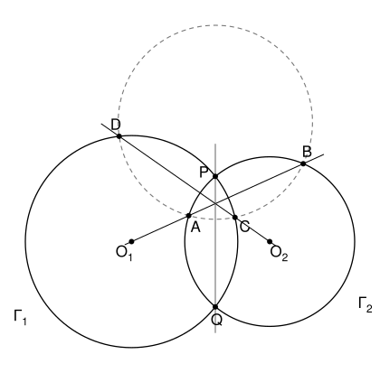

## Statement

Deux cercles $\Gamma_1$ et $\Gamma_2$, de centres $O_1$ et $O_2$, se coupent en deux points $P$ et $Q$. Une droite passant par $O_1$ coupe $\Gamma_2$ en deux points $A$ et $B$, et une droite passant par $O_2$ coupe $\Gamma_1$ en deux points $C$ et $D$.

On suppose qu'il existe un cercle qui passe par les quatre points $A$, $B$, $C$ et $D$. Montrer que le centre de ce cercle est sur la droite $(PQ)$.

## Hints

1. Soit $M$ un point et $\mathcal{C}$ un cercle de centre $O$ et de rayon $R$. Une droite passant par $M$ coupe $\mathcal{C}$ en $U$ et $V$. Montre que $\overrightarrow{MU} \cdot \overrightarrow{MV} = MO^2 - R^2$, en introduisant le milieu de $[UV]$.
2. Applique ce résultat au point $O_1$ et à la droite $(AB)$, une fois avec le cercle $\Gamma_2$ et une fois avec le cercle qui passe par $A$, $B$, $C$, $D$. Fais de même avec $O_2$ et la droite $(CD)$.
3. Montre que l'ensemble des points $M$ tels que $MO_1^2 - r_1^2 = MO_2^2 - r_2^2$ est une droite, et que c'est la droite $(PQ)$.

## Solution

On note $r_1$ et $r_2$ les rayons de $\Gamma_1$ et $\Gamma_2$, et $\Gamma$ le cercle qui passe par $A$, $B$, $C$, $D$, de centre $O$ et de rayon $R$.

### Étape 1 : un outil, la puissance d'un point

**Lemme.** Soit $\mathcal{C}$ un cercle de centre $\Omega$ et de rayon $\rho$, et $M$ un point. Si une droite passant par $M$ coupe $\mathcal{C}$ en deux points $U$ et $V$, alors
$$\overrightarrow{MU} \cdot \overrightarrow{MV} = M\Omega^2 - \rho^2 .$$

*Preuve.* Soit $I$ le milieu de $[UV]$. Alors $\overrightarrow{IV} = -\overrightarrow{IU}$, donc
$$\overrightarrow{MU} \cdot \overrightarrow{MV} = (\overrightarrow{MI} + \overrightarrow{IU}) \cdot (\overrightarrow{MI} - \overrightarrow{IU}) = MI^2 - IU^2 .$$
Comme $\Omega U = \Omega V$, le point $\Omega$ est sur la médiatrice de $[UV]$, donc $(\Omega I)$ est perpendiculaire à la droite $(UV)$, qui contient $M$ (si $\Omega = I$, il n'y a rien à faire). D'après le théorème de Pythagore, $M\Omega^2 = MI^2 + I\Omega^2$ et $\rho^2 = \Omega U^2 = IU^2 + I\Omega^2$. En faisant la différence, $MI^2 - IU^2 = M\Omega^2 - \rho^2$. $\square$

Le nombre $M\Omega^2 - \rho^2$ ne dépend donc que du point et du cercle, pas de la droite choisie.

### Étape 2 : deux égalités

La droite $(AB)$ passe par $O_1$, et les points $A$ et $B$ sont à la fois sur $\Gamma_2$ et sur $\Gamma$. Le lemme, appliqué au point $O_1$ avec chacun des deux cercles, donne
$$O_1O_2^2 - r_2^2 = \overrightarrow{O_1A} \cdot \overrightarrow{O_1B} = O_1O^2 - R^2 .$$
De même, la droite $(CD)$ passe par $O_2$, et $C$, $D$ sont sur $\Gamma_1$ et sur $\Gamma$, donc
$$O_2O_1^2 - r_1^2 = \overrightarrow{O_2C} \cdot \overrightarrow{O_2D} = O_2O^2 - R^2 .$$
On en tire $OO_1^2 = R^2 + O_1O_2^2 - r_2^2$ et $OO_2^2 = R^2 + O_1O_2^2 - r_1^2$, d'où
$$OO_1^2 - r_1^2 = R^2 + O_1O_2^2 - r_1^2 - r_2^2 = OO_2^2 - r_2^2 . \qquad (\star)$$

### Étape 3 : la droite $(PQ)$

Pour un point $M$, on pose $f(M) = MO_1^2 - r_1^2 - MO_2^2 + r_2^2$. Soit $K$ le milieu de $[O_1O_2]$. Alors $\overrightarrow{MO_1} + \overrightarrow{MO_2} = 2\,\overrightarrow{MK}$, et
$$MO_1^2 - MO_2^2 = (\overrightarrow{MO_1} - \overrightarrow{MO_2}) \cdot (\overrightarrow{MO_1} + \overrightarrow{MO_2}) = 2\,\overrightarrow{O_2O_1} \cdot \overrightarrow{MK} .$$
Donc $f(M) = 0$ si et seulement si $\overrightarrow{O_2O_1} \cdot \overrightarrow{MK} = \frac{r_1^2 - r_2^2}{2}$.

Fixons un point $M_0$ qui vérifie $f(M_0) = 0$, par exemple $P$. En faisant la différence, $f(M) = 0$ équivaut à $\overrightarrow{O_2O_1} \cdot \overrightarrow{MM_0} = 0$. L'ensemble des points $M$ tels que $f(M) = 0$ est donc la droite qui passe par $P$ et qui est perpendiculaire à $(O_1O_2)$.

Les points $P$ et $Q$ sont sur les deux cercles, donc $PO_1 = QO_1 = r_1$ et $PO_2 = QO_2 = r_2$, et $f(P) = f(Q) = 0$. Comme $P \neq Q$, cette droite est la droite $(PQ)$.

### Conclusion

L'égalité $(\star)$ dit exactement que $f(O) = 0$. Donc **le centre $O$ du cercle qui passe par $A$, $B$, $C$, $D$ est sur la droite $(PQ)$**.

## Going further

- Le nombre $M\Omega^2 - \rho^2$ s'appelle la puissance du point $M$ par rapport au cercle. La droite $(PQ)$ est l'ensemble des points qui ont la même puissance par rapport à $\Gamma_1$ et à $\Gamma_2$ : on l'appelle l'axe radical des deux cercles.
- Le corrigé raisonne autrement. Les droites $(AB)$, $(CD)$ et $(PQ)$ sont les axes radicaux des cercles pris deux par deux, donc elles se coupent en un même point $X$. Comme $(AB)$ est perpendiculaire à $(OO_2)$ et passe par $O_1$, c'est une hauteur du triangle $OO_1O_2$, et de même pour $(CD)$. Le point $X$ est donc l'orthocentre de ce triangle, et $(OX)$ est perpendiculaire à $(O_1O_2)$ : c'est la droite $(PQ)$.
