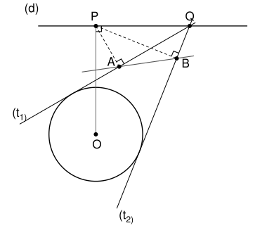

## Statement

Soit $\Gamma$ un cercle de centre $O$, et $(d)$ une droite qui ne coupe pas $\Gamma$. On note $P$ le projeté orthogonal de $O$ sur $(d)$.

Soit $Q$ un point de $(d)$, différent de $P$. On note $(t_1)$ et $(t_2)$ les deux tangentes à $\Gamma$ qui passent par $Q$, et $A$ et $B$ les projetés orthogonaux de $P$ sur $(t_1)$ et sur $(t_2)$.

Montrer que le point d'intersection des droites $(AB)$ et $(OP)$ reste le même quand $Q$ se déplace sur $(d)$.

## Hints

1. Prends un repère orthonormé d'origine $O$ dans lequel $P(0\,;\,h)$ et $Q(q\,;\,h)$, avec $q \neq 0$. Note $r$ le rayon de $\Gamma$, et $S(x_S\,;\,y_S)$, $T(x_T\,;\,y_T)$ les points où $(t_1)$ et $(t_2)$ touchent $\Gamma$.
2. Montre que la tangente en $S$ est l'ensemble des points $M$ tels que $\overrightarrow{OS} \cdot \overrightarrow{OM} = r^2$. Comme $Q$ est sur cette tangente, $q\,x_S + h\,y_S = r^2$.
3. La droite $(PA)$ est parallèle à $(OS)$, donc $\overrightarrow{PA} = \lambda\,\overrightarrow{OS}$ pour un certain nombre $\lambda$. Calcule $\lambda$ en fonction de $q$, $x_S$ et $r$.
4. Les abscisses $x_S$ et $x_T$ sont les deux solutions d'une même équation du second degré. Tu n'as pas besoin de les calculer : leur somme et leur produit suffisent.

## Solution

On note $r$ le rayon de $\Gamma$, $h = OP$, et $S$, $T$ les points où $(t_1)$ et $(t_2)$ touchent $\Gamma$. Comme $(d)$ ne coupe pas $\Gamma$, on a $h > r$, et tout point de $(d)$ est à l'extérieur de $\Gamma$. Il y a donc bien deux tangentes issues de $Q$, et $S \neq T$.

On a besoin de $Q \neq P$ : si $Q = P$, les tangentes passent par $P$, donc $A = B = P$ et la droite $(AB)$ n'existe pas.

### Étape 1 : le repère

On prend un repère orthonormé d'origine $O$ dont l'axe des ordonnées est la droite $(OP)$, avec $P(0\,;\,h)$. La droite $(d)$ est perpendiculaire à $(OP)$ en $P$, c'est donc la droite d'équation $y = h$, et $Q(q\,;\,h)$ avec $q \neq 0$. Le cercle $\Gamma$ a pour équation $x^2 + y^2 = r^2$. On note $S(x_S\,;\,y_S)$ et $T(x_T\,;\,y_T)$.

### Étape 2 : l'équation d'une tangente

La tangente en $S$ est perpendiculaire au rayon $[OS]$ et passe par $S$. Un point $M$ est donc sur cette tangente si et seulement si $\overrightarrow{OS} \cdot \overrightarrow{SM} = 0$. Comme $\overrightarrow{OM} = \overrightarrow{OS} + \overrightarrow{SM}$ et $\overrightarrow{OS} \cdot \overrightarrow{OS} = r^2$, cela revient à
$$\overrightarrow{OS} \cdot \overrightarrow{OM} = r^2 .$$
La tangente $(t_1)$ a donc pour équation $x_S\,x + y_S\,y = r^2$. Le point $Q$ est sur $(t_1)$, et de même sur $(t_2)$, donc
$$q\,x_S + h\,y_S = r^2 \qquad (1) \qquad \text{et} \qquad q\,x_T + h\,y_T = r^2 . \qquad (2)$$

### Étape 3 : les coordonnées de $A$ et de $B$

La droite $(PA)$ est perpendiculaire à $(t_1)$, comme $(OS)$, donc elle est parallèle à $(OS)$ : il existe un nombre $\lambda$ tel que $\overrightarrow{PA} = \lambda\,\overrightarrow{OS}$. Le point $A$ est sur $(t_1)$, donc d'après l'étape 2,
$$r^2 = \overrightarrow{OS} \cdot \overrightarrow{OA} = \overrightarrow{OS} \cdot (\overrightarrow{OP} + \lambda\,\overrightarrow{OS}) = h\,y_S + \lambda\,r^2 .$$
D'après (1), $r^2 - h\,y_S = q\,x_S$, donc
$$\lambda = \frac{q\,x_S}{r^2} \qquad \text{et} \qquad A\left(\frac{q\,x_S^2}{r^2}\,;\,h + \frac{q\,x_S\,y_S}{r^2}\right) .$$
De la même façon,
$$B\left(\frac{q\,x_T^2}{r^2}\,;\,h + \frac{q\,x_T\,y_T}{r^2}\right) .$$

### Étape 4 : la somme et le produit de $x_S$ et $x_T$

D'après (1) et (2), les points $S$ et $T$ sont sur le cercle $x^2 + y^2 = r^2$ et sur la droite $q\,x + h\,y = r^2$. On remplace $y = \dfrac{r^2 - q\,x}{h}$ dans l'équation du cercle, puis on multiplie par $h^2$ :
$$h^2 x^2 + (r^2 - q\,x)^2 = r^2 h^2 ,$$
c'est-à-dire
$$(h^2 + q^2)\,x^2 - 2qr^2\,x + r^2(r^2 - h^2) = 0 .$$
Les nombres $x_S$ et $x_T$ sont solutions de cette équation, et ils sont différents. En effet, si $x_S = x_T$, alors (1) et (2) donnent $y_S = y_T$, car $h \neq 0$, et donc $S = T$, ce qui est faux. Une équation du second degré a au plus deux solutions, donc $x_S$ et $x_T$ sont ses deux solutions, et
$$x_S + x_T = \frac{2qr^2}{h^2 + q^2}, \qquad x_S\,x_T = \frac{r^2(r^2 - h^2)}{h^2 + q^2} .$$

### Étape 5 : le point d'intersection

D'après l'étape 3,
$$x_B - x_A = \frac{q}{r^2}\,(x_T - x_S)(x_T + x_S) .$$
Ce nombre n'est pas nul, car $q \neq 0$, $x_T \neq x_S$, et $x_S + x_T \neq 0$ d'après l'étape 4. Donc $A \neq B$, et la droite $(AB)$ n'est pas parallèle à l'axe des ordonnées $(OP)$. Elle coupe $(OP)$ en un seul point $X(0\,;\,y_X)$.

Le coefficient directeur de $(AB)$ est
$$m = \frac{y_B - y_A}{x_B - x_A} = \frac{x_T\,y_T - x_S\,y_S}{x_T^2 - x_S^2} ,$$
et $y_X = y_A - m\,x_A$. On réduit au même dénominateur :
$$y_X - h = \frac{q}{r^2} \cdot \frac{x_S\,y_S\,(x_T^2 - x_S^2) - x_S^2\,(x_T\,y_T - x_S\,y_S)}{x_T^2 - x_S^2} = \frac{q}{r^2} \cdot \frac{x_S\,x_T\,(x_T\,y_S - x_S\,y_T)}{x_T^2 - x_S^2} .$$
D'après (1) et (2), $h\,y_S = r^2 - q\,x_S$ et $h\,y_T = r^2 - q\,x_T$, donc
$$h\,(x_T\,y_S - x_S\,y_T) = x_T\,(r^2 - q\,x_S) - x_S\,(r^2 - q\,x_T) = r^2\,(x_T - x_S) .$$
On remplace, et on simplifie par $x_T - x_S$, qui n'est pas nul :
$$y_X - h = \frac{q\,x_S\,x_T}{h\,(x_S + x_T)} .$$
Avec l'étape 4, les dénominateurs $h^2 + q^2$ et les facteurs $q\,r^2$ se simplifient :
$$y_X - h = \frac{r^2 - h^2}{2h}, \qquad \text{donc} \qquad y_X = \frac{h^2 + r^2}{2h} .$$

### Conclusion

Le point d'intersection de $(AB)$ et $(OP)$ est le point $X$ de la demi-droite $[OP)$ tel que
$$OX = \frac{OP^2 + r^2}{2\,OP} .$$
Ce nombre ne dépend que du cercle et de la droite $(d)$, pas de $q$. **Le point d'intersection de $(AB)$ et $(OP)$ reste donc fixe quand $Q$ se déplace sur $(d)$.**

## Going further

- À l'étape 4, on a vu que $S$ et $T$ sont sur la droite $q\,x + h\,y = r^2$. Pour $x = 0$, on trouve $y = \frac{r^2}{h}$ : la droite $(ST)$ passe elle aussi par un point fixe $Y$ de $(OP)$, tel que $OY = \frac{r^2}{OP}$. Vérifie que $X$ est le milieu de $[PY]$.
- Le corrigé démontre d'abord ce résultat sur $Y$. Il remarque ensuite que $P$, $Q$, $S$ et $T$ sont sur le cercle de diamètre $[OQ]$, et utilise la droite de Simson : les projetés de $P$ sur $(QS)$, $(QT)$ et $(ST)$ sont alignés. Une chasse aux angles montre enfin que $X$ est le milieu de $[PY]$.
- Vérifie que $XO^2 - r^2 = XP^2$.
