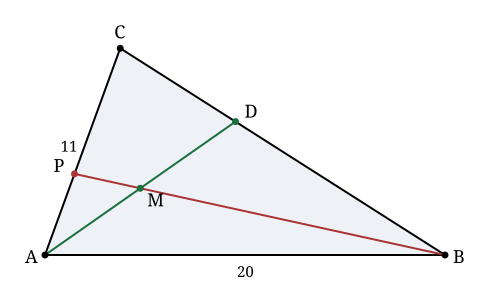

## Statement

Dans un triangle $ABC$, on a $AB = 20$ et $AC = 11$.

La bissectrice issue de $A$ coupe le côté $[BC]$ en $D$. On appelle $M$ le milieu de $[AD]$, puis $P$ le point d'intersection de la droite $(BM)$ avec le côté $[AC]$.

Calculer le rapport $\dfrac{CP}{PA}$.

*On pourra utiliser le **théorème de la bissectrice** : la bissectrice issue de $A$ coupe $[BC]$ au point $D$ tel que*
$$\frac{BD}{DC} = \frac{AB}{AC}.$$

## Hints

1. Le théorème de la bissectrice donne $\dfrac{BD}{DC} = \dfrac{20}{11}$. Traduisez-le en une relation vectorielle : exprimez $\vec{AD}$ en fonction de $\vec{AB}$ et $\vec{AC}$.
2. Posez $\vec{u} = \vec{AB}$ et $\vec{v} = \vec{AC}$. Ces deux vecteurs ne sont pas colinéaires : tout vecteur du plan s'écrit d'une **seule** façon sous la forme $x\vec u + y \vec v$. C'est cette unicité qui va tout résoudre.
3. Écrivez $\vec{AP}$ de deux façons : d'abord parce que $P$ est sur $(AC)$, ensuite parce que $P$ est sur $(BM)$.
4. Deux écritures du même vecteur dans la base $(\vec u, \vec v)$ donnent deux équations. Deux inconnues, deux équations.
5. Si $D$ vérifie $\vec{BD} = k\,\vec{DC}$, alors $\vec{AD} = \dfrac{\vec{AB} + k\,\vec{AC}}{1+k}$. Vérifiez-le.

## Solution

Posons $\vec{u} = \vec{AB}$ et $\vec{v} = \vec{AC}$. Comme $A$, $B$, $C$ ne sont pas alignés, $(\vec u, \vec v)$ est une base du plan : **tout vecteur s'écrit d'une seule façon** sous la forme $x\vec u + y\vec v$.

### Étape 1 : le point $D$

Le théorème de la bissectrice donne
$$\frac{BD}{DC} = \frac{AB}{AC} = \frac{20}{11},$$
et comme $D$ est entre $B$ et $C$, cela s'écrit vectoriellement
$$\vec{BD} = \frac{20}{11}\,\vec{DC}.$$

Décomposons avec le point $A$ : $\vec{BD} = \vec{AD} - \vec{u}$ et $\vec{DC} = \vec{v} - \vec{AD}$. Donc
$$\vec{AD} - \vec{u} = \frac{20}{11}\left(\vec{v} - \vec{AD}\right),$$
$$\vec{AD}\left(1 + \frac{20}{11}\right) = \vec{u} + \frac{20}{11}\vec{v},$$
$$\frac{31}{11}\,\vec{AD} = \vec{u} + \frac{20}{11}\vec{v},$$
$$\vec{AD} = \frac{11}{31}\vec{u} + \frac{20}{31}\vec{v}.$$

### Étape 2 : le point $M$

$M$ est le milieu de $[AD]$, donc $\vec{AM} = \frac12 \vec{AD}$ :
$$\vec{AM} = \frac{11}{62}\vec{u} + \frac{20}{62}\vec{v} = \frac{11}{62}\vec{u} + \frac{10}{31}\vec{v}.$$

### Étape 3 : le point $P$, écrit de deux façons

**Parce que $P$ est sur la droite $(AC)$**, il existe un réel $t$ tel que
$$\vec{AP} = t\,\vec{v}. \qquad (1)$$

**Parce que $P$ est sur la droite $(BM)$**, il existe un réel $s$ tel que $\vec{BP} = s\,\vec{BM}$, c'est-à-dire
$$\vec{AP} = \vec{AB} + s\left(\vec{AM} - \vec{AB}\right) = (1-s)\,\vec u + s\,\vec{AM}.$$

En remplaçant $\vec{AM}$ :
$$\vec{AP} = \left[(1-s) + \frac{11}{62}s\right]\vec u + \frac{10}{31}s\,\vec v = \left(1 - \frac{51}{62}s\right)\vec u + \frac{10}{31}s\,\vec v. \qquad (2)$$

### Étape 4 : identifier

Les écritures $(1)$ et $(2)$ représentent le même vecteur dans la base $(\vec u, \vec v)$. Par unicité de la décomposition, les coefficients coïncident :
$$\text{coefficient de } \vec u : \quad 0 = 1 - \frac{51}{62}s \quad \Longrightarrow \quad s = \frac{62}{51},$$
$$\text{coefficient de } \vec v : \quad t = \frac{10}{31}s = \frac{10}{31}\times\frac{62}{51} = \frac{620}{1581} = \frac{20}{51}.$$

*(On a simplifié par $31$ : $620 = 20 \times 31$ et $1581 = 51 \times 31$.)*

Donc $\vec{AP} = \dfrac{20}{51}\,\vec{AC}$, c'est-à-dire
$$AP = \frac{20}{51}\,AC \qquad \text{et} \qquad CP = AC - AP = \frac{31}{51}\,AC.$$

### Conclusion

$$\frac{CP}{PA} = \frac{31/51}{20/51} = \boxed{\dfrac{31}{20}}.$$

**Vérification numérique.** Avec $AC = 11$, on trouve $AP = \frac{20}{51}\times 11 \approx \text{4,314}$ et $CP \approx \text{6,686}$, dont le rapport vaut bien $\text{1,55} = \frac{31}{20}$. Une construction soignée sur la figure donne la même chose.

**D'où sortent ces nombres ?** Le $20$ est $AB$ et le $31$ est $AB + AC$. En reprenant le calcul avec $AB = c$ et $AC = b$ on trouve
$$\frac{CP}{PA} = \frac{b + c}{c}.$$
Le rapport ne dépend que des deux longueurs issues de $A$, pas de la forme du triangle.

## Going further

1. Refaire le calcul en toute généralité, avec $AB = c$ et $AC = b$, et retrouver $\frac{CP}{PA} = \frac{b+c}{c}$. Vérifier sur le cas $b = c$ (triangle isocèle) que le résultat est bien celui qu'on attend.
2. Démontrer le théorème de la bissectrice. *Indication* : comparer les aires des triangles $ABD$ et $ACD$, une première fois en prenant $[BD]$ et $[DC]$ comme bases, une seconde fois en utilisant les distances de $D$ aux côtés $[AB]$ et $[AC]$, qui sont égales.
3. Où la droite $(CM)$ coupe-t-elle $[AB]$ ? Quel rapport obtient-on ?
4. Vérifier que les trois droites $(AD)$, $(BP)$ et $(CQ)$, où $Q$ est le point de la question 3, sont concourantes, et retrouver ce fait avec le théorème de Céva.
