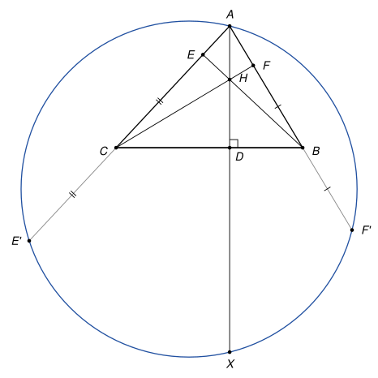

## Statement

Soit $ABC$ un triangle, $H$ son orthocentre (le point commun des trois hauteurs), et $D$, $E$, $F$ les pieds des hauteurs issues de $A$, $B$ et $C$.

On note $F'$ le symétrique de $F$ par rapport au point $B$, et $E'$ le symétrique de $E$ par rapport au point $C$. Le cercle circonscrit au triangle $AF'E'$ recoupe la droite $(AD)$ en un point $X$.

Montrer que $HX = 4 \times HD$.

## Hints

1. Prenez un repère orthonormé d'origine $D$, dont l'axe des abscisses est $(BC)$ et l'axe des ordonnées $(AD)$ : $A(0 ; a)$, $B(b ; 0)$, $C(c ; 0)$. Calculez les coordonnées de $H$.
2. Le cercle a une équation de la forme $x^2 + y^2 + \alpha x + \beta y + \gamma = 0$. Pour trouver $X$, il suffit de connaître $\gamma$ : pensez au produit des racines d'une équation du second degré.
3. Notons $f(x, y) = x^2 + y^2 + \alpha x + \beta y + \gamma$. Si une droite qui passe par un point $Z$ coupe le cercle en $U$ et $V$, alors $f(Z) = \overrightarrow{ZU} \cdot \overrightarrow{ZV}$. Calculez ainsi $f(B)$ et $f(C)$.

## Solution

*Rappels.*

- *Équation d'un cercle.* Dans un repère orthonormé, un cercle a une équation de la forme $x^2 + y^2 + \alpha x + \beta y + \gamma = 0$.
- *Produit des racines.* Si l'équation $t^2 + pt + q = 0$ a pour racines $t_1$ et $t_2$, alors $t^2 + pt + q = (t - t_1)(t - t_2)$, donc $t_1 t_2 = q$.
- *Produit scalaire et projection.* Si $F$ est le projeté orthogonal de $C$ sur la droite $(AB)$, alors $\overrightarrow{BA} \cdot \overrightarrow{BC} = \overrightarrow{BA} \cdot \overrightarrow{BF}$.

On note $\mathcal{C}$ le cercle circonscrit au triangle $AF'E'$, et

$$f(x, y) = x^2 + y^2 + \alpha x + \beta y + \gamma$$

le membre de gauche de son équation. Un point $(x ; y)$ est sur $\mathcal{C}$ exactement quand $f(x, y) = 0$.

**Étape 1 : un lemme.** *Soit $Z$ un point, et soit une droite passant par $Z$ qui coupe $\mathcal{C}$ en deux points $U$ et $V$. Alors $f(Z) = \overrightarrow{ZU} \cdot \overrightarrow{ZV}$.*

Soit $\vec{u} = (u_1 ; u_2)$ un vecteur directeur de la droite, de norme $1$, et $Z = (z_1 ; z_2)$. Les points de la droite sont les points $Z + t\,\vec{u}$, et en développant :

$$f(z_1 + t u_1, z_2 + t u_2) = (u_1^2 + u_2^2)\,t^2 + (2 z_1 u_1 + 2 z_2 u_2 + \alpha u_1 + \beta u_2)\,t + f(z_1, z_2).$$

Comme $u_1^2 + u_2^2 = 1$, c'est un trinôme $t^2 + pt + f(Z)$. On a $U = Z + t_1 \vec{u}$ et $V = Z + t_2 \vec{u}$, où $t_1$ et $t_2$ sont ses deux racines. Le produit des racines donne

$$f(Z) = t_1 t_2 = (t_1 \vec{u}) \cdot (t_2 \vec{u}) = \overrightarrow{ZU} \cdot \overrightarrow{ZV}.$$

**Étape 2 : le repère et le point $H$.** On prend le repère orthonormé d'origine $D$, dont l'axe des abscisses est la droite $(BC)$ et l'axe des ordonnées la droite $(AD)$. On a $A(0 ; a)$, $B(b ; 0)$, $C(c ; 0)$, avec $a \neq 0$ et $b \neq c$.

Le point $H$ est sur la hauteur $(AD)$, donc $H(0 ; h)$. Il est aussi sur la hauteur issue de $B$, perpendiculaire à $(AC)$ :

$$\overrightarrow{BH} \cdot \overrightarrow{CA} = (-b)(-c) + h\,a = 0, \quad \text{donc} \quad h = -\frac{bc}{a}.$$

Ainsi $HD = \frac{|bc|}{|a|}$.

**Étape 3 : les coefficients $\alpha$ et $\gamma$.** La droite $(AB)$ passe par $B$ et coupe $\mathcal{C}$ en $A$ et $F'$. Comme $F'$ est le symétrique de $F$ par rapport à $B$, $\overrightarrow{BF'} = -\overrightarrow{BF}$. Le lemme et le troisième rappel donnent

$$f(B) = \overrightarrow{BA} \cdot \overrightarrow{BF'} = -\overrightarrow{BA} \cdot \overrightarrow{BF} = -\overrightarrow{BA} \cdot \overrightarrow{BC}.$$

Avec $\overrightarrow{BA} = (-b ; a)$ et $\overrightarrow{BC} = (c - b ; 0)$, on obtient $f(B) = b(c - b) = bc - b^2$. Le même raisonnement avec la droite $(AC)$, qui coupe $\mathcal{C}$ en $A$ et $E'$, donne

$$f(C) = -\overrightarrow{CA} \cdot \overrightarrow{CB} = c(b - c) = bc - c^2.$$

Or, directement, $f(B) = b^2 + \alpha b + \gamma$ et $f(C) = c^2 + \alpha c + \gamma$. On a donc

$$b^2 + \alpha b + \gamma = bc - b^2 \quad \text{et} \quad c^2 + \alpha c + \gamma = bc - c^2.$$

En soustrayant la seconde égalité de la première : $(b^2 - c^2) + \alpha(b - c) = -(b^2 - c^2)$, soit $\alpha(b - c) = -2(b - c)(b + c)$. Comme $b \neq c$, on obtient $\alpha = -2(b + c)$. En reportant dans la première égalité :

$$\gamma = bc - 2b^2 - \alpha b = bc - 2b^2 + 2b^2 + 2bc = 3bc.$$

**Étape 4 : le point $X$.** Un point $(0 ; y)$ de la droite $(AD)$ est sur $\mathcal{C}$ exactement quand $y^2 + \beta y + \gamma = 0$. Les deux racines de cette équation sont l'ordonnée $a$ de $A$ et l'ordonnée $y_X$ de $X$. Leur produit vaut $\gamma$ :

$$a \, y_X = 3bc, \quad \text{donc} \quad X\left(0 ; \frac{3bc}{a}\right).$$

**Conclusion.** Les points $H$ et $X$ sont sur l'axe des ordonnées, donc

$$HX = \left| \frac{3bc}{a} - \left(-\frac{bc}{a}\right) \right| = \frac{4\,|bc|}{|a|} = 4 \times HD.$$

*Remarque.* On n'a jamais eu besoin de $\beta$, ni de savoir si le triangle a un angle obtus : le calcul vaut dans toutes les dispositions. Le corrigé officiel passe par le symétrique $D'$ de $H$ par rapport à $D$, qui est sur le cercle circonscrit à $ABC$, puis utilise des similitudes, un outil qui n'est pas au programme du lycée. Avec les coordonnées ci-dessus, $D'(0 ; \frac{bc}{a})$, et l'on voit que $X$ est le symétrique de $H$ par rapport à $D'$.

## Going further

1. La quantité $f(Z)$ du lemme ne dépend pas de la droite choisie : on l'appelle la *puissance* du point $Z$ par rapport au cercle. Montrer que si $Z$ est extérieur au cercle et si $T$ est un point de contact d'une tangente issue de $Z$, alors $f(Z) = ZT^2$.
2. Avec les mêmes coordonnées, montrer que le cercle circonscrit au triangle $ABC$ a pour équation $x^2 + y^2 - (b + c)x - \frac{a^2 + bc}{a}\,y + bc = 0$, et en déduire que $D'$ est sur ce cercle.
