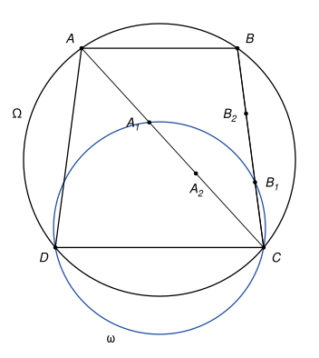
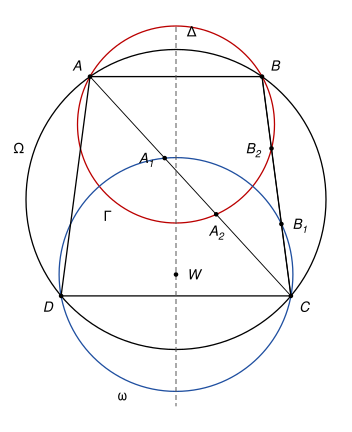

## Statement

Soit $ABCD$ un trapèze dont les côtés $[AB]$ et $[CD]$ sont parallèles. On suppose que ses quatre sommets sont sur un même cercle $\Omega$.

Soit $\omega$ un cercle qui passe par $C$ et par $D$. Il recoupe la droite $(CA)$ en un point $A_1$ et la droite $(CB)$ en un point $B_1$, tous deux différents de $C$.

On note $A_2$ le symétrique de $A_1$ par rapport au milieu du segment $[CA]$, et $B_2$ le symétrique de $B_1$ par rapport au milieu du segment $[CB]$.

Montrer que les points $A$, $B$, $A_2$ et $B_2$ sont sur un même cercle.

## Hints

1. Commencez par un lemme. Un cercle de centre $W$ et de rayon $r$ est coupé en $U$ et $V$ par une droite qui passe par un point $X$. Montrez que $\overrightarrow{XU} \cdot \overrightarrow{XV} = XW^2 - r^2$, en introduisant le milieu de $[UV]$. Ce nombre ne dépend donc pas de la droite choisie.
2. Montrez que $\overrightarrow{CA_2} = \overrightarrow{A_1A}$. Que vaut alors $\overrightarrow{CA} \cdot \overrightarrow{CA_2}$, d'après le lemme appliqué au point $A$ et au cercle $\omega$ ?
3. La médiatrice de $[CD]$ est aussi celle de $[AB]$, et le centre de $\omega$ est dessus. Comparez $\overrightarrow{CA} \cdot \overrightarrow{CA_2}$ et $\overrightarrow{CB} \cdot \overrightarrow{CB_2}$.
4. Pour conclure, tracez le cercle $\Gamma$ qui passe par $A$, $A_2$ et $B$, et appliquez encore le lemme, cette fois au point $C$ et au cercle $\Gamma$.

## Solution

**Le lemme (puissance d'un point).** Soit $\mathcal{C}$ un cercle de centre $W$ et de rayon $r$, et $X$ un point. Si une droite passant par $X$ coupe $\mathcal{C}$ en $U$ et $V$ (avec $U = V$ si la droite est tangente), alors

$$\overrightarrow{XU} \cdot \overrightarrow{XV} = XW^2 - r^2.$$

*Preuve.* Soit $M$ le milieu de $[UV]$. La droite $(WM)$ est perpendiculaire à $(UV)$ : c'est la médiatrice de la corde $[UV]$ (dans le cas d'une tangente, $M = U$ et c'est le rayon perpendiculaire à la tangente). On a $\overrightarrow{XU} = \overrightarrow{XM} + \overrightarrow{MU}$ et $\overrightarrow{XV} = \overrightarrow{XM} + \overrightarrow{MV} = \overrightarrow{XM} - \overrightarrow{MU}$, donc

$$\overrightarrow{XU} \cdot \overrightarrow{XV} = XM^2 - MU^2.$$

Les points $X$ et $U$ sont sur la droite $(UV)$, perpendiculaire à $(WM)$ en $M$. Le théorème de Pythagore donne $XM^2 = XW^2 - WM^2$ et $MU^2 = WU^2 - WM^2 = r^2 - WM^2$. En soustrayant, on obtient $XW^2 - r^2$. $\square$

Ce nombre ne dépend que du point $X$ et du cercle, pas de la droite. On l'appelle la puissance de $X$ par rapport au cercle.

**Étape 1 : $A$ et $B$ ont la même puissance par rapport à $\omega$.** Les cordes $[AB]$ et $[CD]$ du cercle $\Omega$ sont parallèles. Leurs médiatrices passent toutes les deux par le centre de $\Omega$ et sont perpendiculaires à la même direction, donc elles sont confondues. Notons $\Delta$ cette droite : c'est la médiatrice commune de $[AB]$ et de $[CD]$.

Soit $W$ le centre de $\omega$ et $r$ son rayon. Comme $\omega$ passe par $C$ et $D$, on a $WC = WD$, donc $W$ est sur $\Delta$. Comme $\Delta$ est aussi la médiatrice de $[AB]$, on a $WA = WB$, donc

$$WA^2 - r^2 = WB^2 - r^2.$$

On note $p$ ce nombre.

**Étape 2 : $\overrightarrow{CA} \cdot \overrightarrow{CA_2} = p$.** Soit $K$ le milieu de $[CA]$. C'est aussi le milieu de $[A_1A_2]$, donc

$$\overrightarrow{CA_2} = \overrightarrow{CK} + \overrightarrow{KA_2} = \overrightarrow{KA} + \overrightarrow{A_1K} = \overrightarrow{A_1A}.$$

La droite $(AC)$ passe par $A$ et coupe $\omega$ en $C$ et $A_1$. Par le lemme :

$$\overrightarrow{CA} \cdot \overrightarrow{CA_2} = \overrightarrow{CA} \cdot \overrightarrow{A_1A} = \overrightarrow{AC} \cdot \overrightarrow{AA_1} = WA^2 - r^2 = p.$$

De la même façon, $\overrightarrow{CB_2} = \overrightarrow{B_1B}$ et

$$\overrightarrow{CB} \cdot \overrightarrow{CB_2} = \overrightarrow{BC} \cdot \overrightarrow{BB_1} = WB^2 - r^2 = p.$$

Donc

$$\overrightarrow{CA} \cdot \overrightarrow{CA_2} = \overrightarrow{CB} \cdot \overrightarrow{CB_2}.$$

**Étape 3 : conclusion.** On a $A_2 \neq A$, car sinon $A_1 = C$, ce qui est exclu. Les points $A$ et $A_2$ sont sur la droite $(CA)$ et $B$ n'y est pas, donc $A$, $A_2$, $B$ ne sont pas alignés. Soit $\Gamma$ le cercle qui passe par ces trois points.

La droite $(CB)$ passe par le point $B$ de $\Gamma$. Elle recoupe $\Gamma$ en un point $B'$ (avec $B' = B$ si elle est tangente). La droite $(CA)$ coupe $\Gamma$ en $A$ et $A_2$. Le lemme, appliqué au point $C$ et au cercle $\Gamma$ avec ces deux droites, donne

$$\overrightarrow{CB} \cdot \overrightarrow{CB'} = \overrightarrow{CA} \cdot \overrightarrow{CA_2} = \overrightarrow{CB} \cdot \overrightarrow{CB_2}.$$

Donc $\overrightarrow{CB} \cdot \overrightarrow{B_2B'} = 0$. Mais $B_2$ et $B'$ sont tous les deux sur la droite $(CB)$, donc $\overrightarrow{B_2B'} = k\,\overrightarrow{CB}$ pour un certain réel $k$. Alors $k\,CB^2 = 0$, donc $k = 0$ et $B_2 = B'$.

Le point $B_2$ est donc sur $\Gamma$ : **les points $A$, $B$, $A_2$ et $B_2$ sont sur un même cercle.**

*Remarques.*

- Le corrigé officiel fait le même calcul avec des longueurs, $CB \times CB_2 = CA_2 \times CA$, puis invoque la réciproque de la puissance d'un point. Avec des longueurs, il faudrait vérifier dans chaque figure de quel côté de $C$ tombent les points, car $A_1$ peut être entre $C$ et $A$ ou au-delà de $A$, ou même de l'autre côté de $C$. Le produit scalaire tient compte des sens et règle toutes les dispositions d'un coup.
- L'étape 1 est le seul endroit où l'on utilise le trapèze inscrit : on a seulement besoin que $A$ et $B$ soient symétriques par rapport à la médiatrice de $[CD]$.
