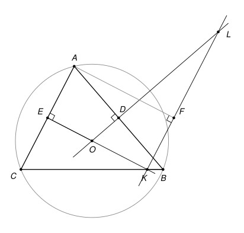

## Statement

Soit $ABC$ un triangle et $O$ le centre de son cercle circonscrit. On note $D$ et $E$ les milieux des côtés $[AB]$ et $[AC]$.

- La droite $(OE)$ coupe la droite $(BC)$ en un point $K$.
- La droite $(OD)$ recoupe le cercle circonscrit au triangle $OKB$ en un point $L$.
- On note $F$ le projeté orthogonal du point $A$ sur la droite $(KL)$.

Montrer que les points $D$, $E$ et $F$ sont alignés.

On suppose que la figure n'est pas dégénérée : le triangle $ABC$ n'a pas d'angle droit, $BA \neq BC$, et les points nommés sont tous distincts.

## Hints

1. Tracez une grande figure, avec le cercle circonscrit au triangle $OKB$. Quel autre point de la figure semble être sur ce cercle ? Démontrez-le, en utilisant le parallélisme de $(DE)$ et $(BC)$ et le cercle de diamètre $[OA]$.
2. Les points $D$, $E$ et $F$ sont les projetés orthogonaux de $A$ sur les trois côtés du triangle $OKL$. Ils sont donc sur des cercles de diamètres $[AO]$, $[AK]$ et $[AL]$. Lesquels sur lesquels ?
3. Pour montrer l'alignement, comparez les angles $(FD, FA)$ et $(FE, FA)$, en passant par $L$, puis par $K$.

## Solution

### Rappels

*Angles orientés de droites.* Pour deux droites $d_1$ et $d_2$, on note $(d_1, d_2)$ l'angle dont il faut faire tourner $d_1$, dans le sens direct, pour qu'elle devienne parallèle à $d_2$. Cet angle est compté **à $180°$ près**. On utilise les règles suivantes.

- *Relation de Chasles* : $(d_1, d_3) = (d_1, d_2) + (d_2, d_3)$.
- $(d_1, d_2) = 0$ si et seulement si $d_1$ et $d_2$ sont parallèles. Deux droites parallèles font le même angle avec une troisième.
- Une droite peut être nommée par deux quelconques de ses points.
- *Angle inscrit.* Si $W$, $X$, $Y$, $Z$ sont quatre points distincts d'un même cercle, alors $(ZX, ZY) = (WX, WY)$. C'est le théorème de l'angle inscrit quand $Z$ et $W$ sont du même côté de $(XY)$, et la propriété des angles opposés d'un quadrilatère inscrit quand ils sont de part et d'autre : à $180°$ près, les deux cas donnent la même égalité.
- *Réciproque.* Si $W$, $X$, $Y$, $Z$ sont quatre points distincts, dont trois ne sont jamais alignés, et si $(ZX, ZY) = (WX, WY)$, alors ils sont sur un même cercle.

*Cercle de diamètre.* Si $\widehat{XMY} = 90°$, le point $M$ est sur le cercle de diamètre $[XY]$.

Les angles orientés évitent de séparer les cas. Selon la forme du triangle, le point $K$ peut être entre $B$ et $C$ ou à l'extérieur du segment, et $L$ peut changer de côté. Avec des angles ordinaires, il faudrait refaire la preuve pour chaque disposition.

### La preuve

![La solution : le cercle OKB passe aussi par A, le cercle de diamètre [AO] passe par D et E, et D, E, F sont sur une même droite](10248-figure-2.svg)

**Étape 1 : trois cercles de diamètre.** La droite $(OD)$ est la médiatrice de $[AB]$, donc $(OD) \perp (AB)$. De même $(OE) \perp (AC)$. On en déduit :

- les angles $\widehat{ADO}$ et $\widehat{AEO}$ sont droits, donc $D$ et $E$ sont sur le cercle $c_1$ de diamètre $[AO]$ ;
- $K$ est sur $(OE)$, donc $\widehat{AEK} = 90°$. Et $\widehat{AFK} = 90°$ par définition de $F$. Donc $E$ et $F$ sont sur le cercle $c_2$ de diamètre $[AK]$ ;
- $L$ est sur $(OD)$, donc $\widehat{ADL} = 90°$. Et $\widehat{AFL} = 90°$. Donc $D$ et $F$ sont sur le cercle $c_3$ de diamètre $[AL]$.

**Étape 2 : le point $A$ est sur le cercle $\Gamma$ qui passe par $O$, $K$ et $B$.** Le point $K$ est sur la droite $(OE)$, donc $(KO) = (EO)$. Il est aussi sur $(BC)$ et distinct de $B$, donc $(KB) = (BC)$. Enfin $(BC)$ est parallèle à $(DE)$, car $D$ et $E$ sont les milieux de deux côtés du triangle $ABC$. Donc

$$(KO, KB) = (EO, ED).$$

Les points $E$, $A$, $O$, $D$ sont sur le cercle $c_1$, donc par la règle de l'angle inscrit $(EO, ED) = (AO, AD)$. Et $(AD) = (AB)$. Finalement

$$(KO, KB) = (AO, AB).$$

Parmi les points $K$, $A$, $O$, $B$, trois ne sont jamais alignés. En effet, $O$, $K$, $B$ ne le sont pas puisque le cercle $\Gamma$ existe ; $A$, $O$, $B$ seraient alignés seulement si $[AB]$ était un diamètre, c'est-à-dire si l'angle en $C$ était droit ; $A$, $B$, $K$ seulement si $K = B$, c'est-à-dire si $BA = BC$ ; et $A$, $O$, $K$ seulement si $A$ était sur la médiatrice de $[AC]$, ce qui est impossible. D'après la réciproque, **$A$ est sur le cercle $\Gamma$**.

**Étape 3 : les quatre points $A$, $O$, $K$, $L$ sont sur $\Gamma$.** Le point $L$ est sur $\Gamma$ par définition. Avec l'étape 2, les points $A$, $O$, $K$ et $L$ sont tous sur $\Gamma$. Autrement dit, $A$ est sur le cercle circonscrit au triangle $OKL$, et $D$, $E$, $F$ sont les projetés orthogonaux de $A$ sur les droites $(OL)$, $(OK)$ et $(KL)$.

**Étape 4 : l'alignement.** On enchaîne les égalités, en justifiant chacune :

$$(FD, FA) = (LD, LA) \quad \text{car } F, L, D, A \text{ sont sur } c_3,$$

$$(LD, LA) = (LO, LA) \quad \text{car } D \text{ est sur } (LO),$$

$$(LO, LA) = (KO, KA) \quad \text{car } L, K, O, A \text{ sont sur } \Gamma,$$

$$(KO, KA) = (KE, KA) \quad \text{car } E \text{ est sur } (KO),$$

$$(KE, KA) = (FE, FA) \quad \text{car } K, F, E, A \text{ sont sur } c_2.$$

Donc $(FD, FA) = (FE, FA)$. Par la relation de Chasles,

$$(FD, FE) = (FD, FA) + (FA, FE) = (FD, FA) - (FE, FA) = 0.$$

Les droites $(FD)$ et $(FE)$ sont donc parallèles. Elles ont le point $F$ en commun, donc elles sont confondues. **Les points $D$, $E$ et $F$ sont alignés.**

*Remarques.*

- L'étape 4 démontre un théorème classique, celui de la *droite de Simson* : si un point $A$ est sur le cercle circonscrit à un triangle, les projetés orthogonaux de $A$ sur les trois côtés sont alignés. Les correcteurs notent que très peu d'élèves y ont pensé, alors qu'une fois l'étape 2 faite, il donne la conclusion tout de suite.
- Le corrigé officiel fait la même preuve avec des angles ordinaires, sur la disposition de sa figure.

## Going further

1. Réciproquement, soit $OKL$ un triangle et $A$ un point du plan. On suppose que les projetés orthogonaux de $A$ sur les droites $(OK)$, $(KL)$ et $(LO)$ sont alignés. Montrer que $A$ est sur le cercle circonscrit au triangle $OKL$.
2. Dans la figure de l'exercice, on a $OA = OB$ et les points $A$, $B$ sont sur $\Gamma$. En déduire que la droite $(KO)$ est une bissectrice de l'angle formé par les droites $(KA)$ et $(KB)$.
