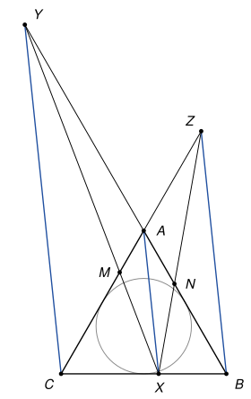
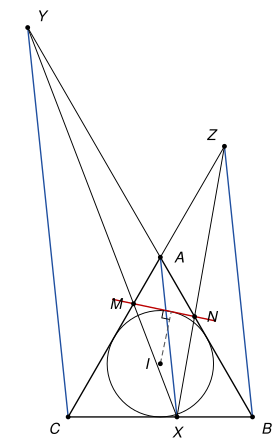

## Statement

Soit $ABC$ un triangle équilatéral, et $X$ un point de la droite $(BC)$, différent de $B$ et de $C$.

- Soit $Y$ le point de la droite $(AB)$ tel que $(CY)$ soit parallèle à $(AX)$.
- Soit $Z$ le point de la droite $(AC)$ tel que $(BZ)$ soit parallèle à $(AX)$.
- La droite $(XY)$ coupe la droite $(AC)$ en $M$, et la droite $(XZ)$ coupe la droite $(AB)$ en $N$. On suppose que ces deux points existent.

Montrer que la droite $(MN)$ est tangente au cercle inscrit dans le triangle $ABC$.

## Hints

1. Tout se calcule. Un repère pratique est $(A\,;\,\overrightarrow{AB}, \overrightarrow{AC})$, même s'il n'est pas orthonormé : les droites $(AB)$ et $(AC)$ deviennent les deux axes.
2. Dans ce repère, écrivez $X(1 - t\,;\,t)$. Calculez les coordonnées de $Y$ et de $Z$, puis celles de $M(0\,;\,m)$ et de $N(n\,;\,0)$, en fonction de $t$. Vous devez trouver $m = \frac{t}{1 + t}$.
3. Pour la tangence, passez dans un repère orthonormé et comparez la distance du centre $I$ à la droite $(MN)$ avec le rayon. Calculez d'abord $3mn - 2(m + n) + 1$.

## Solution

On prend le côté du triangle comme unité de longueur.

*Rappel (colinéarité).* Dans un repère quelconque, deux vecteurs de coordonnées $(p\,;\,q)$ et $(p'\,;\,q')$ sont colinéaires si et seulement si $pq' - qp' = 0$.

### Partie 1 : les points $M$ et $N$

On travaille dans le repère $(A\,;\,\overrightarrow{AB}, \overrightarrow{AC})$, où $A(0\,;\,0)$, $B(1\,;\,0)$ et $C(0\,;\,1)$.

**Étape 1 : le point $X$.** Le point $X$ est sur $(BC)$, donc $\overrightarrow{BX} = t\,\overrightarrow{BC}$ pour un certain réel $t$, et $X(1 - t\,;\,t)$. Comme $X \neq B$ et $X \neq C$, on a $t \neq 0$ et $t \neq 1$.

**Étape 2 : les points $Y$ et $Z$.** Le point $Y$ est sur $(AB)$, donc $Y(y\,;\,0)$. Les vecteurs $\overrightarrow{CY}(y\,;\,-1)$ et $\overrightarrow{AX}(1 - t\,;\,t)$ sont colinéaires, donc $yt + (1 - t) = 0$ et

$$y = -\frac{1 - t}{t}.$$

De même $Z(0\,;\,z)$, et les vecteurs $\overrightarrow{BZ}(-1\,;\,z)$ et $\overrightarrow{AX}$ sont colinéaires, donc $-t - z(1 - t) = 0$ et

$$z = -\frac{t}{1 - t}.$$

**Étape 3 : le point $M$.** Le point $M$ est sur $(AC)$, donc $M(0\,;\,m)$. Les vecteurs $\overrightarrow{YX}(1 - t - y\,;\,t)$ et $\overrightarrow{YM}(-y\,;\,m)$ sont colinéaires, donc

$$(1 - t - y)\,m + ty = 0.$$

Or $ty = -(1 - t)$ et $1 - t - y = (1 - t) + \frac{1 - t}{t} = \frac{(1 - t)(1 + t)}{t}$. L'égalité devient $\frac{(1 - t)(1 + t)}{t}\,m = 1 - t$. Si $t = -1$, le membre de gauche est nul et celui de droite vaut $2$ : c'est impossible, et en effet dans ce cas $(XY)$ est parallèle à $(AC)$ et le point $M$ n'existe pas. Donc $t \neq -1$, et en divisant par $1 - t \neq 0$ :

$$m = \frac{t}{1 + t}.$$

**Étape 4 : le point $N$.** De même $N(n\,;\,0)$, et les vecteurs $\overrightarrow{ZX}(1 - t\,;\,t - z)$ et $\overrightarrow{ZN}(n\,;\,-z)$ sont colinéaires, donc $-(1 - t)\,z - (t - z)\,n = 0$, c'est-à-dire $(t - z)\,n = -(1 - t)\,z = t$. Or $t - z = t + \frac{t}{1 - t} = \frac{t(2 - t)}{1 - t}$. Le point $N$ existe, donc comme à l'étape 3 on a $t \neq 2$, et

$$n = \frac{1 - t}{2 - t}.$$

Comme $t \neq 0$ et $t \neq 1$, on a $m \neq 0$ et $n \neq 0$ : les points $M$ et $N$ sont distincts de $A$, et donc distincts l'un de l'autre.

**Étape 5 : une relation entre $m$ et $n$.** Posons $Q = (1 + t)(2 - t) = 2 + t - t^2$. Alors

$$mn = \frac{t(1 - t)}{Q} \quad \text{et} \quad m + n = \frac{t(2 - t) + (1 - t)(1 + t)}{Q} = \frac{1 + 2t - 2t^2}{Q}.$$

Donc

$$3mn - 2(m + n) + 1 = \frac{3t - 3t^2 - 2 - 4t + 4t^2 + 2 + t - t^2}{Q} = \frac{0}{Q} = 0.$$

On retient :

$$3mn = 2(m + n) - 1.$$

### Partie 2 : la tangence

**Étape 6 : un repère orthonormé.** On prend maintenant le repère orthonormé d'origine $A$ dans lequel $B(1\,;\,0)$ et $C\left(\frac{1}{2}\,;\,\frac{\sqrt{3}}{2}\right)$. Le point de coordonnées $(p\,;\,q)$ dans l'ancien repère est le point $A + p\,\overrightarrow{AB} + q\,\overrightarrow{AC}$, donc

$$N(n\,;\,0) \qquad \text{et} \qquad M\left(\frac{m}{2}\,;\,\frac{\sqrt{3}}{2}\,m\right).$$

Dans un triangle équilatéral, le centre $I$ du cercle inscrit est le centre de gravité, donc $I\left(\frac{1}{2}\,;\,\frac{\sqrt{3}}{6}\right)$. Le rayon $r$ est la distance de $I$ à la droite $(AB)$, donc $r = \frac{\sqrt{3}}{6}$.

**Étape 7 : la distance d'un point à une droite.** Soit $d$ une droite, $P$ un point de $d$, et $\vec{w}$ un vecteur non nul orthogonal à $d$. Pour tout point $J$, si $H$ est le projeté orthogonal de $J$ sur $d$, on a $\overrightarrow{PJ} = \overrightarrow{PH} + \overrightarrow{HJ}$, avec $\overrightarrow{PH}$ orthogonal à $\vec{w}$ et $\overrightarrow{HJ}$ colinéaire à $\vec{w}$. Donc $\overrightarrow{PJ} \cdot \vec{w} = \overrightarrow{HJ} \cdot \vec{w} = \pm\, HJ \times \|\vec{w}\|$, et la distance de $J$ à $d$ vaut

$$HJ = \frac{|\overrightarrow{PJ} \cdot \vec{w}|}{\|\vec{w}\|}.$$

**Étape 8 : la distance de $I$ à $(MN)$.** On a $\overrightarrow{NM}\left(\frac{m}{2} - n\,;\,\frac{\sqrt{3}}{2}\,m\right)$. Le vecteur $\vec{w}\left(\frac{\sqrt{3}}{2}\,m\,;\,n - \frac{m}{2}\right)$ lui est orthogonal, car leur produit scalaire vaut $\left(\frac{m}{2} - n\right)\frac{\sqrt{3}}{2}\,m + \frac{\sqrt{3}}{2}\,m\left(n - \frac{m}{2}\right) = 0$. De plus

$$\|\vec{w}\|^2 = \frac{3m^2}{4} + n^2 - mn + \frac{m^2}{4} = m^2 - mn + n^2,$$

qui n'est pas nul car $m \neq 0$. Avec $\overrightarrow{NI}\left(\frac{1}{2} - n\,;\,\frac{\sqrt{3}}{6}\right)$ :

$$\overrightarrow{NI} \cdot \vec{w} = \frac{\sqrt{3}}{2}\,m\left(\frac{1}{2} - n\right) + \frac{\sqrt{3}}{6}\left(n - \frac{m}{2}\right) = \frac{\sqrt{3}}{6}\,(m + n - 3mn).$$

D'après l'étape 7, la distance de $I$ à $(MN)$ est donc

$$\delta = \frac{\sqrt{3}}{6} \times \frac{|m + n - 3mn|}{\sqrt{m^2 - mn + n^2}}.$$

**Étape 9 : conclusion.** D'après l'étape 5, $m + n - 3mn = m + n - 2(m + n) + 1 = 1 - (m + n)$, et

$$\left(1 - (m + n)\right)^2 = 1 - 2(m + n) + (m + n)^2 = -3mn + m^2 + 2mn + n^2 = m^2 - mn + n^2.$$

Donc $|m + n - 3mn| = \sqrt{m^2 - mn + n^2}$, et $\delta = \frac{\sqrt{3}}{6} = r$. Une droite dont la distance au centre d'un cercle est égale au rayon touche ce cercle en un seul point, le projeté du centre. **La droite $(MN)$ est tangente au cercle inscrit.**

*Remarques.*

- Le calcul de l'étape 8 montre plus : une droite qui coupe $(AB)$ en $N(n\,;\,0)$ et $(AC)$ en $M(0\,;\,m)$, avec $m \neq 0$ et $n \neq 0$, est tangente au cercle inscrit si et seulement si $3mn - 2(m + n) + 1 = 0$. Le problème revient donc à vérifier cette relation, ce qui est l'objet de la partie 1.
- Le corrigé officiel donne une preuve sans calcul, mais longue, qui utilise deux lemmes : l'angle $\widehat{BJC}$ en un centre de cercle exinscrit, et le fait que dans un trapèze, la droite qui joint le point d'intersection des diagonales et celui des côtés non parallèles coupe les bases en leur milieu. Les correcteurs notent que les rares élèves qui ont résolu l'exercice l'ont fait par le calcul.

## Going further

1. Dans un triangle équilatéral de côté $1$, soit $N$ un point de $[AB]$ et $M$ un point de $[AC]$, distincts de $A$. Montrer que $(MN)$ est tangente au cercle inscrit si et seulement si le périmètre du triangle $AMN$ vaut $1$. On pourra utiliser la relation de la remarque, et le théorème d'Al-Kashi dans le triangle $AMN$.
2. Pour quelles positions de $X$ sur $(BC)$ les points $M$ et $N$ sont-ils tous deux sur les côtés $[AC]$ et $[AB]$ ?
