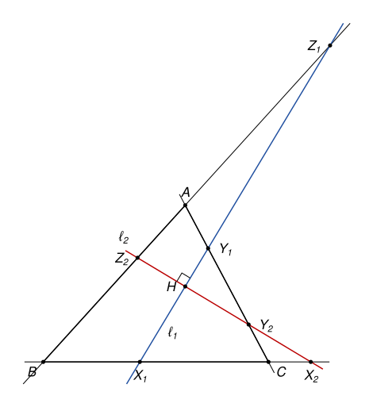
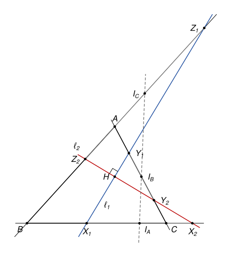

## Statement

Soit $ABC$ un triangle et $H$ son orthocentre. Soient $\ell_1$ et $\ell_2$ deux droites perpendiculaires qui passent par $H$.

On note $X_1$, $Y_1$ et $Z_1$ les points d'intersection de $\ell_1$ avec les droites $(BC)$, $(CA)$ et $(AB)$, et $X_2$, $Y_2$ et $Z_2$ les points d'intersection de $\ell_2$ avec ces mêmes droites.

Montrer que les milieux des segments $[X_1X_2]$, $[Y_1Y_2]$ et $[Z_1Z_2]$ sont alignés.

## Hints

1. Choisissez un repère adapté à la figure : deux droites perpendiculaires qui se coupent en $H$ sont déjà là.
2. Prenez $H$ comme origine et notez $A(a_1, a_2)$, $B(b_1, b_2)$, $C(c_1, c_2)$. Traduisez « $(HA)$ est perpendiculaire à $(BC)$ » et « $(HB)$ est perpendiculaire à $(CA)$ » : vous devez trouver $a_1b_1 + a_2b_2 = b_1c_1 + b_2c_2 = c_1a_1 + c_2a_2$.
3. Appelez $k$ cette valeur commune. Vérifiez que la droite $(BC)$ a pour équation $a_1x + a_2y = k$. Calculez alors les coordonnées de $X_1$, de $X_2$ et du milieu de $[X_1X_2]$.
4. Pour l'alignement, écrivez une équation de la droite qui passe par deux des milieux, et exprimez les coordonnées de $C$ à l'aide de celles de $A$ et de $B$.

## Solution

*Rappels.*

- Dans un repère orthonormé, les vecteurs $\vec u(x, y)$ et $\vec v(x', y')$ sont orthogonaux si et seulement si $xx' + yy' = 0$.
- Si $(\alpha, \beta) \neq (0, 0)$, l'ensemble des points $M(x, y)$ tels que $\alpha x + \beta y = k$ est une droite.

**Le cas d'un triangle rectangle.** Si le triangle est rectangle en $A$, son orthocentre est $H = A$. Les droites $\ell_1$ et $\ell_2$ passent par $A$, donc $Y_1 = Z_1 = Y_2 = Z_2 = A$, et les milieux de $[Y_1Y_2]$ et de $[Z_1Z_2]$ sont tous les deux en $A$. Il n'y a que deux points distincts parmi les trois milieux, ils sont alignés. On suppose désormais que le triangle n'a pas d'angle droit, donc que $H$ n'est pas un sommet.

**Étape 1 : le repère.** Comme $\ell_1$ et $\ell_2$ sont perpendiculaires en $H$, on peut prendre un repère orthonormé d'origine $H$, dont l'axe des abscisses est $\ell_1$ et l'axe des ordonnées est $\ell_2$. On note $A(a_1, a_2)$, $B(b_1, b_2)$ et $C(c_1, c_2)$. Les coordonnées du vecteur $\overrightarrow{HA}$ sont alors $(a_1, a_2)$, et de même pour $B$ et $C$.

**Étape 2 : traduire « $H$ est l'orthocentre ».** La droite $(HA)$ est la hauteur issue de $A$, donc $\overrightarrow{HA}$ est orthogonal à $\overrightarrow{BC}(c_1 - b_1, c_2 - b_2)$ :

$$a_1(c_1 - b_1) + a_2(c_2 - b_2) = 0, \quad \text{c'est-à-dire} \quad a_1b_1 + a_2b_2 = a_1c_1 + a_2c_2.$$

De même, $\overrightarrow{HB}$ est orthogonal à $\overrightarrow{CA}$, ce qui donne $b_1a_1 + b_2a_2 = b_1c_1 + b_2c_2$. Les trois quantités sont donc égales, on note $k$ leur valeur commune :

$$k = a_1b_1 + a_2b_2 = b_1c_1 + b_2c_2 = c_1a_1 + c_2a_2.$$

Le nombre $k$ n'est pas nul. Sinon les vecteurs $\overrightarrow{HA}$, $\overrightarrow{HB}$ et $\overrightarrow{HC}$ seraient deux à deux orthogonaux. Comme $\overrightarrow{HA}$ et $\overrightarrow{HB}$ ne sont pas nuls ($H$ n'est pas un sommet), le vecteur $\overrightarrow{HC}$ serait orthogonal à deux vecteurs non nuls perpendiculaires entre eux, donc nul, et $H$ serait le sommet $C$, ce qui est exclu.

**Étape 3 : les équations des côtés.** Comme $\overrightarrow{HA} \neq \vec 0$, l'équation $a_1x + a_2y = k$ est celle d'une droite. Les points $B$ et $C$ la vérifient, d'après l'étape 2. C'est donc la droite $(BC)$. De la même façon :

$$(BC) : a_1x + a_2y = k, \qquad (CA) : b_1x + b_2y = k, \qquad (AB) : c_1x + c_2y = k.$$

**Étape 4 : les milieux.** Le point $X_1$ est sur l'axe des abscisses, ses coordonnées sont $(x, 0)$ avec $a_1x = k$. Comme ce point existe et que $k \neq 0$, on a $a_1 \neq 0$, et $X_1\left(\frac{k}{a_1}, 0\right)$. De même $X_2\left(0, \frac{k}{a_2}\right)$, avec $a_2 \neq 0$. Le milieu $I_A$ de $[X_1X_2]$ est donc

$$I_A\left(\frac{k}{2a_1}, \frac{k}{2a_2}\right), \quad \text{et de même} \quad I_B\left(\frac{k}{2b_1}, \frac{k}{2b_2}\right), \quad I_C\left(\frac{k}{2c_1}, \frac{k}{2c_2}\right).$$

Tous les nombres $a_1, a_2, b_1, b_2, c_1, c_2$ sont non nuls.

Posons $Q_A\left(\frac{1}{a_1}, \frac{1}{a_2}\right)$, $Q_B\left(\frac{1}{b_1}, \frac{1}{b_2}\right)$ et $Q_C\left(\frac{1}{c_1}, \frac{1}{c_2}\right)$. On a $\overrightarrow{I_AI_B} = \frac{k}{2}\,\overrightarrow{Q_AQ_B}$ et $\overrightarrow{I_AI_C} = \frac{k}{2}\,\overrightarrow{Q_AQ_C}$. Il suffit donc de montrer que $Q_A$, $Q_B$ et $Q_C$ sont alignés.

**Étape 5 : une droite qui passe par $Q_A$ et $Q_B$.** On pose $\delta = a_1b_2 - a_2b_1$ et on considère l'équation

$$(d) : \quad a_1b_1(a_2 - b_2)\,x - a_2b_2(a_1 - b_1)\,y + \delta = 0.$$

- Pour $Q_A$ : $b_1(a_2 - b_2) - b_2(a_1 - b_1) + \delta = a_2b_1 - a_1b_2 + \delta = 0$.
- Pour $Q_B$ : $a_1(a_2 - b_2) - a_2(a_1 - b_1) + \delta = a_2b_1 - a_1b_2 + \delta = 0$.

Les coefficients de $x$ et de $y$ ne sont pas tous les deux nuls : sinon on aurait $a_2 = b_2$ et $a_1 = b_1$, donc $A = B$. Ainsi $(d)$ est une droite, et elle passe par $Q_A$ et $Q_B$.

**Étape 6 : les coordonnées de $C$.** D'après l'étape 2, $(c_1, c_2)$ vérifie

$$a_1c_1 + a_2c_2 = k \quad \text{et} \quad b_1c_1 + b_2c_2 = k.$$

On multiplie la première égalité par $b_2$, la seconde par $a_2$, et on soustrait : $\delta\, c_1 = k(b_2 - a_2)$. De même, en multipliant par $b_1$ et $a_1$ : $\delta\, c_2 = k(a_1 - b_1)$.

Si $\delta$ était nul, on aurait $b_2 = a_2$ et $a_1 = b_1$, donc $A = B$. Donc $\delta \neq 0$. Comme $c_1$ et $c_2$ ne sont pas nuls, on a aussi $b_2 \neq a_2$ et $a_1 \neq b_1$, et

$$\frac{1}{c_1} = \frac{\delta}{k(b_2 - a_2)}, \qquad \frac{1}{c_2} = \frac{\delta}{k(a_1 - b_1)}.$$

**Étape 7 : conclusion.** On remplace les coordonnées de $Q_C$ dans l'équation de $(d)$ :

$$a_1b_1(a_2 - b_2) \times \frac{\delta}{k(b_2 - a_2)} - a_2b_2(a_1 - b_1) \times \frac{\delta}{k(a_1 - b_1)} + \delta = -\frac{\delta}{k}\,(a_1b_1 + a_2b_2) + \delta = -\frac{\delta}{k} \times k + \delta = 0.$$

Le point $Q_C$ est donc sur la droite $(d)$, et les points $Q_A$, $Q_B$, $Q_C$ sont alignés. Par l'étape 4 :

**les milieux de $[X_1X_2]$, $[Y_1Y_2]$ et $[Z_1Z_2]$ sont alignés.**

*Remarques.*

- Ce résultat s'appelle le théorème de Droz-Farny.
- Tout le travail est dans le choix du repère. Avec un repère quelconque, les calculs deviennent très lourds. Ici l'orthocentre donne la relation de l'étape 2, qui rend les équations des côtés très simples.
- Le corrigé officiel donne une preuve sans calcul. Comme l'angle $\widehat{X_1HX_2}$ est droit, le milieu de $[X_1X_2]$ est le centre du cercle circonscrit à $HX_1X_2$. On montre ensuite par une chasse aux angles que les trois cercles $HX_1X_2$, $HY_1Y_2$ et $HZ_1Z_2$ ont un deuxième point commun $P$, situé sur le cercle circonscrit à $ABC$. Les trois centres sont alors sur la médiatrice de $[HP]$.

## Going further

1. On note $\Delta$ la droite qui porte les trois milieux. En utilisant le symétrique de $H$ par rapport à $\Delta$, montrer que les trois cercles de diamètres $[X_1X_2]$, $[Y_1Y_2]$ et $[Z_1Z_2]$ ont un deuxième point commun, autre que $H$, quand $H$ n'est pas sur $\Delta$.
