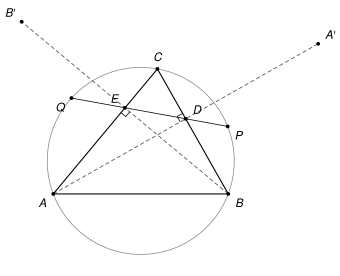
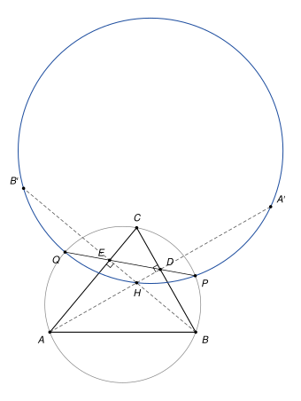

## Statement

Soit $ABC$ un triangle sans angle droit, dont l'angle en $C$ est aigu, et $\Gamma$ son cercle circonscrit. On note $D$ et $E$ les pieds des hauteurs issues de $A$ et de $B$. La droite $(DE)$ coupe le cercle $\Gamma$ en deux points $P$ et $Q$.

Soit $A'$ le symétrique de $A$ par rapport à $(BC)$, et $B'$ le symétrique de $B$ par rapport à $(AC)$.

Montrer que les points $A'$, $B'$, $P$ et $Q$ sont cocycliques.

## Hints

1. Sur une figure soignée, un autre point remarquable du triangle semble être sur le même cercle que $A'$, $B'$, $P$, $Q$. Lequel ?
2. Avec l'orthocentre $H$, montrez que $\overrightarrow{DA'} \cdot \overrightarrow{DH} = \overrightarrow{DB} \cdot \overrightarrow{DC}$. On peut partir de $\overrightarrow{BH} \cdot \overrightarrow{AC} = 0$.
3. La puissance du point $D$ par rapport au cercle $\Gamma$ se calcule avec la droite $(BC)$ ou avec la droite $(PQ)$. Concluez que $A'$ est sur le cercle qui passe par $P$, $Q$ et $H$.

## Solution

*Rappel (puissance d'un point).* Soit $\omega$ un cercle de centre $O$ et de rayon $R$, et $X$ un point. Si une droite passant par $X$ coupe $\omega$ en $U$ et $V$ (avec $U = V$ si elle est tangente), alors

$$\overrightarrow{XU} \cdot \overrightarrow{XV} = XO^2 - R^2.$$

Ce nombre ne dépend donc pas de la droite choisie. *Preuve.* Soit $U^*$ le point diamétralement opposé à $U$. Le point $V$ est le projeté orthogonal de $U^*$ sur la droite $(UV)$ : si $V \neq U$ et $V \neq U^*$, l'angle $\widehat{UVU^*}$ est droit car il intercepte un diamètre ; si $V = U$, la droite est tangente en $U$, donc perpendiculaire à $(UU^*)$. Par la propriété du projeté,

$$\overrightarrow{XU} \cdot \overrightarrow{XV} = \overrightarrow{XU} \cdot \overrightarrow{XU^*} = \left(\overrightarrow{XO} + \overrightarrow{OU}\right) \cdot \left(\overrightarrow{XO} - \overrightarrow{OU}\right) = XO^2 - R^2.$$

*Réciproque utile.* Soit $X$ un point qui n'est pas sur $\omega$. Une droite passant par $X$ coupe $\omega$ en $U$ et $V$. Une autre droite passant par $X$ contient un point $S$ de $\omega$ et un point $T$ tels que $\overrightarrow{XS} \cdot \overrightarrow{XT} = \overrightarrow{XU} \cdot \overrightarrow{XV}$. Alors $T$ est sur $\omega$. *Preuve.* La droite $(XS)$ recoupe $\omega$ en un point $S'$ (avec $S' = S$ si elle est tangente). D'après le rappel, $\overrightarrow{XS} \cdot \overrightarrow{XS'} = \overrightarrow{XU} \cdot \overrightarrow{XV} = \overrightarrow{XS} \cdot \overrightarrow{XT}$, donc $\overrightarrow{XS} \cdot \overrightarrow{TS'} = 0$. Or $\overrightarrow{TS'}$ est colinéaire au vecteur non nul $\overrightarrow{XS}$, puisque $T$ et $S'$ sont sur la droite $(XS)$. Un vecteur colinéaire à $\overrightarrow{XS}$ et orthogonal à lui est nul : $T = S'$, qui est sur $\omega$.

Soit $H$ l'orthocentre du triangle. Il est sur la droite $(AD)$ et sur la droite $(BE)$.

**Étape 1 : le cercle $\omega$ qui passe par $P$, $Q$, $H$.** Comme le triangle n'a pas d'angle droit, $H$ n'est pas sur $(BC)$, donc $H \neq D$. De même, $E$ n'est pas sur la droite $(AD)$, car sinon $E$ serait le point $A$, commun à $(AD)$ et $(AC)$, et l'angle en $A$ serait droit. Les droites $(DE)$ et $(AD)$ ne se coupent donc qu'en $D$, et $H$, qui est sur $(AD)$ sans être $D$, n'est pas sur $(DE)$. Les points $P$, $Q$, $H$ ne sont pas alignés : ils définissent un cercle $\omega$.

Le point $D$ n'est pas sur $\omega$ : $\omega$ ne coupe la droite $(PQ)$ qu'en $P$ et $Q$, et $D$ n'est ni $P$ ni $Q$, car un point de $(BC)$ situé sur $\Gamma$ est $B$ ou $C$, ce qui ferait un angle droit en $B$ ou en $C$. Pour la même raison, $E$ n'est pas sur $\omega$.

**Étape 2 : un calcul au point $D$.** Les droites $(BH)$ et $(AC)$ sont perpendiculaires, donc $\overrightarrow{BH} \cdot \overrightarrow{AC} = 0$. Décomposons avec le point $D$ :

$$\left(\overrightarrow{BD} + \overrightarrow{DH}\right) \cdot \left(\overrightarrow{AD} + \overrightarrow{DC}\right) = 0.$$

Les vecteurs $\overrightarrow{BD}$ et $\overrightarrow{DC}$ sont dirigés selon $(BC)$, les vecteurs $\overrightarrow{AD}$ et $\overrightarrow{DH}$ selon la hauteur $(AD)$, qui est perpendiculaire à $(BC)$. Les produits $\overrightarrow{BD} \cdot \overrightarrow{AD}$ et $\overrightarrow{DH} \cdot \overrightarrow{DC}$ sont donc nuls, et il reste

$$\overrightarrow{BD} \cdot \overrightarrow{DC} + \overrightarrow{DH} \cdot \overrightarrow{AD} = 0, \qquad \text{c'est-à-dire} \qquad \overrightarrow{DA} \cdot \overrightarrow{DH} = -\,\overrightarrow{DB} \cdot \overrightarrow{DC}.$$

**Étape 3 : le point $A'$ est sur $\omega$.** Le point $D$ est le milieu de $[AA']$, donc $\overrightarrow{DA'} = -\overrightarrow{DA}$, et l'étape 2 donne

$$\overrightarrow{DH} \cdot \overrightarrow{DA'} = \overrightarrow{DB} \cdot \overrightarrow{DC}.$$

D'après le rappel appliqué au cercle $\Gamma$, avec la droite $(BC)$ puis avec la droite $(PQ)$, qui passent toutes les deux par $D$ :

$$\overrightarrow{DB} \cdot \overrightarrow{DC} = \overrightarrow{DP} \cdot \overrightarrow{DQ}.$$

Ainsi $\overrightarrow{DH} \cdot \overrightarrow{DA'} = \overrightarrow{DP} \cdot \overrightarrow{DQ}$. Appliquons la réciproque au cercle $\omega$, avec $X = D$, la droite $(PQ)$, et la droite $(DH)$ qui contient $S = H$, point de $\omega$, et $T = A'$. On obtient : **$A'$ est sur $\omega$.**

**Étape 4 : le point $B'$ est sur $\omega$.** On fait le même calcul au point $E$, en partant de $\overrightarrow{AH} \cdot \overrightarrow{BC} = 0$ :

$$\left(\overrightarrow{AE} + \overrightarrow{EH}\right) \cdot \left(\overrightarrow{BE} + \overrightarrow{EC}\right) = 0, \qquad \text{donc} \qquad \overrightarrow{EB} \cdot \overrightarrow{EH} = -\,\overrightarrow{EA} \cdot \overrightarrow{EC}.$$

Comme $E$ est le milieu de $[BB']$, il vient $\overrightarrow{EH} \cdot \overrightarrow{EB'} = \overrightarrow{EA} \cdot \overrightarrow{EC} = \overrightarrow{EP} \cdot \overrightarrow{EQ}$, et la réciproque montre que **$B'$ est sur $\omega$.**

**Conclusion.** Les points $A'$, $B'$, $P$ et $Q$ sont tous sur le cercle $\omega$, qui passe aussi par l'orthocentre $H$. **Ils sont donc cocycliques.**

*Remarques.*

- Le produit scalaire permet de ne jamais regarder la figure : le calcul reste vrai que $D$ soit entre $B$ et $C$ ou non, et que $H$ soit à l'intérieur du triangle ou non. Le corrigé de la source fait le même raisonnement avec des longueurs, en passant par le symétrique de $H$ par rapport à $(BC)$, qui est sur $\Gamma$.
- Pourquoi l'angle en $C$ doit être aigu : on peut montrer que $(DE)$ est perpendiculaire à $(OC)$, où $O$ est le centre de $\Gamma$. Quand l'angle en $C$ est obtus, $D$ et $E$ sont au-delà de $C$ sur les droites $(BC)$ et $(AC)$, et la droite $(DE)$ passe à l'extérieur du cercle : les points $P$ et $Q$ n'existent pas.
