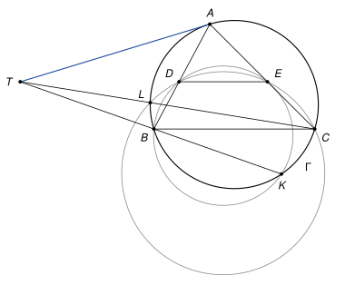
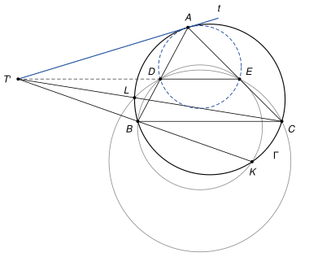

## Statement

Soit $ABC$ un triangle avec $AB \neq AC$, et $\Gamma$ son cercle circonscrit. Soit $D$ un point de la droite $(AB)$, distinct de $A$ et de $B$, et $E$ le point de la droite $(AC)$ tel que les droites $(DE)$ et $(BC)$ sont parallèles.

Le cercle $\Gamma$ recoupe le cercle circonscrit au triangle $BDE$ en un point $K$, et le cercle circonscrit au triangle $CDE$ en un point $L$. Les droites $(BK)$ et $(CL)$ se coupent en un point $T$.

Montrer que la droite $(TA)$ est tangente au cercle $\Gamma$.

## Hints

1. Faites une figure soignée : que remarquez-vous sur les points $T$, $D$ et $E$ ?
2. Plutôt que de partir de $T$, partez de la tangente à $\Gamma$ en $A$. Elle coupe la droite $(DE)$ en un point $T'$. Il suffit de montrer que $T'$ est sur $(BK)$ et sur $(CL)$.
3. Le cercle circonscrit au triangle $ADE$ est tangent à $\Gamma$ en $A$. Pour le voir, cherchez son centre sur la droite $(AO)$, où $O$ est le centre de $\Gamma$.
4. Calculez la puissance de $T'$ par rapport à $\Gamma$, au cercle $ADE$ et au cercle $BDE$. Que se passe-t-il pour la droite $(T'B)$ ?

## Solution

*Rappel (puissance d'un point).* Soit $\omega$ un cercle de centre $\Omega$ et de rayon $r$, et $M$ un point. Si une droite passant par $M$ coupe $\omega$ en $X$ et $Y$ (avec $X = Y$ si elle est tangente en $X$), alors

$$\overrightarrow{MX} \cdot \overrightarrow{MY} = M\Omega^2 - r^2.$$

Ce nombre ne dépend donc pas de la droite choisie : on l'appelle la puissance de $M$ par rapport à $\omega$. *Preuve.* Soit $X^*$ le point diamétralement opposé à $X$. Le point $Y$ est le projeté orthogonal de $X^*$ sur la droite $(MX)$ : si $Y \neq X$ et $Y \neq X^*$, l'angle $\widehat{XYX^*}$ est droit car il intercepte un diamètre ; si $Y = X$, la droite est tangente en $X$, donc perpendiculaire à $(XX^*)$. Par la propriété du projeté,

$$\overrightarrow{MX} \cdot \overrightarrow{MY} = \overrightarrow{MX} \cdot \overrightarrow{MX^*} = \left(\overrightarrow{M\Omega} + \overrightarrow{\Omega X}\right) \cdot \left(\overrightarrow{M\Omega} - \overrightarrow{\Omega X}\right) = M\Omega^2 - r^2.$$

Soit $O$ le centre de $\Gamma$ et $R$ son rayon, et soit $t$ la tangente à $\Gamma$ en $A$. On ne part pas de $T$ : on construit un point $T'$ sur $t$, puis on montre que $T' = T$.

**Étape 1 : le cercle $ADE$ est tangent à $\Gamma$ en $A$.** Comme $D$ est sur $(AB)$, il existe un réel $k$ tel que $\overrightarrow{AD} = k\,\overrightarrow{AB}$, avec $k \neq 0$ et $k \neq 1$ car $D \neq A$ et $D \neq B$. Comme $(DE) \parallel (BC)$, le théorème de Thalès donne aussi $\overrightarrow{AE} = k\,\overrightarrow{AC}$.

Soit $O'$ le point défini par $\overrightarrow{AO'} = k\,\overrightarrow{AO}$. Alors

$$\overrightarrow{O'D} = \overrightarrow{AD} - \overrightarrow{AO'} = k\left(\overrightarrow{AB} - \overrightarrow{AO}\right) = k\,\overrightarrow{OB},$$

donc $O'D = |k|\,OB = |k|\,R$. De même $O'E = |k|\,OC = |k|\,R$ et $O'A = |k|\,OA = |k|\,R$. Le point $O'$ est donc le centre du cercle circonscrit au triangle $ADE$, que l'on note $\omega$, et son rayon est $|k|\,R$.

Le point $O'$ est sur la droite $(AO)$. La tangente à $\omega$ en $A$ est perpendiculaire à $(AO')$, c'est-à-dire à $(AO)$ : c'est donc la même droite $t$. **La droite $t$ est tangente en $A$ à la fois à $\Gamma$ et à $\omega$.**

**Étape 2 : le point $T'$.** La droite $t$ n'est pas parallèle à $(BC)$. Sinon, la droite $(OA)$, perpendiculaire à $t$, serait perpendiculaire à $(BC)$. Elle serait alors la perpendiculaire à $(BC)$ passant par le centre $O$, c'est-à-dire la médiatrice de $[BC]$, et l'on aurait $AB = AC$.

Comme $(DE) \parallel (BC)$, la droite $t$ coupe donc $(DE)$ en un point $T'$. Le point $A$ n'est pas sur $(DE)$ (sinon $(DE)$ serait la droite $(AD) = (AB)$, qui n'est pas parallèle à $(BC)$), donc $T' \neq A$. Comme la tangente $t$ n'a que le point $A$ en commun avec $\Gamma$, le point $T'$ n'est pas sur $\Gamma$. En particulier $T' \neq B$ et $T' \neq C$.

**Étape 3 : $T'$ a la même puissance par rapport à trois cercles.** Notons $p = T'A^2$, un nombre strictement positif.

- La droite $t$ passe par $T'$ et est tangente à $\Gamma$ en $A$ : la puissance de $T'$ par rapport à $\Gamma$ vaut $T'A^2 = p$.
- La même droite est tangente à $\omega$ en $A$ : la puissance de $T'$ par rapport à $\omega$ vaut aussi $p$. La droite $(DE)$, qui passe par $T'$, coupe $\omega$ en $D$ et $E$, donc $\overrightarrow{T'D} \cdot \overrightarrow{T'E} = p$.
- Soit $\omega_B$ le cercle circonscrit au triangle $BDE$. La droite $(DE)$ le coupe en $D$ et $E$, donc la puissance de $T'$ par rapport à $\omega_B$ vaut $\overrightarrow{T'D} \cdot \overrightarrow{T'E} = p$.

Le même calcul avec le cercle $\omega_C$ circonscrit au triangle $CDE$ montre que la puissance de $T'$ par rapport à $\omega_C$ vaut aussi $p$.

**Étape 4 : $T'$ est sur la droite $(BK)$.** La droite $(T'B)$ recoupe $\Gamma$ en un point $K_1$, et recoupe $\omega_B$ en un point $K_2$ (avec $K_1 = B$ ou $K_2 = B$ si elle est tangente). D'après l'étape 3,

$$\overrightarrow{T'B} \cdot \overrightarrow{T'K_1} = p = \overrightarrow{T'B} \cdot \overrightarrow{T'K_2}, \quad \text{donc} \quad \overrightarrow{T'B} \cdot \overrightarrow{K_2K_1} = 0.$$

Le vecteur $\overrightarrow{K_2K_1}$ est colinéaire au vecteur non nul $\overrightarrow{T'B}$, puisque $K_1$ et $K_2$ sont sur la droite $(T'B)$. Un vecteur colinéaire à $\overrightarrow{T'B}$ et orthogonal à lui est nul, donc $K_1 = K_2$. Ce point est à la fois sur $\Gamma$ et sur $\omega_B$.

Ce point n'est pas $B$. Sinon, la droite $(T'B)$ ne rencontrerait chacun des deux cercles qu'en $B$ : elle serait tangente en $B$ à $\Gamma$ et à $\omega_B$. Or ces deux cercles sont distincts ($D$ est sur $\omega_B$ mais pas sur $\Gamma$, car la droite $(AB)$ ne coupe $\Gamma$ qu'en $A$ et $B$), et deux cercles distincts tangents à une même droite en $B$ n'ont aucun autre point commun. En effet, leurs centres sont tous deux sur la perpendiculaire $n$ à cette droite en $B$ ; un second point commun $Z$ mettrait les deux centres sur la médiatrice de $[BZ]$, qui ne passe pas par $B$, donc est différente de $n$ et la coupe en au plus un point ; les deux cercles auraient le même centre et passeraient par $B$, ils seraient égaux. Cela contredit l'énoncé, qui dit que $\Gamma$ et $\omega_B$ se recoupent en $K$.

Le point $K_1 = K_2$ est donc un point commun à $\Gamma$ et $\omega_B$ autre que $B$ : c'est $K$. Ainsi $K$ est sur la droite $(T'B)$, autrement dit **$T'$ est sur la droite $(BK)$**.

**Étape 5 : conclusion.** Le même raisonnement, avec $C$, $\omega_C$ et $L$ à la place de $B$, $\omega_B$ et $K$, montre que $T'$ est sur la droite $(CL)$.

Les droites $(BK)$ et $(CL)$ sont distinctes. Sinon, cette droite unique contiendrait $B$ et $C$, ce serait $(BC)$, et $K$, point de $\Gamma$ sur $(BC)$ différent de $B$, serait $C$. Le point $C$ serait alors sur $\omega_B$, et le rappel appliqué au point $A$ et au cercle $\omega_B$, avec les droites $(AB)$ et $(AC)$, donnerait $\overrightarrow{AD} \cdot \overrightarrow{AB} = \overrightarrow{AE} \cdot \overrightarrow{AC}$, c'est-à-dire $k\,AB^2 = k\,AC^2$, donc $AB = AC$, ce qui est exclu.

Deux droites distinctes ont au plus un point commun. Le point $T'$ est sur les deux, donc $T' = T$. Comme $T'$ est sur $t$ et différent de $A$, la droite $(TA)$ est la droite $t$ :

**la droite $(TA)$ est tangente au cercle $\Gamma$ en $A$.**

*Remarques.*

- La preuve montre au passage que $T$ est sur la droite $(DE)$. Les correcteurs notent que tous les élèves qui ont abordé l'exercice ont vu cet alignement sur leur figure : c'est la première idée.
- Le corrigé officiel part de $T$ et utilise le théorème des axes radicaux : les trois droites $(BK)$, $(CL)$ et $(DE)$ sont les « axes radicaux » des trois cercles $\Gamma$, $\omega_B$, $\omega_C$ pris deux à deux, et de tels axes sont toujours concourants. La preuve ci-dessus évite ce théorème en partant de la tangente.
- L'hypothèse $AB \neq AC$, absente de l'énoncé original, est indispensable. Si $AB = AC$, la figure est symétrique par rapport à la médiatrice de $[BC]$, le cercle $BDE$ passe par $C$, donc $K = C$ et $L = B$, et les droites $(BK)$ et $(CL)$ sont toutes deux la droite $(BC)$ : le point $T$ n'existe pas. On retrouve que la tangente en $A$ est alors parallèle à $(BC)$.
