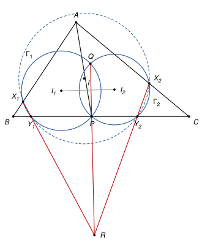

## Statement

Soit $ABC$ un triangle et $P$ un point du côté $[BC]$, autre que $B$ et $C$, tel que $AP \neq AB$ et $AP \neq AC$. On note $I_1$ et $I_2$ les centres des cercles inscrits dans les triangles $APB$ et $APC$.

Soit $\Gamma_1$ le cercle de centre $I_1$ qui passe par $P$, et $\Gamma_2$ le cercle de centre $I_2$ qui passe par $P$. Ces deux cercles se recoupent en un second point $Q$.

On note $X_1$ et $Y_1$ les points d'intersection de $\Gamma_1$ avec les droites $(AB)$ et $(BC)$ qui sont les plus proches de $B$, et $X_2$ et $Y_2$ les points d'intersection de $\Gamma_2$ avec les droites $(AC)$ et $(BC)$ qui sont les plus proches de $C$.

Montrer que les droites $(X_1Y_1)$, $(X_2Y_2)$ et $(PQ)$ sont concourantes.

![Le triangle ABC, le segment [AP], les cercles Γ1 et Γ2 de centres I1 et I2 passant par P, et les points X1, Y1, X2, Y2 et Q](10280-figure-1.svg)

## Hints

1. La symétrie d'axe $(AI_1)$ conserve le cercle $\Gamma_1$ et échange les droites $(AP)$ et $(AB)$. Où envoie-t-elle le point $P$ ? Déduisez-en que $AX_1 = AP$.
2. De même, la symétrie d'axe $(BI_1)$ envoie $X_1$ sur $Y_1$. Faites la même chose dans le triangle $APC$.
3. Soit $I$ le centre du cercle inscrit dans $ABC$. Montrez que $IX_1 = IY_1 = IX_2 = IY_2$.
4. Si une droite passant par $M$ coupe un cercle de centre $\Omega$ et de rayon $\rho$ en $U$ et $V$, alors $\overrightarrow{MU} \cdot \overrightarrow{MV} = M\Omega^2 - \rho^2$. Appliquez cela au point d'intersection de $(X_1Y_1)$ et $(X_2Y_2)$, pour trois cercles.

## Solution

*Rappels.*

- *Symétrie et cercle.* Une symétrie axiale dont l'axe passe par le centre d'un cercle envoie ce cercle sur lui-même. Le centre du cercle inscrit d'un triangle est sur les trois bissectrices, et la symétrie par rapport à la bissectrice d'un angle échange les deux côtés de cet angle.
- *Lemme de la puissance.* Soit un cercle de centre $\Omega$ et de rayon $\rho$, et une droite passant par un point $M$ qui coupe le cercle en $U$ et $V$. Alors
$$\overrightarrow{MU} \cdot \overrightarrow{MV} = M\Omega^2 - \rho^2.$$
En effet, soit $K$ le milieu de $[UV]$, qui est le projeté de $\Omega$ sur la droite. Alors $\overrightarrow{MU} = \overrightarrow{MK} + \overrightarrow{KU}$ et $\overrightarrow{MV} = \overrightarrow{MK} - \overrightarrow{KU}$, donc $\overrightarrow{MU} \cdot \overrightarrow{MV} = MK^2 - KU^2$. Par Pythagore, $MK^2 = M\Omega^2 - \Omega K^2$ et $KU^2 = \rho^2 - \Omega K^2$, d'où le résultat.
- *Une ligne de niveau.* Pour deux points distincts $I_1$, $I_2$ et un réel $c$, l'ensemble des points $M$ tels que $MI_1^2 - MI_2^2 = c$ est une droite perpendiculaire à $(I_1I_2)$. En effet, si $K$ est le milieu de $[I_1I_2]$, alors $MI_1^2 - MI_2^2 = (\overrightarrow{MI_1} - \overrightarrow{MI_2}) \cdot (\overrightarrow{MI_1} + \overrightarrow{MI_2}) = 2\,\overrightarrow{I_2I_1} \cdot \overrightarrow{MK}$.

On note $s_A$ la symétrie d'axe $(AI_1)$ et $s_B$ la symétrie d'axe $(BI_1)$. Comme $I_1$ est le centre de $\Gamma_1$, ces deux symétries envoient $\Gamma_1$ sur lui-même. La droite $(AI_1)$ est la bissectrice de l'angle $\widehat{PAB}$, donc $s_A$ échange les demi-droites $[AP)$ et $[AB)$. La droite $(BI_1)$ est la bissectrice de l'angle $\widehat{ABP}$, qui est aussi l'angle $\widehat{ABC}$, donc $s_B$ échange les demi-droites $[BA)$ et $[BC)$.

**Étape 1 : $AX_1 = AP$ et $BX_1 = BY_1$.** Le point $s_A(P)$ est sur $\Gamma_1$, sur la demi-droite $[AB)$, à la distance $AP$ de $A$. Le point $s_B(P)$ est sur $\Gamma_1$, sur la demi-droite $[BA)$, à la distance $BP$ de $B$. Ces deux points de la droite $(AB)$ sont distincts : sinon ce point serait sur le segment $[AB]$ avec $AP + PB = AB$, ce qui est impossible car $P$ n'est pas sur $(AB)$. Ce sont donc les deux points d'intersection de $\Gamma_1$ avec $(AB)$.

Leurs distances à $B$ sont $|AB - AP|$ pour le premier, et $BP$ pour le second. D'après l'inégalité triangulaire dans le triangle $ABP$, $|AB - AP| < BP$. Le plus proche de $B$ est donc $s_A(P)$ : c'est $X_1$, et $AX_1 = AP$.

La symétrie $s_B$ envoie la droite $(AB)$ sur la droite $(BC)$ et $\Gamma_1$ sur lui-même. Elle envoie donc les deux points d'intersection $X_1$ et $s_B(P)$ de $\Gamma_1$ avec $(AB)$ sur les deux points d'intersection de $\Gamma_1$ avec $(BC)$. Le second va sur $P$, donc $s_B(X_1)$ est l'autre point, à la distance $BX_1 < BP$ de $B$ : c'est $Y_1$. Donc $Y_1 = s_B(X_1)$ et $BX_1 = BY_1$.

Comme $AP \neq AB$, on a $X_1 \neq B$, donc $X_1 \neq Y_1$.

**Étape 2 : dans le triangle $APC$.** Le même raisonnement, avec les bissectrices $(AI_2)$ et $(CI_2)$, donne $AX_2 = AP$, puis $Y_2$ symétrique de $X_2$ par rapport à $(CI_2)$, et $CX_2 = CY_2$, avec $X_2 \neq Y_2$.

**Étape 3 : les points $X_1$, $Y_1$, $X_2$, $Y_2$ sont sur un cercle de centre $I$.** Soit $I$ le centre du cercle inscrit dans $ABC$.

- $Y_1$ est le symétrique de $X_1$ par rapport à la bissectrice $(BI_1)$, qui est la bissectrice de l'angle $\widehat{ABC}$. Le point $I$ est sur cette droite, donc $IX_1 = IY_1$.
- De même, $Y_2$ est le symétrique de $X_2$ par rapport à la bissectrice de l'angle $\widehat{ACB}$, qui passe par $I$, donc $IX_2 = IY_2$.
- $X_1$ est sur $[AB)$ et $X_2$ sur $[AC)$, avec $AX_1 = AP = AX_2$. Ils sont donc symétriques par rapport à la bissectrice de l'angle $\widehat{BAC}$, qui passe par $I$, et $IX_1 = IX_2$.

Finalement $IX_1 = IY_1 = IX_2 = IY_2$. On note $\rho$ cette longueur, et $\omega$ le cercle de centre $I$ et de rayon $\rho$.

**Étape 4 : les droites $(X_1Y_1)$ et $(X_2Y_2)$ se coupent.** La droite $(X_1Y_1)$ est perpendiculaire à l'axe de symétrie $(BI)$, et $(X_2Y_2)$ est perpendiculaire à $(CI)$. Les droites $(BI)$ et $(CI)$ ne sont pas parallèles, puisqu'elles se coupent en $I$. Donc $(X_1Y_1)$ et $(X_2Y_2)$ ne sont pas parallèles, et elles se coupent en un point $R$.

**Étape 5 : le point $R$ est sur $(PQ)$.** Appliquons le lemme de la puissance au point $R$ et à la droite $(X_1Y_1)$, qui coupe à la fois $\Gamma_1$ et $\omega$ en $X_1$ et $Y_1$ :
$$RI_1^2 - r_1^2 = \overrightarrow{RX_1} \cdot \overrightarrow{RY_1} = RI^2 - \rho^2,$$
où $r_1$ est le rayon de $\Gamma_1$. De même, avec la droite $(X_2Y_2)$, qui coupe $\Gamma_2$ et $\omega$ en $X_2$ et $Y_2$ :
$$RI_2^2 - r_2^2 = \overrightarrow{RX_2} \cdot \overrightarrow{RY_2} = RI^2 - \rho^2.$$
Donc $RI_1^2 - r_1^2 = RI_2^2 - r_2^2$, c'est-à-dire $RI_1^2 - RI_2^2 = r_1^2 - r_2^2$.

Les points $I_1$ et $I_2$ sont distincts, puisque $\Gamma_1$ et $\Gamma_2$ se coupent en deux points. D'après le troisième rappel, l'ensemble $\mathcal{D}$ des points $M$ tels que $MI_1^2 - MI_2^2 = r_1^2 - r_2^2$ est une droite. Le point $P$ est dans $\mathcal{D}$, car $PI_1 = r_1$ et $PI_2 = r_2$. Le point $Q$ aussi, pour la même raison. Comme $P \neq Q$, la droite $\mathcal{D}$ est la droite $(PQ)$. Et $R$ est dans $\mathcal{D}$.

**Conclusion.** Le point $R$, commun à $(X_1Y_1)$ et $(X_2Y_2)$, est aussi sur $(PQ)$ : les trois droites sont concourantes.

*Remarques.*

- Les cercles $\Gamma_1$ et $\Gamma_2$ se coupent bien en deux points : les bissectrices $(PI_1)$ et $(PI_2)$ des deux angles supplémentaires $\widehat{APB}$ et $\widehat{APC}$ sont perpendiculaires, donc $P$ n'est pas sur la droite $(I_1I_2)$, et $Q$ est le symétrique de $P$ par rapport à $(I_1I_2)$.
- La quantité $M\Omega^2 - \rho^2$ s'appelle la *puissance* du point $M$ par rapport au cercle, et la droite $\mathcal{D}$ de l'étape 5 s'appelle l'*axe radical* des deux cercles. C'est le langage du corrigé officiel.
