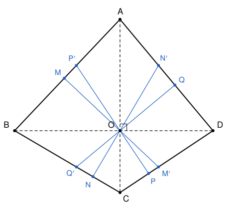

## Statement

Les diagonales du quadrilatère convexe $ABCD$ sont perpendiculaires et se coupent en $O$.

- La perpendiculaire à $(AB)$ passant par $O$ coupe $(AB)$ en $M$ et $(CD)$ en $M'$.
- La perpendiculaire à $(BC)$ passant par $O$ coupe $(BC)$ en $N$ et $(DA)$ en $N'$.
- La perpendiculaire à $(CD)$ passant par $O$ coupe $(CD)$ en $P$ et $(AB)$ en $P'$.
- La perpendiculaire à $(DA)$ passant par $O$ coupe $(DA)$ en $Q$ et $(BC)$ en $Q'$.

Prouver que les huit points $M$, $N$, $P$, $Q$, $M'$, $N'$, $P'$, $Q'$ sont sur un même cercle.

## Hints

1. Prends un repère orthonormé d'origine $O$ dont les axes portent les diagonales : $A(0, a)$, $B(-b, 0)$, $C(0, -c)$, $D(d, 0)$.
2. Un vecteur normal à $(AB)$ est $(a, -b)$. Les points de la perpendiculaire à $(AB)$ passant par $O$ s'écrivent donc $t\,(a, -b)$. Pour quelles valeurs de $t$ obtient-on $M$ et $M'$ ?
3. Cherche un cercle d'équation $x^2 + y^2 + ux + vy - k = 0$. En remplaçant $(x, y)$ par $t\,(a, -b)$, on obtient une équation du second degré en $t$. Que doivent valoir la somme et le produit de ses deux racines pour que $M$ et $M'$ soient sur le cercle ?
4. Les quatre conditions sur le produit donnent toutes la même valeur de $k$. Il reste quatre conditions sur la somme, qui sont des équations du premier degré en $u$ et $v$.

## Solution

**Le repère.** On prend un repère orthonormé d'origine $O$, dont l'axe des abscisses porte $(BD)$ et l'axe des ordonnées porte $(AC)$. Comme $O$ est entre $A$ et $C$ et entre $B$ et $D$ (le quadrilatère est convexe), on peut écrire

$$A(0, a), \qquad B(-b, 0), \qquad C(0, -c), \qquad D(d, 0),$$

avec $a$, $b$, $c$, $d$ strictement positifs. On pose $S = ac + bd > 0$.

**Les équations des côtés.** On vérifie à chaque fois que les deux sommets satisfont l'équation :

$$(AB) : ax - by + ab = 0, \qquad (BC) : cx + by + bc = 0,$$
$$(CD) : cx - dy - cd = 0, \qquad (DA) : ax + dy - ad = 0.$$

Par exemple pour $(AB)$ : en $A$, $0 - ab + ab = 0$, et en $B$, $-ab - 0 + ab = 0$.

**Les quatre perpendiculaires.** Le vecteur $(a, -b)$ est normal à $(AB)$, donc la perpendiculaire à $(AB)$ passant par $O$ est formée des points $t\,(a, -b)$, pour $t$ réel. Le point $t\,(a, -b)$ est sur $(AB)$ quand $a \cdot ta - b \cdot (-tb) + ab = 0$, c'est-à-dire $t = -ab/(a^2 + b^2)$ : c'est $M$. Il est sur $(CD)$ quand $c \cdot ta - d \cdot (-tb) - cd = 0$, c'est-à-dire $t = cd/S$ : c'est $M'$.

On fait le même calcul pour les trois autres perpendiculaires. Voici les résultats, où $w$ est le vecteur directeur choisi pour chaque perpendiculaire (un vecteur normal au côté), et où chaque point vaut $t\,w$ :

| perpendiculaire à | $w$ | $\lvert w \rvert^2$ | premier point | second point |
|---|---|---|---|---|
| $(AB)$ | $(a, -b)$ | $a^2 + b^2$ | $M$ : $t = -ab/(a^2+b^2)$ | $M'$ : $t = cd/S$ |
| $(BC)$ | $(c, b)$ | $b^2 + c^2$ | $N$ : $t = -bc/(b^2+c^2)$ | $N'$ : $t = ad/S$ |
| $(CD)$ | $(c, -d)$ | $c^2 + d^2$ | $P$ : $t = cd/(c^2+d^2)$ | $P'$ : $t = -ab/S$ |
| $(DA)$ | $(a, d)$ | $a^2 + d^2$ | $Q$ : $t = ad/(a^2+d^2)$ | $Q'$ : $t = -bc/S$ |

**Un outil : deux points d'une droite sur un cercle.** Prenons une équation $x^2 + y^2 + ux + vy - k = 0$, et une droite formée des points $t\,w$ avec $w = (w_1, w_2)$. Le point $t\,w$ vérifie l'équation quand

$$\lvert w \rvert^2\, t^2 + (u w_1 + v w_2)\, t - k = 0. \qquad (E)$$

Soient $t_1$ et $t_2$ deux nombres. Le trinôme $\lvert w \rvert^2 (t - t_1)(t - t_2)$ se développe en $\lvert w \rvert^2 t^2 - \lvert w \rvert^2 (t_1 + t_2)\, t + \lvert w \rvert^2 t_1 t_2$. Il coïncide avec le membre de gauche de $(E)$, et alors $t_1$ et $t_2$ sont solutions de $(E)$, dès que

$$t_1 t_2 = -\frac{k}{\lvert w \rvert^2} \qquad \text{et} \qquad u w_1 + v w_2 = -\lvert w \rvert^2 (t_1 + t_2).$$

**Le choix de $k$.** Pour chacune des quatre lignes du tableau, le produit des deux valeurs de $t$ vaut $-abcd/(S\,\lvert w \rvert^2)$. Par exemple, pour la première ligne,

$$-\frac{ab}{a^2+b^2} \times \frac{cd}{S} = -\frac{abcd}{S(a^2+b^2)}.$$

On prend donc

$$k = \frac{abcd}{S},$$

et la condition sur le produit est remplie pour les quatre perpendiculaires à la fois.

**Le choix de $u$ et $v$.** La condition sur la somme donne, pour les quatre lignes du tableau :

$$\begin{aligned}
(1)\quad & ua - vb = ab - \frac{cd(a^2 + b^2)}{S}, \\
(2)\quad & uc + vb = bc - \frac{ad(b^2 + c^2)}{S}, \\
(3)\quad & uc - vd = \frac{ab(c^2 + d^2)}{S} - cd, \\
(4)\quad & ua + vd = \frac{bc(a^2 + d^2)}{S} - ad.
\end{aligned}$$

En résolvant le système formé par $(1)$ et $(2)$, on trouve

$$u = \frac{ac(b - d)}{S}, \qquad v = \frac{bd(c - a)}{S}.$$

Vérifions que ces valeurs satisfont les quatre égalités. On multiplie chaque égalité par $S$ et on développe les deux membres :

- $(1)$ : à gauche $a^2 c(b - d) - b^2 d(c - a) = a^2 bc + ab^2 d - a^2 cd - b^2 cd$, et à droite $ab(ac + bd) - cd(a^2 + b^2)$, qui donne la même chose.
- $(2)$ : à gauche $ac^2(b - d) + b^2 d(c - a) = abc^2 + b^2 cd - ab^2 d - ac^2 d$, et à droite $bc(ac + bd) - ad(b^2 + c^2)$, qui donne la même chose.
- $(3)$ : à gauche $ac^2(b - d) - bd^2(c - a) = abc^2 + abd^2 - ac^2 d - bcd^2$, et à droite $ab(c^2 + d^2) - cd(ac + bd)$, qui donne la même chose.
- $(4)$ : à gauche $a^2 c(b - d) + bd^2(c - a) = a^2 bc + bcd^2 - a^2 cd - abd^2$, et à droite $bc(a^2 + d^2) - ad(ac + bd)$, qui donne la même chose.

**C'est bien un cercle.** L'équation $x^2 + y^2 + ux + vy - k = 0$ s'écrit aussi

$$\left(x + \frac{u}{2}\right)^2 + \left(y + \frac{v}{2}\right)^2 = k + \frac{u^2 + v^2}{4}.$$

Comme $k > 0$, le membre de droite est strictement positif : c'est l'équation d'un cercle $\Gamma$.

**Conclusion.** Avec ces valeurs de $k$, $u$ et $v$, les deux conditions de l'outil sont remplies sur chacune des quatre perpendiculaires. Donc $M$ et $M'$, $N$ et $N'$, $P$ et $P'$, $Q$ et $Q'$ sont tous sur le cercle $\Gamma$ : **les huit points sont cocycliques.**

## Going further

Le corrigé original évite les calculs. Les quadrilatères $BMON$, $CNOP$, $DPOQ$ et $AQOM$ ont chacun deux angles droits opposés, donc ils sont inscrits dans des cercles de diamètres $[OB]$, $[OC]$, $[OD]$ et $[OA]$. Une chasse aux angles dans ces cercles montre d'abord que $MNPQ$ est inscriptible, puis que $M'$, $N'$, $P'$ et $Q'$ sont sur le même cercle.
