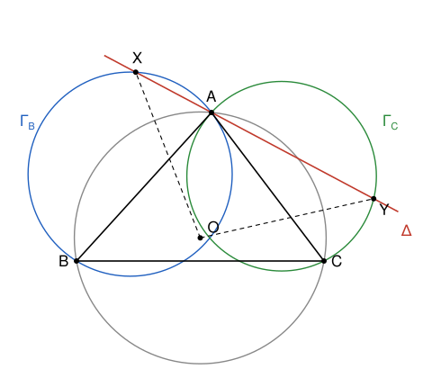
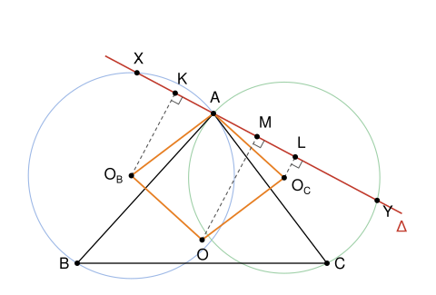

## Statement

Soit $ABC$ un triangle dont les trois angles sont aigus, et $O$ le centre de son cercle circonscrit.

On considère le cercle $\Gamma_B$ qui passe par $A$ et $B$ et qui est tangent à la droite $(AC)$, et le cercle $\Gamma_C$ qui passe par $A$ et $C$ et qui est tangent à la droite $(AB)$.

Une droite $\Delta$ passant par $A$ recoupe $\Gamma_B$ en $X$ et $\Gamma_C$ en $Y$.

Montrer que $OX = OY$.

## Hints

1. En quel point $\Gamma_B$ est-il tangent à $(AC)$ ? Appelle $O_B$ et $O_C$ les centres de $\Gamma_B$ et $\Gamma_C$. Sur quelles droites se trouve $O_B$ ? Et $O_C$ ? Et $O$ ?
2. Montre que $AO_BOO_C$ est un parallélogramme, autrement dit que $\overrightarrow{AO} = \overrightarrow{AO_B} + \overrightarrow{AO_C}$.
3. Le projeté orthogonal du centre d'un cercle sur une corde est le milieu de cette corde. Projette $O_B$, $O_C$ et $O$ sur la droite $\Delta$.
4. Si $\vec{u}$ est un vecteur de norme $1$ qui dirige $\Delta$, le projeté $P'$ d'un point $P$ sur $\Delta$ vérifie $\overrightarrow{AP'} = \left(\vec{u} \cdot \overrightarrow{AP}\right)\vec{u}$.

## Solution

On note $O_B$ et $O_C$ les centres respectifs de $\Gamma_B$ et de $\Gamma_C$, et $\vec{u}$ un vecteur de norme $1$ qui dirige la droite $\Delta$.

**Étape 1 : où sont les trois centres.**

- Le cercle $\Gamma_B$ passe par $A$, qui est sur $(AC)$, et il est tangent à $(AC)$ : il touche donc $(AC)$ en $A$. Une tangente est perpendiculaire au rayon au point de contact, donc $(AO_B)$ est perpendiculaire à $(AC)$. De plus $O_BA = O_BB$, donc $O_B$ est sur la médiatrice de $[AB]$.
- De même, $(AO_C)$ est perpendiculaire à $(AB)$, et $O_C$ est sur la médiatrice de $[AC]$.
- Le point $O$ est sur la médiatrice de $[AB]$ et sur celle de $[AC]$.

**Étape 2 : $\overrightarrow{AO} = \overrightarrow{AO_B} + \overrightarrow{AO_C}$.** Soit $V$ le point défini par $\overrightarrow{AV} = \overrightarrow{AO_B} + \overrightarrow{AO_C}$.

- On a $\overrightarrow{O_CV} = \overrightarrow{AO_B}$, qui est orthogonal à $(AC)$. Donc $V$ est sur la droite qui passe par $O_C$ et qui est perpendiculaire à $(AC)$. Comme $O_C$ est sur la médiatrice de $[AC]$, cette droite **est** la médiatrice de $[AC]$.
- De même, $\overrightarrow{O_BV} = \overrightarrow{AO_C}$ est orthogonal à $(AB)$, donc $V$ est sur la médiatrice de $[AB]$.

Les médiatrices de $[AB]$ et de $[AC]$ ne se coupent qu'en un point, qui est $O$. Donc $V = O$. Autrement dit, $AO_BOO_C$ est un parallélogramme.

**Étape 3 : les projetés sur $\Delta$.** Pour un point $P$, son projeté orthogonal $P'$ sur $\Delta$ vérifie $\overrightarrow{AP'} = \left(\vec{u} \cdot \overrightarrow{AP}\right)\vec{u}$. On note $K$, $L$ et $M$ les projetés de $O_B$, $O_C$ et $O$ sur $\Delta$.

- Les points $A$ et $X$ sont sur $\Gamma_B$, donc $O_BA = O_BX$. Dans le triangle isocèle $O_BAX$, la hauteur issue de $O_B$ est aussi une médiane : $K$ est le milieu de $[AX]$. (Si $X = A$, la droite $\Delta$ est tangente à $\Gamma_B$, et $K = A$ reste le « milieu » de $[AX]$.) Donc
$$\left(\vec{u} \cdot \overrightarrow{AO_B}\right)\vec{u} = \overrightarrow{AK} = \frac{1}{2}\overrightarrow{AX}.$$
- De la même façon, $L$ est le milieu de $[AY]$, donc
$$\left(\vec{u} \cdot \overrightarrow{AO_C}\right)\vec{u} = \overrightarrow{AL} = \frac{1}{2}\overrightarrow{AY}.$$

**Étape 4 : $M$ est le milieu de $[XY]$.** D'après l'étape 2, et parce que le produit scalaire se distribue sur la somme,
$$\overrightarrow{AM} = \left(\vec{u} \cdot \overrightarrow{AO}\right)\vec{u} = \left(\vec{u} \cdot \overrightarrow{AO_B}\right)\vec{u} + \left(\vec{u} \cdot \overrightarrow{AO_C}\right)\vec{u} = \frac{1}{2}\left(\overrightarrow{AX} + \overrightarrow{AY}\right).$$
C'est exactement dire que $M$ est le milieu de $[XY]$.

**Étape 5 : conclusion.** Le point $M$ est le pied de la perpendiculaire à $\Delta$ issue de $O$, et $X$, $Y$ sont sur $\Delta$. Par le théorème de Pythagore dans les triangles $OMX$ et $OMY$, rectangles en $M$ (si $O = M$ il n'y a rien à faire),
$$OX^2 = OM^2 + MX^2 \qquad \text{et} \qquad OY^2 = OM^2 + MY^2.$$
Comme $MX = MY$, on obtient $OX^2 = OY^2$.

**Conclusion : $OX = OY$.**

## Going further

La preuve n'utilise pas le fait que les angles du triangle sont aigus : le résultat est vrai pour tout triangle.

Le corrigé original introduit le point $Z$ où $\Delta$ recoupe le cercle circonscrit à $ABC$. Une chasse aux angles montre que les triangles $ABC$ et $XBZ$ sont semblables, ainsi que $CAY$ et $CBZ$. On en tire $AY = XZ$, donc $[XY]$ et $[AZ]$ ont la même médiatrice, qui passe par $O$. Dans la preuve ci-dessus, $M$ est aussi le milieu de $[AZ]$, et c'est la même idée vue autrement.
