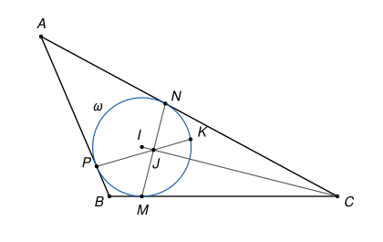

## Statement

Soit $ABC$ un triangle qui n'est pas isocèle. On note $\omega$ son cercle inscrit et $I$ le centre de $\omega$. Le cercle $\omega$ touche les côtés $[BC]$, $[CA]$ et $[AB]$ aux points $M$, $N$ et $P$.

Soit $J$ le point d'intersection des droites $(MN)$ et $(IC)$. La droite $(PJ)$ recoupe $\omega$ en un point $K$.

Montrer que :

**a)** les points $C$, $K$, $I$ et $P$ sont sur un même cercle ;

**b)** la droite $(CI)$ est la bissectrice de l'angle $\widehat{PCK}$.

## Hints

1. Montre que $(CI)$ est la médiatrice de $[MN]$. Où est $J$ sur le segment $[MN]$ ?
2. Démontre d'abord un lemme : si deux cordes $[XY]$ et $[ZT]$ d'un même cercle se coupent en $J$, alors $JX \times JY = JZ \times JT$. Cherche deux triangles semblables.
3. Les points $M$ et $N$ sont aussi sur le cercle de diamètre $[IC]$. Applique le lemme dans ce cercle, puis dans $\omega$, pour obtenir $JI \times JC = JP \times JK$.
4. Pour **a)**, trace le cercle qui passe par $P$, $I$ et $C$, et regarde où il recoupe la droite $(PJ)$. Pour **b)**, l'égalité $JI \times JC = JP \times JK$ donne deux paires de triangles semblables, et le triangle $IPK$ est isocèle.

## Solution

**Un lemme sur les cordes.** *Si deux cordes $[XY]$ et $[ZT]$ d'un même cercle se coupent en un point $J$, alors $JX \times JY = JZ \times JT$.*

Les diagonales $[XY]$ et $[ZT]$ du quadrilatère $XZYT$ se coupent, donc ce quadrilatère est convexe, et $X$ et $T$ sont du même côté de la droite $(ZY)$. Les angles inscrits $\widehat{ZXY}$ et $\widehat{ZTY}$ interceptent alors le même arc $ZY$ : ils sont égaux. Comme $J$ est sur $[XY]$ et sur $[ZT]$, cela s'écrit $\widehat{JXZ} = \widehat{JTY}$. De plus, les angles $\widehat{XJZ}$ et $\widehat{TJY}$ sont opposés par le sommet, donc égaux. Les triangles $JXZ$ et $JTY$ ont deux angles égaux : ils sont semblables, avec $J \leftrightarrow J$, $X \leftrightarrow T$, $Z \leftrightarrow Y$. Donc

$$\frac{JX}{JT} = \frac{JZ}{JY}, \qquad \text{c'est-à-dire} \qquad JX \times JY = JZ \times JT.$$

**Étape 1. La position de $J$.**

Le rayon $[IM]$ est perpendiculaire à la tangente $(BC)$, et de même $(IN) \perp (CA)$. Par le théorème de Pythagore, $CM^2 = CI^2 - IM^2 = CI^2 - IN^2 = CN^2$, donc $CM = CN$. Comme aussi $IM = IN$, les points $C$ et $I$ sont tous deux sur la médiatrice de $[MN]$ : la droite $(CI)$ **est** la médiatrice de $[MN]$. Son point d'intersection $J$ avec $(MN)$ est donc le milieu de $[MN]$, et $(MN) \perp (CI)$.

En particulier, $J$ est strictement à l'intérieur du disque $\omega$ (c'est le milieu d'une corde), donc $J$ est strictement entre les deux points $P$ et $K$ où la droite $(PJ)$ coupe $\omega$.

**Étape 2. $JI \times JC = JP \times JK$.**

Les angles $\widehat{IMC}$ et $\widehat{INC}$ sont droits, donc $M$ et $N$ sont sur le cercle de diamètre $[IC]$. Dans le triangle $IMC$ rectangle en $M$, le point $J$ est le pied de la hauteur issue de $M$, donc il est strictement entre $I$ et $C$. Les cordes $[MN]$ et $[IC]$ de ce cercle se coupent en $J$, donc, d'après le lemme, $JM \times JN = JI \times JC$.

Dans le cercle $\omega$, les cordes $[MN]$ et $[PK]$ se coupent en $J$, donc $JM \times JN = JP \times JK$. Finalement,

$$JI \times JC = JP \times JK. \qquad (\star)$$

**Étape 3. Question a).**

Les points $P$, $I$, $C$ ne sont pas alignés. En effet, $(IP)$ est perpendiculaire à $(AB)$. Si $P$ était sur $(IC)$, la bissectrice $(CI)$ de l'angle $\widehat{ACB}$ serait perpendiculaire à $(AB)$. Les deux triangles rectangles formés de part et d'autre auraient le côté $[CP]$ en commun et les mêmes angles, donc ils seraient égaux, et l'on aurait $CA = CB$. Or le triangle n'est pas isocèle.

Il existe donc un cercle $\Gamma$ passant par $P$, $I$ et $C$. Le point $J$ est strictement entre $I$ et $C$, donc strictement à l'intérieur de $\Gamma$. La droite $(PJ)$ recoupe donc $\Gamma$ en un point $K'$, avec $J$ strictement entre $P$ et $K'$. D'après le lemme appliqué aux cordes $[IC]$ et $[PK']$ de $\Gamma$, puis d'après $(\star)$,

$$JP \times JK' = JI \times JC = JP \times JK,$$

donc $JK' = JK$. Les points $K$ et $K'$ sont sur la même demi-droite issue de $J$ (celle qui ne contient pas $P$), à la même distance de $J$ : ils sont égaux. **Donc $K$ est sur $\Gamma$, et $C$, $K$, $I$, $P$ sont cocycliques.**

**Étape 4. Question b).**

Comme $J$ est entre $I$ et $C$ et entre $P$ et $K$, les angles $\widehat{IJK}$ et $\widehat{PJC}$ sont opposés par le sommet, ainsi que $\widehat{IJP}$ et $\widehat{KJC}$.

- L'égalité $(\star)$ s'écrit $\dfrac{JI}{JP} = \dfrac{JK}{JC}$. Les triangles $JIK$ et $JPC$ ont un angle égal en $J$ compris entre des côtés proportionnels : ils sont semblables, avec $I \leftrightarrow P$ et $K \leftrightarrow C$. Donc $\widehat{JKI} = \widehat{JCP}$.
- L'égalité $(\star)$ s'écrit aussi $\dfrac{JI}{JK} = \dfrac{JP}{JC}$. Les triangles $JIP$ et $JKC$ sont semblables, avec $I \leftrightarrow K$ et $P \leftrightarrow C$. Donc $\widehat{JPI} = \widehat{JCK}$.

Or $IP = IK$ (ce sont deux rayons de $\omega$), donc le triangle $IPK$ est isocèle en $I$ et $\widehat{IKP} = \widehat{IPK}$. Comme $J$ est sur $[PK]$, cela s'écrit $\widehat{JKI} = \widehat{JPI}$. On en déduit

$$\widehat{JCP} = \widehat{JKI} = \widehat{JPI} = \widehat{JCK}.$$

Comme $J$ est sur $[CI]$, cela donne $\widehat{ICP} = \widehat{ICK}$. Enfin, $P$ et $K$ sont de part et d'autre de la droite $(CI)$, puisque le segment $[PK]$ la coupe en $J$. **Donc $(CI)$ est la bissectrice de l'angle $\widehat{PCK}$.**

## Going further

Le produit $JX \times JY$ du lemme ne dépend que du point $J$ et du cercle, pas de la corde choisie : on l'appelle la **puissance** du point $J$ par rapport au cercle. Le corrigé officiel utilise directement cette notion, et sa réciproque pour la question a).

La question b) a été résolue ici sans utiliser a). Avec a), on peut aussi conclure par des angles inscrits dans le cercle $\Gamma$ : $\widehat{ICP} = \widehat{IKP}$ et $\widehat{ICK} = \widehat{IPK}$.
