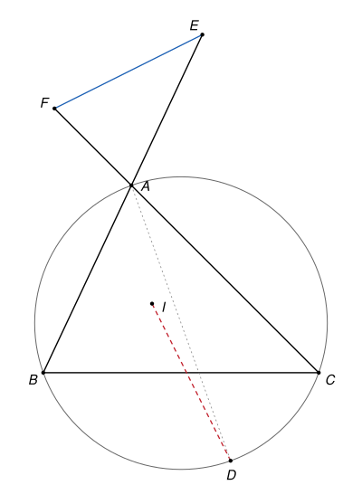

## Statement

Soit $ABC$ un triangle, $I$ le centre de son cercle inscrit, et $D$ le point diamétralement opposé à $A$ sur son cercle circonscrit.

On place le point $E$ sur la demi-droite $[BA)$ et le point $F$ sur la demi-droite $[CA)$ de sorte que
$$BE = CF = \frac{AB + BC + CA}{2}.$$

Montrer que les droites $(EF)$ et $(DI)$ sont perpendiculaires.

## Hints

1. Note $a = BC$, $b = CA$, $c = AB$ et $s$ le demi-périmètre. Calcule $DE^2 - DF^2$ : quels angles droits apparaissent grâce au diamètre $[AD]$ ?
2. Calcule aussi $IE^2 - IF^2$. Il est utile de connaître les distances des sommets aux points de contact du cercle inscrit : par exemple, le point de contact sur $[AB]$ est à la distance $s - b$ de $B$.
3. Tu dois trouver $DE^2 - DF^2 = IE^2 - IF^2$.
4. Pour un point $X$ et le milieu $K$ de $[DI]$, montre que $XD^2 - XI^2 = 2\,\overrightarrow{XK} \cdot \overrightarrow{ID}$. Applique-le à $X = E$ et à $X = F$.

## Solution

On note $a = BC$, $b = CA$, $c = AB$, $s = \frac{a + b + c}{2}$ le demi-périmètre, et $r$ le rayon du cercle inscrit.

**Étape 1. Où sont $E$ et $F$ ?**

On a $s - c = \frac{a + b - c}{2} > 0$, d'après l'inégalité triangulaire. Donc $BE = s > c = BA$ : le point $E$ est sur la demi-droite $[BA)$, au-delà de $A$. De même, $CF = s > b = CA$, et $F$ est sur la demi-droite $[CA)$, au-delà de $A$.

Les points $E$ et $F$ sont différents : ils sont respectivement sur les droites $(AB)$ et $(AC)$, et tous deux différents de $A$, alors que ces deux droites n'ont que $A$ en commun.

**Étape 2. $DE^2 - DF^2 = b^2 - c^2$.**

Comme $[AD]$ est un diamètre du cercle circonscrit, l'angle $\widehat{ABD}$ est droit si $D \neq B$. Le point $E$ est sur la droite $(AB)$, donc le triangle $DBE$ est rectangle en $B$, et le théorème de Pythagore donne $DE^2 = DB^2 + BE^2$. Si $D = B$, cette égalité est encore vraie, puisque $DB = 0$.

De même, $DF^2 = DC^2 + CF^2$. Comme $BE = CF$, on obtient
$$DE^2 - DF^2 = DB^2 - DC^2.$$

Toujours parce que les triangles $ABD$ et $ACD$ sont rectangles en $B$ et en $C$, on a $AD^2 = AB^2 + DB^2 = AC^2 + DC^2$. Donc $DB^2 = AD^2 - c^2$ et $DC^2 = AD^2 - b^2$, d'où
$$DE^2 - DF^2 = (AD^2 - c^2) - (AD^2 - b^2) = b^2 - c^2.$$

**Étape 3. Les longueurs des tangentes.**

Soient $A'$, $B'$ et $C'$ les points de contact du cercle inscrit avec les côtés $[BC]$, $[CA]$ et $[AB]$. Le rayon $[IC']$ est perpendiculaire à la tangente $(AB)$, et le rayon $[IB']$ à la tangente $(AC)$. Les triangles $AIC'$ et $AIB'$ sont donc rectangles en $C'$ et en $B'$, avec la même hypoténuse $[AI]$ et $IC' = IB' = r$. Par le théorème de Pythagore, $AC' = AB'$.

On a de même $BC' = BA'$ et $CA' = CB'$. Notons $x = AC' = AB'$, $y = BC' = BA'$ et $z = CA' = CB'$. Les côtés du triangle s'écrivent
$$c = x + y, \qquad a = y + z, \qquad b = z + x.$$

En additionnant, $2\,(x + y + z) = a + b + c$, donc $x + y + z = s$. On en déduit $y = s - (z + x) = s - b$, et de même $z = s - c$.

**Étape 4. $IE^2 - IF^2 = b^2 - c^2$.**

Les points $C'$ et $E$ sont sur la demi-droite $[BA)$, avec $BC' = s - b$ et $BE = s$. Donc $C'E = BE - BC' = b$. Comme $(IC')$ est perpendiculaire à $(AB)$, le théorème de Pythagore dans le triangle $IC'E$ donne
$$IE^2 = IC'^2 + C'E^2 = r^2 + b^2.$$

De même, $B'$ et $F$ sont sur la demi-droite $[CA)$, avec $CB' = s - c$ et $CF = s$, donc $B'F = c$ et $IF^2 = r^2 + c^2$. Ainsi
$$IE^2 - IF^2 = b^2 - c^2.$$

**Étape 5. Un lemme avec le produit scalaire.**

*Soient $D$ et $I$ deux points distincts, et $K$ le milieu de $[DI]$. Pour tout point $X$,*
$$XD^2 - XI^2 = 2\,\overrightarrow{XK} \cdot \overrightarrow{ID}.$$

En effet, $XD^2 - XI^2 = \overrightarrow{XD}^2 - \overrightarrow{XI}^2 = \left(\overrightarrow{XD} - \overrightarrow{XI}\right) \cdot \left(\overrightarrow{XD} + \overrightarrow{XI}\right)$. Or $\overrightarrow{XD} - \overrightarrow{XI} = \overrightarrow{ID}$, et $\overrightarrow{XD} + \overrightarrow{XI} = 2\,\overrightarrow{XK}$ puisque $K$ est le milieu de $[DI]$.

**Étape 6. Conclusion.**

Les étapes 2 et 4 donnent $DE^2 - DF^2 = IE^2 - IF^2$, c'est-à-dire
$$ED^2 - EI^2 = FD^2 - FI^2.$$

Les points $D$ et $I$ sont distincts : $I$ est à l'intérieur du triangle, donc à l'intérieur du cercle circonscrit, alors que $D$ est sur ce cercle. On note $K$ le milieu de $[DI]$, et l'on applique le lemme à $X = E$ et à $X = F$ :
$$2\,\overrightarrow{EK} \cdot \overrightarrow{ID} = 2\,\overrightarrow{FK} \cdot \overrightarrow{ID}, \qquad \text{donc} \qquad \left(\overrightarrow{EK} - \overrightarrow{FK}\right) \cdot \overrightarrow{ID} = 0.$$

Or $\overrightarrow{EK} - \overrightarrow{FK} = \overrightarrow{EK} + \overrightarrow{KF} = \overrightarrow{EF}$. Ainsi $\overrightarrow{EF} \cdot \overrightarrow{ID} = 0$, avec $E \neq F$ et $D \neq I$ : les droites $(EF)$ et $(DI)$ sont perpendiculaires.

## Going further

Le lemme de l'étape 5 dit plus : pour un nombre $k$ fixé, l'ensemble des points $X$ tels que $XD^2 - XI^2 = k$ est une droite perpendiculaire à $(DI)$. Pour $k = 0$, c'est la médiatrice de $[DI]$.

Le choix $BE = CF = s$ n'a servi qu'à l'étape 4. Que devient la preuve si l'on prend $BE = CF = t$ pour un autre nombre $t > 0$ ? Les droites $(EF)$ et $(DI)$ restent-elles perpendiculaires ?
