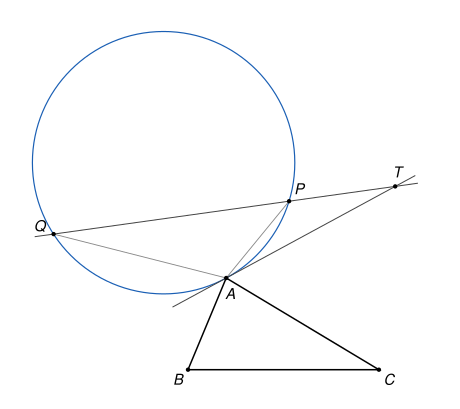

## Statement

Soit $ABC$ un triangle tel que $AB \neq AC$. On note $P$ le symétrique de $B$ par rapport à la droite $(AC)$, et $Q$ le symétrique de $C$ par rapport à la droite $(AB)$. On suppose que les points $A$, $P$, $Q$ ne sont pas alignés.

La tangente en $A$ au cercle passant par $A$, $P$ et $Q$ coupe la droite $(PQ)$ en un point $T$.

Montrer que le symétrique de $T$ par rapport à $A$ appartient à la droite $(BC)$.

## Hints

1. Exprime le vecteur $\overrightarrow{AP}$ à l'aide de $\overrightarrow{AB}$ et $\overrightarrow{AC}$. Pense au projeté orthogonal de $B$ sur $(AC)$ : c'est le milieu de $[BP]$. Fais de même pour $\overrightarrow{AQ}$.
2. Montre que $TA^2 = TP \times TQ$. Introduis le centre $O$ du cercle et utilise le théorème de Pythagore, une fois dans le triangle $TAO$ et une fois avec le pied de la perpendiculaire à $(PQ)$ passant par $O$.
3. Avec le théorème d'Al-Kashi dans les triangles $TAP$ et $TAQ$, déduis-en que $\frac{TP}{TQ} = \frac{AB^2}{AC^2}$.
4. Écris alors $\overrightarrow{AT}$ à l'aide de $\overrightarrow{AP}$ et $\overrightarrow{AQ}$, puis à l'aide de $\overrightarrow{AB}$ et $\overrightarrow{AC}$. À quelle condition un point $M$ tel que $\overrightarrow{AM} = \alpha\,\overrightarrow{AB} + \beta\,\overrightarrow{AC}$ est-il sur la droite $(BC)$ ?

## Solution

On note $b = AC$, $c = AB$ et $k = \overrightarrow{AB} \cdot \overrightarrow{AC}$. Une symétrie d'axe passant par $A$ conserve les distances à $A$, donc
$$AP = AB = c \qquad \text{et} \qquad AQ = AC = b.$$

**Étape 1. Les vecteurs $\overrightarrow{AP}$ et $\overrightarrow{AQ}$.**

Soit $E$ le projeté orthogonal de $B$ sur $(AC)$. Comme $P$ est le symétrique de $B$ par rapport à $(AC)$, le point $E$ est le milieu de $[BP]$, donc $\overrightarrow{AB} + \overrightarrow{AP} = 2\,\overrightarrow{AE}$. D'après le cours sur le produit scalaire,
$$\overrightarrow{AE} = \frac{\overrightarrow{AB} \cdot \overrightarrow{AC}}{AC^2}\,\overrightarrow{AC} = \frac{k}{b^2}\,\overrightarrow{AC}.$$
On en déduit
$$\overrightarrow{AP} = \frac{2k}{b^2}\,\overrightarrow{AC} - \overrightarrow{AB}, \qquad \text{et de même} \qquad \overrightarrow{AQ} = \frac{2k}{c^2}\,\overrightarrow{AB} - \overrightarrow{AC}.$$

**Étape 2. On montre que $TA^2 = TP \times TQ$.**

Soit $O$ le centre du cercle passant par $A$, $P$, $Q$, et $R$ son rayon. Le point $T$ est différent de $A$, car $A$ n'est pas sur la droite $(PQ)$.

- La tangente en $A$ est perpendiculaire au rayon $[OA]$. Le théorème de Pythagore dans le triangle $TAO$, rectangle en $A$, donne $TO^2 = TA^2 + R^2$. En particulier $TO > R$ : le point $T$ est à l'extérieur du cercle.
- Soit $K$ le pied de la perpendiculaire à $(PQ)$ passant par $O$. Avec Pythagore, $KP^2 = R^2 - OK^2 = KQ^2$, donc $K$ est le milieu de $[PQ]$. On note $t = KP = KQ$. Toujours avec Pythagore,
$$TO^2 - R^2 = (TK^2 + OK^2) - (t^2 + OK^2) = TK^2 - t^2 = (TK - t)(TK + t).$$
Comme $TO > R$, on a $TK > t$. Le point $T$ est donc en dehors du segment $[PQ]$, et les points $P$ et $Q$ sont du même côté de $T$, à des distances $TK - t$ et $TK + t$.

On obtient $TP \times TQ = TO^2 - R^2 = TA^2$.

**Étape 3. On montre que $\frac{TP}{TQ} = \frac{c^2}{b^2}$.**

On note $x = TA$, $p = TP$, $q = TQ$, de sorte que $x^2 = pq$. Comme $P$ et $Q$ sont du même côté de $T$, les angles $\widehat{ATP}$ et $\widehat{ATQ}$ sont égaux, et l'on note $\theta$ leur mesure. Le théorème d'Al-Kashi dans les triangles $TAP$ et $TAQ$ donne
$$AP^2 = x^2 + p^2 - 2xp\cos\theta = p\,(q + p - 2x\cos\theta),$$
$$AQ^2 = x^2 + q^2 - 2xq\cos\theta = q\,(p + q - 2x\cos\theta).$$
Le facteur $p + q - 2x\cos\theta$ est le même dans les deux lignes, et il n'est pas nul puisque $AQ^2 > 0$. En divisant, on obtient
$$\frac{c^2}{b^2} = \frac{AP^2}{AQ^2} = \frac{p}{q} = \frac{TP}{TQ}.$$

**Étape 4. Le vecteur $\overrightarrow{AT}$.**

Les vecteurs $\overrightarrow{TP}$ et $\overrightarrow{TQ}$ ont le même sens, puisque $P$ et $Q$ sont du même côté de $T$. D'après l'étape 3, on a donc $b^2\,\overrightarrow{TP} = c^2\,\overrightarrow{TQ}$. En passant par $A$ :
$$b^2\left(\overrightarrow{AP} - \overrightarrow{AT}\right) = c^2\left(\overrightarrow{AQ} - \overrightarrow{AT}\right), \qquad \text{donc} \qquad (c^2 - b^2)\,\overrightarrow{AT} = c^2\,\overrightarrow{AQ} - b^2\,\overrightarrow{AP}.$$
Soit $T'$ le symétrique de $T$ par rapport à $A$. Comme $b \neq c$, on obtient
$$\overrightarrow{AT'} = -\overrightarrow{AT} = \frac{c^2\,\overrightarrow{AQ} - b^2\,\overrightarrow{AP}}{b^2 - c^2}.$$

**Étape 5. On conclut.**

Avec l'étape 1,
$$c^2\,\overrightarrow{AQ} - b^2\,\overrightarrow{AP} = 2k\,\overrightarrow{AB} - c^2\,\overrightarrow{AC} - 2k\,\overrightarrow{AC} + b^2\,\overrightarrow{AB} = (b^2 + 2k)\,\overrightarrow{AB} - (c^2 + 2k)\,\overrightarrow{AC}.$$
Donc $\overrightarrow{AT'} = \alpha\,\overrightarrow{AB} + \beta\,\overrightarrow{AC}$, avec
$$\alpha = \frac{b^2 + 2k}{b^2 - c^2}, \qquad \beta = -\frac{c^2 + 2k}{b^2 - c^2}, \qquad \alpha + \beta = \frac{b^2 - c^2}{b^2 - c^2} = 1.$$
Ainsi $\beta = 1 - \alpha$, et
$$\overrightarrow{CT'} = \overrightarrow{AT'} - \overrightarrow{AC} = \alpha\,\overrightarrow{AB} - \alpha\,\overrightarrow{AC} = \alpha\,\overrightarrow{CB}.$$
Les vecteurs $\overrightarrow{CT'}$ et $\overrightarrow{CB}$ sont colinéaires : le point $T'$, symétrique de $T$ par rapport à $A$, appartient à la droite $(BC)$.

## Going further

1. Montre que l'angle $\widehat{PAQ}$ mesure $3\widehat{BAC}$, ou $360° - 3\widehat{BAC}$. Pour quelles valeurs de l'angle $\widehat{BAC}$ les points $A$, $P$, $Q$ sont-ils alignés ?
2. Que se passe-t-il quand $AB = AC$ ? Pourquoi le point $T$ n'existe-t-il pas ?
