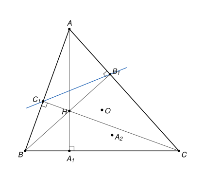

## Statement

Soit $ABC$ un triangle dont les trois angles sont aigus, et tel que $AB \neq AC$. Ses hauteurs $[AA_1]$, $[BB_1]$ et $[CC_1]$ se coupent au point $H$. On note $O$ le centre du cercle circonscrit au triangle $ABC$, et $A_2$ le symétrique de $A$ par rapport à la droite $(B_1C_1)$.

1. Montrer que les points $O$, $A_2$, $B_1$ et $C$ sont sur un même cercle.
2. Montrer que les points $O$, $H$, $A_1$ et $A_2$ sont sur un même cercle.

## Hints

1. Commence par calculer $\overrightarrow{AO} \cdot \overrightarrow{AB_1}$ et $\overrightarrow{AO} \cdot \overrightarrow{AC_1}$ en fonction de $\overrightarrow{AB} \cdot \overrightarrow{AC}$. Où se trouve le projeté orthogonal de $O$ sur la droite $(AC)$ ? Déduis-en que $(AO)$ est perpendiculaire à $(B_1C_1)$.
2. Le point $A_2$ est donc sur la droite $(AO)$. Calcule $\overrightarrow{AO} \cdot \overrightarrow{AA_2}$, puis $\overrightarrow{AB_1} \cdot \overrightarrow{AC}$ et $\overrightarrow{AH} \cdot \overrightarrow{AA_1}$. Tu dois trouver trois fois le même nombre.
3. Il reste à montrer ceci : si $X$ et $Y$ sont sur une demi-droite d'origine $A$, si $U$ et $V$ sont sur une autre demi-droite d'origine $A$, et si $AX \times AY = AU \times AV$, alors $X$, $Y$, $U$, $V$ sont sur un même cercle.
4. Pour cela, trace le cercle qui passe par $X$, $U$ et $V$, et note $\Omega$ son centre. Si $X'$ est le point diamétralement opposé à $X$, que vaut $\overrightarrow{AX} \cdot \overrightarrow{AX'}$ ?

## Solution

On utilise une propriété du cours sur le produit scalaire : si $M'$ est le projeté orthogonal d'un point $M$ sur une droite $(AD)$, alors $\overrightarrow{AD} \cdot \overrightarrow{AM} = \overrightarrow{AD} \cdot \overrightarrow{AM'}$.

**Étape 1. Un outil : quatre points sur un cercle.**

*Lemme.* Soient deux demi-droites d'origine $A$ qui ne sont pas portées par une même droite. On prend deux points $X$ et $Y$ sur la première, et deux points distincts $U$ et $V$ sur la seconde, tous différents de $A$. Si $AX \times AY = AU \times AV$, alors les points $X$, $Y$, $U$, $V$ sont sur un même cercle.

*Démonstration.* La droite $(UV)$ est la droite qui porte la seconde demi-droite. Elle ne passe pas par $X$, donc $X$, $U$, $V$ ne sont pas alignés, et il existe un cercle $\Gamma$ qui passe par ces trois points. On note $\Omega$ son centre et $\rho$ son rayon.

(a) *Une formule.* Soit $M$ un point de $\Gamma$ différent de $A$, et $M'$ le point diamétralement opposé, de sorte que $\overrightarrow{\Omega M'} = -\overrightarrow{\Omega M}$. Soit $N$ le projeté orthogonal de $M'$ sur la droite $(AM)$. Le point $N$ est sur $\Gamma$ : c'est clair si $N = M$ ou $N = M'$, et sinon le triangle $MNM'$ est rectangle en $N$, donc $N$ est sur le cercle de diamètre $[MM']$, qui est $\Gamma$. De plus,
$$\overrightarrow{AM} \cdot \overrightarrow{AN} = \overrightarrow{AM} \cdot \overrightarrow{AM'} = \left(\overrightarrow{A\Omega} + \overrightarrow{\Omega M}\right) \cdot \left(\overrightarrow{A\Omega} - \overrightarrow{\Omega M}\right) = A\Omega^2 - \rho^2.$$

(b) *Avec $M = U$.* Le point $N$ est alors sur $\Gamma$ et sur la droite $(UV)$. Une droite coupe un cercle en au plus deux points, donc $N = U$ ou $N = V$. Si l'on avait $N = U$, la droite $(UV)$ serait perpendiculaire en $U$ au rayon $[\Omega U]$, et le théorème de Pythagore dans le triangle $\Omega UV$ donnerait $\Omega V^2 = \Omega U^2 + UV^2 > \rho^2$ : le point $V$ ne serait pas sur $\Gamma$. Donc $N = V$, et
$$\overrightarrow{AU} \cdot \overrightarrow{AV} = A\Omega^2 - \rho^2.$$
Comme $U$ et $V$ sont sur une même demi-droite d'origine $A$, on a $\overrightarrow{AU} \cdot \overrightarrow{AV} = AU \times AV$.

(c) *Avec $M = X$.* On obtient un point $N$ de $\Gamma$, situé sur la droite $(AX)$, tel que
$$\overrightarrow{AX} \cdot \overrightarrow{AN} = A\Omega^2 - \rho^2 = AU \times AV = AX \times AY.$$
Comme $N$ est sur la droite $(AX)$, on peut écrire $\overrightarrow{AN} = t\,\overrightarrow{AX}$ avec $t$ réel. L'égalité devient $t \times AX^2 = AX \times AY$, donc $t = \frac{AY}{AX}$. Or $Y$ est sur la demi-droite $[AX)$, donc $\overrightarrow{AY} = \frac{AY}{AX}\,\overrightarrow{AX}$ aussi. Ainsi $\overrightarrow{AN} = \overrightarrow{AY}$, c'est-à-dire $N = Y$, et $Y$ est sur $\Gamma$.

Les quatre points $X$, $Y$, $U$, $V$ sont donc sur le cercle $\Gamma$.

**Étape 2. Deux produits scalaires avec $O$.**

Le point $O$ est sur la médiatrice de $[AC]$, donc son projeté orthogonal sur $(AC)$ est le milieu $M$ de $[AC]$. Comme $B_1$ est sur $(AC)$, on obtient
$$\overrightarrow{AB_1} \cdot \overrightarrow{AO} = \overrightarrow{AB_1} \cdot \overrightarrow{AM} = \frac{1}{2}\,\overrightarrow{AB_1} \cdot \overrightarrow{AC}.$$
Le point $B_1$ est le projeté orthogonal de $B$ sur $(AC)$, donc $\overrightarrow{AC} \cdot \overrightarrow{AB_1} = \overrightarrow{AC} \cdot \overrightarrow{AB}$. Finalement
$$\overrightarrow{AO} \cdot \overrightarrow{AB_1} = \frac{1}{2}\,\overrightarrow{AB} \cdot \overrightarrow{AC}. \qquad (1)$$
En échangeant les rôles de $B$ et de $C$, on obtient de même $\overrightarrow{AO} \cdot \overrightarrow{AC_1} = \frac{1}{2}\,\overrightarrow{AB} \cdot \overrightarrow{AC}$.

**Étape 3. La droite $(AO)$ est perpendiculaire à $(B_1C_1)$.**

D'après l'étape 2,
$$\overrightarrow{AO} \cdot \overrightarrow{B_1C_1} = \overrightarrow{AO} \cdot \overrightarrow{AC_1} - \overrightarrow{AO} \cdot \overrightarrow{AB_1} = 0.$$
Les points $B_1$ et $C_1$ sont distincts : $B_1$ est sur $(AC)$, $C_1$ sur $(AB)$, et aucun des deux n'est en $A$ puisque l'angle en $A$ n'est pas droit. Donc $(AO) \perp (B_1C_1)$.

**Étape 4. Le point $A_2$ est sur la demi-droite $[AO)$.**

Le point $A$ n'est pas sur la droite $(B_1C_1)$ : sinon cette droite serait à la fois $(AC)$, car elle passerait par $A$ et $B_1$, et $(AB)$, car elle passerait par $A$ et $C_1$. Soit $P$ le projeté orthogonal de $A$ sur $(B_1C_1)$. Comme $A_2$ est le symétrique de $A$ par rapport à $(B_1C_1)$, le point $P$ est le milieu de $[AA_2]$, donc $\overrightarrow{AA_2} = 2\,\overrightarrow{AP}$.

Les droites $(AP)$ et $(AO)$ passent toutes les deux par $A$ et sont perpendiculaires à $(B_1C_1)$. Elles sont donc confondues : les points $A$, $O$, $P$, $A_2$ sont alignés. De plus, $P$ est le projeté orthogonal de $B_1$ sur cette droite $(AO)$, car $P$ et $B_1$ sont sur $(B_1C_1)$, qui est perpendiculaire à $(AO)$. D'après $(1)$,
$$\overrightarrow{AO} \cdot \overrightarrow{AA_2} = 2\,\overrightarrow{AO} \cdot \overrightarrow{AP} = 2\,\overrightarrow{AO} \cdot \overrightarrow{AB_1} = \overrightarrow{AB} \cdot \overrightarrow{AC}.$$

L'angle $\widehat{BAC}$ est aigu, donc $\overrightarrow{AB} \cdot \overrightarrow{AC} = AB \times AC \times \cos \widehat{BAC} > 0$. Les vecteurs $\overrightarrow{AO}$ et $\overrightarrow{AA_2}$ sont colinéaires et leur produit scalaire est positif : ils ont le même sens. Le point $A_2$ est donc sur la demi-droite $[AO)$, et
$$AO \times AA_2 = \overrightarrow{AB} \cdot \overrightarrow{AC}. \qquad (2)$$

**Étape 5. Question 1.**

On a $\overrightarrow{AB_1} \cdot \overrightarrow{AC} = \overrightarrow{AB} \cdot \overrightarrow{AC} > 0$, car $B_1$ est le projeté orthogonal de $B$ sur $(AC)$. Donc $B_1$ est sur la demi-droite $[AC)$, et $AB_1 \times AC = \overrightarrow{AB} \cdot \overrightarrow{AC}$. Avec $(2)$,
$$AO \times AA_2 = AB_1 \times AC.$$

Vérifions les conditions du lemme.

- Les demi-droites $[AO)$ et $[AC)$ ne sont pas portées par une même droite. Sinon $O$ serait sur $(AC)$ ; comme $OA = OC$, ce serait le milieu de $[AC]$, donc $[AC]$ serait un diamètre du cercle circonscrit, et l'angle en $B$ serait droit.
- Les points $B_1$ et $C$ sont distincts, car l'angle en $C$ n'est pas droit, et aucun des points $O$, $A_2$, $B_1$, $C$ n'est en $A$.

D'après le lemme, **les points $O$, $A_2$, $B_1$ et $C$ sont sur un même cercle.**

**Étape 6. Question 2.**

Le point $H$ est sur la hauteur $(AA_1)$, et il est différent de $A$ puisque l'angle en $A$ n'est pas droit.

- Le point $A_1$ est le projeté orthogonal de $C$ sur la droite $(AH)$, car $(AA_1) \perp (BC)$. Donc $\overrightarrow{AH} \cdot \overrightarrow{AA_1} = \overrightarrow{AH} \cdot \overrightarrow{AC}$.
- Le point $B_1$ est le projeté orthogonal de $H$ sur $(AC)$, car $H$ est sur la hauteur $(BB_1)$. Donc $\overrightarrow{AC} \cdot \overrightarrow{AH} = \overrightarrow{AC} \cdot \overrightarrow{AB_1} = \overrightarrow{AB} \cdot \overrightarrow{AC}$.

Ainsi $\overrightarrow{AH} \cdot \overrightarrow{AA_1} = \overrightarrow{AB} \cdot \overrightarrow{AC} > 0$. Les points $H$ et $A_1$ sont donc sur une même demi-droite d'origine $A$, et avec $(2)$,
$$AO \times AA_2 = AH \times AA_1.$$

Vérifions les conditions du lemme.

- Les demi-droites $[AO)$ et $[AA_1)$ ne sont pas portées par une même droite. Sinon $O$ serait sur la hauteur $(AA_1)$, qui est perpendiculaire à $(BC)$. Or $O$ est aussi sur la médiatrice de $[BC]$, perpendiculaire à $(BC)$. Deux droites perpendiculaires à $(BC)$ qui passent par $O$ sont confondues : la hauteur serait la médiatrice de $[BC]$, et $A$, qui est sur cette médiatrice, vérifierait $AB = AC$. C'est exclu par l'énoncé.
- Les points $H$ et $A_1$ sont distincts. Sinon $A_1$ serait sur la hauteur $(BB_1)$ et sur $(BC)$, donc $A_1 = B$, et l'angle en $B$ serait droit.

D'après le lemme, **les points $O$, $H$, $A_1$ et $A_2$ sont sur un même cercle.**

## Going further

1. Que se passe-t-il pour la question 2 lorsque $AB = AC$ ? Montre que les quatre points $O$, $H$, $A_1$, $A_2$ sont alors sur une même droite.
2. Le résultat de l'étape 1 s'appelle la *puissance d'un point par rapport à un cercle*. Montre que, pour un point $A$ extérieur à un cercle de centre $\Omega$ et de rayon $\rho$, et pour une tangente au cercle menée de $A$ qui le touche en $T$, on a $AT^2 = A\Omega^2 - \rho^2$.
3. Montre que l'hypothèse « les trois angles sont aigus » n'est pas indispensable pour la question 1 : refais le calcul avec un angle obtus en $B$.
