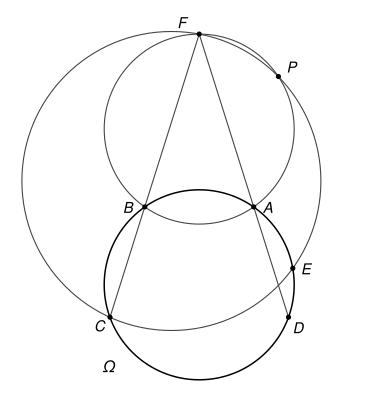

## Statement

Soit $A$, $B$, $C$, $D$, $E$ cinq points situés dans cet ordre sur un cercle $\Omega$, tels que $AD = BC$. On suppose que les droites $(AD)$ et $(BC)$ se coupent en un point $F$. Les cercles circonscrits aux triangles $ABF$ et $CEF$ se recoupent en un point $P$, autre que $F$.

Démontrer que les cercles circonscrits aux triangles $BDF$ et $BEP$ sont tangents l'un à l'autre.

La figure montre un cas possible. Selon la position des points, $F$ peut aussi se trouver du côté de $C$ et $D$.

## Hints

1. Les deux cercles passent par $B$. Il suffit de montrer qu'ils ont la même tangente en $B$. L'angle entre une tangente et une corde se calcule avec le théorème de l'angle tangentiel.
2. Montrez d'abord que les droites $(AB)$ et $(CD)$ sont parallèles. Notez $I$ le point d'intersection des diagonales $[AC]$ et $[BD]$, et comparez les triangles $IBC$ et $IAD$.
3. Pour comparer les deux tangentes, passez par les droites $(BE)$ et $(BC)$. Faites ensuite disparaître le point $P$ à l'aide des cercles $ABFP$ et $CEFP$, puis le point $E$ à l'aide du cercle $\Omega$.
4. Selon la figure, les angles ne s'ajoutent pas toujours de la même façon. Les angles orientés de droites évitent de séparer les cas.

## Solution

### Deux outils : les angles orientés de droites

Pour deux droites $d_1$ et $d_2$, on note $(d_1, d_2)$ l'angle dont il faut faire tourner $d_1$, dans le sens direct, pour la rendre parallèle à $d_2$. Cet angle est compté **à $180^\circ$ près** : tourner une droite de $180^\circ$ la ramène sur elle-même. Ces angles suivent des règles simples.

- **Relation de Chasles** : $(d_1, d_3) = (d_1, d_2) + (d_2, d_3)$, et $(d_2, d_1) = -(d_1, d_2)$.
- $(d_1, d_2) = 0$ si et seulement si $d_1$ et $d_2$ sont parallèles (ou confondues).
- Une droite peut être nommée par deux quelconques de ses points : par exemple $(AD) = (AF) = (DF)$.

Le théorème de l'angle inscrit prend alors une forme qui ne dépend plus de la figure.

**Angle inscrit.** Si $W$, $X$, $Y$, $Z$ sont quatre points d'un même cercle, alors $(ZX, ZY) = (WX, WY)$.

En effet, notons $\theta = \widehat{XZY}$. Si $Z$ et $W$ sont du même côté de la droite $(XY)$, le théorème de l'angle inscrit donne $\widehat{XWY} = \theta$, et les deux rotations, de $[ZX)$ vers $[ZY)$ et de $[WX)$ vers $[WY)$, tournent dans le même sens : les deux angles orientés sont égaux. Si $Z$ et $W$ sont de part et d'autre de $(XY)$, on a $\widehat{XWY} = 180^\circ - \theta$, et les deux rotations tournent en sens contraires. Si la première vaut $\theta$, la seconde vaut $-(180^\circ - \theta) = \theta - 180^\circ$, c'est-à-dire $\theta$ à $180^\circ$ près.

**Angle tangentiel.** De la même façon, si $X$, $Y$, $Z$ sont sur un cercle et si $t$ est la tangente à ce cercle en $X$, alors $(t, XY) = (ZX, ZY)$.

### Étape 1 : les droites (AB) et (CD) sont parallèles

Les points $A$, $B$, $C$, $D$ sont dans cet ordre sur $\Omega$, donc $ABCD$ est un quadrilatère convexe. Ses diagonales $[AC]$ et $[BD]$ se coupent en un point $I$.

- Les points $C$ et $D$ sont du même côté de $(AB)$, et voient la corde $[AB]$. D'après le théorème de l'angle inscrit, $\widehat{ACB} = \widehat{ADB}$.
- Dans les triangles $IBC$ et $IAD$, les angles en $I$ sont égaux (ils sont opposés par le sommet), et $\widehat{ICB} = \widehat{ACB} = \widehat{ADB} = \widehat{IDA}$. Le troisième angle est donc égal aussi : $\widehat{IBC} = \widehat{IAD}$.
- Ces deux triangles ont donc les mêmes angles, et le côté $[BC]$, compris entre les angles en $B$ et en $C$, a la même longueur que le côté $[AD]$, compris entre les angles en $A$ et en $D$. Ils sont isométriques, d'où $IB = IA$ et $IC = ID$.
- Les triangles $IAB$ et $ICD$ sont isocèles en $I$, et leurs angles en $I$ sont égaux (opposés par le sommet). Leurs angles à la base sont donc égaux : $\widehat{IAB} = \widehat{ICD}$, c'est-à-dire $\widehat{CAB} = \widehat{ACD}$.

Les droites $(AB)$ et $(CD)$, coupées par la sécante $(AC)$, forment deux angles alternes-internes égaux ($B$ et $D$ sont de part et d'autre de $(AC)$). **Donc $(AB)$ et $(CD)$ sont parallèles**, c'est-à-dire $(AB, CD) = 0$.

### Étape 2 : l'angle entre les deux tangentes

Notons $t_1$ la tangente en $B$ au cercle $BEP$, et $t_2$ la tangente en $B$ au cercle $BDF$. On veut montrer que $(t_1, t_2) = 0$. Par la relation de Chasles,

$$(t_1, t_2) = (t_1, BE) + (BE, BC) + (BC, t_2).$$

On transforme le premier et le dernier terme avec l'angle tangentiel.

- Dans le cercle $BEP$, avec la corde $[BE]$ et le point $P$ : $(t_1, BE) = (PB, PE)$.
- Dans le cercle $BDF$, avec la corde $[BF]$ et le point $D$ : $(t_2, BF) = (DB, DF)$. Comme $(BF) = (BC)$ et $(DF) = (DA)$, on obtient $(BC, t_2) = -(DB, DA) = (DA, DB)$.

On coupe ensuite $(PB, PE)$ en deux en passant par la droite $(PF)$ :

$$(PB, PE) = (PB, PF) + (PF, PE).$$

- Les points $A$, $B$, $F$, $P$ sont sur un même cercle, donc $(PB, PF) = (AB, AF) = (AB, AD)$.
- Les points $C$, $E$, $F$, $P$ sont sur un même cercle, donc $(PF, PE) = (CF, CE) = (CB, CE)$.

Le point $P$ a disparu. En rassemblant,

$$(t_1, t_2) = (AB, AD) + (CB, CE) + (BE, BC) + (DA, DB).$$

### Étape 3 : on simplifie

On regroupe les termes deux par deux avec la relation de Chasles :

$$(AB, AD) + (DA, DB) = (AB, DB), \qquad (BE, BC) + (CB, CE) = (BE, CE) = (EB, EC).$$

Les points $B$, $C$, $D$, $E$ sont sur $\Omega$, donc $(EB, EC) = (DB, DC)$. Le point $E$ disparaît à son tour :

$$(t_1, t_2) = (AB, DB) + (DB, DC) = (AB, DC) = 0,$$

d'après l'étape 1.

### Conclusion

Les tangentes $t_1$ et $t_2$ sont parallèles, et elles passent toutes deux par $B$ : elles sont confondues. Les deux cercles ont donc le point $B$ en commun et la même tangente en ce point. Leurs centres sont tous deux sur la perpendiculaire à cette tangente en $B$, donc alignés avec $B$. **Les cercles circonscrits à $BDF$ et à $BEP$ sont tangents en $B$.**

## Going further

1. Tracez une figure où $F$ est du côté de $C$ et $D$ (il suffit de prendre $CD < AB$). Refaites la démonstration avec des angles ordinaires sur la figure de l'énoncé, puis sur la vôtre : à quel endroit une somme d'angles devient-elle une différence ?
2. À quels endroits la démonstration utilise-t-elle l'hypothèse $AD = BC$ ? Et l'ordre des cinq points sur le cercle ? Montrez que le résultat reste vrai pour tout trapèze $ABCD$ inscrit dans $\Omega$, avec $(AB)$ parallèle à $(CD)$, et pour tout point $E$ de $\Omega$.
