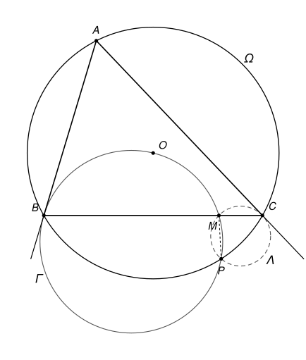

## Statement

Soit $ABC$ un triangle, $\Omega$ son cercle circonscrit et $O$ le centre de $\Omega$.

- Soit $\Gamma$ le cercle qui passe par $B$ et par $O$, et qui est tangent à la droite $(AB)$ en $B$. Il recoupe $\Omega$ en un point $P$ autre que $B$.
- Soit $\Lambda$ le cercle qui passe par $C$ et par $P$, et qui est tangent à la droite $(AC)$ en $C$. Il recoupe $\Gamma$ en un point $M$ autre que $P$.

Démontrer que $MC = MP$.

## Hints

1. Faites une figure précise. Pour tracer $\Gamma$, cherchez son centre : il est sur la perpendiculaire à $(AB)$ en $B$ et sur la médiatrice de $[BO]$. Que remarquez-vous sur la position du point $M$ ?
2. Montrez que $M$ est sur la droite $(BC)$. Utilisez l'angle entre une tangente et une corde, dans $\Gamma$ puis dans $\Lambda$, et le théorème de l'angle inscrit dans $\Omega$.
3. Le point $O$ n'a pas encore servi. Montrez que $P$ est le symétrique de $A$ par rapport à la droite $(OB)$ : comparez les angles que font les droites $(BA)$ et $(BP)$ avec la droite $(BO)$.
4. Déduisez-en que la droite $(CB)$ fait le même angle avec $(CA)$ qu'avec $(CP)$. Comparez ensuite les angles du triangle $MCP$ en $C$ et en $P$.

## Solution

On suppose que la figure n'est pas dégénérée : le cercle $\Gamma$ existe (il faut pour cela que $O$ ne soit pas sur la droite $(AB)$) et $P \neq C$ (sinon le cercle $\Lambda$ ne serait pas défini). La figure suggère que **$M$ est sur la droite $(BC)$** : c'est la clé de l'exercice.

Comme la position des points change d'une figure à l'autre, on travaille avec des angles orientés de droites, qui évitent de distinguer les cas.

### Outil : les angles orientés de droites

Pour deux droites $d_1$ et $d_2$, on note $(d_1, d_2)$ l'angle dont il faut faire tourner $d_1$, dans le sens direct, pour la rendre parallèle à $d_2$. Cet angle est compté **à $180^\circ$ près** : tourner une droite de $180^\circ$ la ramène sur elle-même. Ces angles suivent des règles simples.

- **Relation de Chasles** : $(d_1, d_3) = (d_1, d_2) + (d_2, d_3)$.
- $(d_1, d_2) = 0$ si et seulement si $d_1$ et $d_2$ sont parallèles (ou confondues). En particulier, si $d_2$ et $d_3$ sont parallèles, alors $(d_1, d_2) = (d_1, d_3)$.
- Une droite peut être nommée par deux quelconques de ses points : par exemple, si $M$ est sur la droite $(BC)$ et $M \neq C$, alors $(CM) = (CB)$.

Le théorème de l'angle inscrit prend alors une forme qui ne dépend plus de la figure.

**Angle inscrit.** Si $W$, $X$, $Y$, $Z$ sont quatre points d'un même cercle, alors $(ZX, ZY) = (WX, WY)$.

En effet, notons $\theta = \widehat{XZY}$. Si $Z$ et $W$ sont du même côté de la droite $(XY)$, le théorème de l'angle inscrit donne $\widehat{XWY} = \theta$, et les deux rotations, de $[ZX)$ vers $[ZY)$ et de $[WX)$ vers $[WY)$, tournent dans le même sens : les deux angles orientés sont égaux. Si $Z$ et $W$ sont de part et d'autre de $(XY)$, on a $\widehat{XWY} = 180^\circ - \theta$, et les deux rotations tournent en sens contraires. Si la première vaut $\theta$, la seconde vaut $-(180^\circ - \theta) = \theta - 180^\circ$, c'est-à-dire $\theta$ à $180^\circ$ près.

**Angle entre une tangente et une corde.** Soit $\Gamma$ un cercle passant par trois points distincts $X$, $Y$, $Z$, et $\tau$ la tangente à $\Gamma$ en $Z$. Alors $(\tau, ZY) = (XZ, XY)$.

En effet, soit $Z'$ le point diamétralement opposé à $Z$ sur $\Gamma$. La tangente $\tau$ est perpendiculaire au rayon, donc à $(ZZ')$. Si $Y = Z'$, alors $(\tau, ZY) = 90^\circ$, et $(XZ, XY) = 90^\circ$ car $[ZY]$ est un diamètre. Sinon, le triangle $ZYZ'$ est rectangle en $Y$, et par la relation de Chasles,

$$(\tau, ZY) = (\tau, ZZ') + (ZZ', Z'Y) + (Z'Y, ZY) = 90^\circ + (Z'Z, Z'Y) + 90^\circ = (Z'Z, Z'Y),$$

puisque $180^\circ$ compte pour $0$. Enfin $(Z'Z, Z'Y) = (XZ, XY)$ par le théorème de l'angle inscrit, car $X$ et $Z'$ sont sur $\Gamma$.

**Symétrie axiale.** Une symétrie axiale renverse le sens de rotation. Si $s$ est une symétrie axiale, alors pour toutes droites $d_1$ et $d_2$, on a $(s(d_1), s(d_2)) = -(d_1, d_2)$.

**Triangle isocèle.** Soit $XYZ$ un triangle non aplati. Alors $XY = XZ$ si et seulement si $(YZ, YX) = (ZX, ZY)$.

En effet, soit $\Delta$ la médiatrice de $[YZ]$ et $s$ la symétrie d'axe $\Delta$. Elle échange $Y$ et $Z$. Notons $X' = s(X)$.

- Si $XY = XZ$, alors $X$ est sur $\Delta$ et $X' = X$. La symétrie envoie la droite $(YZ)$ sur $(ZY)$ et la droite $(YX)$ sur $(ZX)$, donc $(ZY, ZX) = -(YZ, YX)$, c'est-à-dire $(YZ, YX) = (ZX, ZY)$.
- Réciproquement, supposons $(YZ, YX) = (ZX, ZY)$. La symétrie envoie $(YZ)$ sur $(ZY)$ et $(YX)$ sur $(ZX')$, donc $(ZY, ZX') = -(YZ, YX) = -(ZX, ZY) = (ZY, ZX)$. Les droites $(ZX')$ et $(ZX)$ passent par $Z$ et font le même angle avec $(ZY)$ : elles sont confondues, et $X'$ est sur $(ZX)$. De la même façon, $(YZ, YX') = -(ZY, ZX) = (ZX, ZY) = (YZ, YX)$, donc $X'$ est aussi sur $(YX)$. Les droites $(ZX)$ et $(YX)$ ne se coupent qu'en $X$, donc $X' = X$ : le point $X$ est sur la médiatrice $\Delta$, et $XY = XZ$.

### Étape 1 : M est sur la droite (BC)

Remarquons d'abord que $M \neq C$. En effet, les cercles $\Gamma$ et $\Omega$ n'ont que deux points communs, $B$ et $P$. Le point $C$ est sur $\Omega$ et différent de $B$ et de $P$, donc il n'est pas sur $\Gamma$, alors que $M$ y est.

Si $M = B$, il n'y a rien à démontrer. Sinon, les points $M$, $B$, $P$ sont trois points distincts de $\Gamma$, et $M$, $C$, $P$ trois points distincts de $\Lambda$.

- Dans $\Gamma$, la tangente en $B$ est $(AB)$. L'angle entre une tangente et une corde, appliqué à la corde $[BP]$, donne $(BA, BP) = (MB, MP)$.
- Dans $\Lambda$, la tangente en $C$ est $(AC)$. Appliqué à la corde $[CP]$, il donne $(CA, CP) = (MC, MP)$.
- Dans $\Omega$, le théorème de l'angle inscrit donne $(BA, BP) = (CA, CP)$.

Par la relation de Chasles,

$$(MB, MC) = (MB, MP) + (MP, MC) = (BA, BP) - (CA, CP) = 0.$$

Les droites $(MB)$ et $(MC)$ sont donc parallèles. Elles passent toutes les deux par $M$, elles sont confondues : **$M$ est sur la droite $(BC)$.**

### Étape 2 : P est le symétrique de A par rapport à (OB)

Le point $P$ est sur $\Gamma$, et $P \neq O$ car $O$, le centre de $\Omega$, n'est pas sur $\Omega$. L'angle entre la tangente $(AB)$ et la corde $[BO]$ de $\Gamma$ donne

$$(BA, BO) = (PB, PO).$$

Le triangle $OBP$ est isocèle en $O$, car $OB = OP$ (deux rayons de $\Omega$). Il n'est pas aplati, car la droite $(BO)$ ne coupe $\Gamma$ qu'en $B$ et en $O$, et $P$ n'est aucun des deux. D'après la règle du triangle isocèle, $(BP, BO) = (PO, PB)$, et donc

$$(BO, BP) = -(BP, BO) = -(PO, PB) = (PB, PO) = (BA, BO).$$

Soit $s$ la symétrie d'axe $(OB)$. Elle laisse la droite $(BO)$ en place, donc $(BO, s(BA)) = -(BO, BA) = (BA, BO) = (BO, BP)$. Les droites $s(BA)$ et $(BP)$ passent par $B$ et font le même angle avec $(BO)$ : elles sont confondues. Ainsi **$s$ envoie la droite $(BA)$ sur la droite $(BP)$.**

D'autre part, $s$ envoie le cercle $\Omega$ sur lui-même, car son centre $O$ est sur l'axe. Le point $s(A)$ est donc à la fois sur $\Omega$ et sur la droite $(BP)$. Cette droite ne coupe $\Omega$ qu'en $B$ et en $P$, et $s(A) \neq B$ car $s(B) = B$ et $A \neq B$. Donc **$s(A) = P$.**

### Étape 3 : la droite (CB) fait le même angle avec (CA) et avec (CP)

Notons $C' = s(C)$, qui est sur $\Omega$. La symétrie $s$ envoie $A$ sur $P$, $B$ sur $B$ et $C$ sur $C'$, donc

$$(C'P, C'B) = -(CA, CB).$$

Le point $C'$ est différent de $B$ (car $C \neq B$) et de $P$ (car $C \neq A$). Le théorème de l'angle inscrit dans $\Omega$ donne alors $(C'P, C'B) = (CP, CB)$. (Si $C' = C$, c'est évident.) Ainsi $(CP, CB) = -(CA, CB) = (CB, CA)$, c'est-à-dire

$$(CA, CB) = (CB, CP).$$

### Étape 4 : le triangle MCP est isocèle en M

Le triangle $MCP$ n'est pas aplati. En effet, $P$ n'est pas sur $(BC)$, car cette droite ne coupe $\Omega$ qu'en $B$ et en $C$. Les droites $(BC)$ et $(CP)$ ne se coupent donc qu'en $C$, et $M$, qui est sur $(BC)$ et différent de $C$, n'est pas sur $(CP)$.

Dans $\Lambda$, l'angle entre la tangente $(AC)$ et la corde $[CM]$ donne $(CA, CM) = (PC, PM)$. Comme $M$ est sur $(BC)$, on a $(CM) = (CB)$, et avec l'étape 3 :

$$(PC, PM) = (CA, CB) = (CB, CP) = (CM, CP).$$

C'est exactement la condition de la règle du triangle isocèle, appliquée au triangle $MPC$ (avec $X = M$, $Y = P$, $Z = C$).

### Conclusion

Le triangle $MCP$ est isocèle en $M$ : **$MC = MP$.**

## Going further

1. L'étape 1 n'utilise pas le point $O$. Montrez que, pour **tout** cercle $\Gamma$ tangent à $(AB)$ en $B$, qui recoupe $\Omega$ en $P$, le cercle $\Lambda$ défini comme dans l'énoncé recoupe $\Gamma$ en un point de la droite $(BC)$. Le point $O$ ne sert qu'à rendre le triangle $MCP$ isocèle.
2. Montrez que la droite $(OM)$ est perpendiculaire à $(PC)$.
