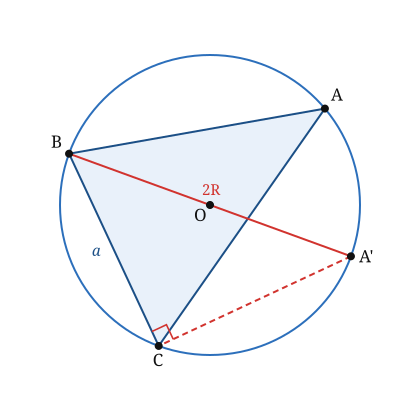

## Statement

Soit $ABC$ un triangle. On note, comme d'habitude, $a = BC$, $b = CA$, $c = AB$, et $\widehat{A}$, $\widehat{B}$, $\widehat{C}$ ses trois angles. On appelle $\mathcal{C}$ son cercle circonscrit, de centre $O$ et de rayon $R$.

Montrer que

$$\frac{a}{\sin \widehat{A}} = \frac{b}{\sin \widehat{B}} = \frac{c}{\sin \widehat{C}} = 2R .$$

**Applications.**

1. Un triangle a un côté de longueur $6$ et l'angle opposé à ce côté mesure $30°$. Quel est le rayon de son cercle circonscrit ?
2. Quel est le rayon du cercle circonscrit à un triangle équilatéral de côté $a$ ?

## Hints

1. Il suffit de démontrer une seule des égalités, par exemple $\dfrac{a}{\sin\widehat{A}} = 2R$ : les deux autres s'obtiendront en échangeant les noms des sommets.
2. Fabrique un angle droit. Quel est le seul angle inscrit dont on connaisse toujours la mesure, sans rien savoir du triangle ?
3. Appelle $A'$ le point du cercle diamétralement opposé à $B$. Que vaut l'angle $\widehat{BCA'}$ ? Et quelle est la longueur $BA'$ ?
4. Les angles $\widehat{BAC}$ et $\widehat{BA'C}$ interceptent la même corde $[BC]$. Que peut-on en dire ? Attention, il y a deux cas selon la position de $A'$.

## Solution

**L'idée : amener un angle droit en remplaçant $A$ par un point mieux placé.**

Soit $A'$ le point du cercle $\mathcal{C}$ diamétralement opposé à $B$. Le segment $[BA']$ est alors un diamètre, donc

$$BA' = 2R .$$

**Un angle droit gratuit.**

Le point $C$ est sur le cercle, et $[BA']$ est un diamètre. D'après le théorème de l'angle inscrit dans un demi-cercle, le triangle $BCA'$ est **rectangle en $C$**.

(Si $C$ coïncide avec $A'$, c'est que $[BC]$ est lui-même un diamètre ; on traite ce cas à la fin.)

**On écrit le sinus dans ce triangle rectangle.**

Dans le triangle $BCA'$, rectangle en $C$, l'angle $\widehat{BA'C}$ a pour côté opposé $[BC]$ et pour hypoténuse $[BA']$. Donc

$$\sin \widehat{BA'C} = \frac{BC}{BA'} = \frac{a}{2R}.$$

**On remplace $\widehat{BA'C}$ par $\widehat{A}$.**

Les deux angles $\widehat{BAC}$ et $\widehat{BA'C}$ sont des angles inscrits dans $\mathcal{C}$ qui interceptent la même corde $[BC]$. Deux cas se présentent.

- *Si $A$ et $A'$ sont sur le même arc délimité par $[BC]$* (c'est le cas de la figure), le théorème de l'angle inscrit donne directement $\widehat{BA'C} = \widehat{BAC} = \widehat{A}$, donc $\sin\widehat{BA'C} = \sin\widehat{A}$.
- *Si $A$ et $A'$ sont sur les deux arcs opposés*, le quadrilatère $ABA'C$ (ou $ABCA'$) est inscrit dans le cercle, et deux angles opposés d'un quadrilatère inscriptible sont supplémentaires : $\widehat{BA'C} = 180° - \widehat{A}$. Or $\sin\left(180° - x\right) = \sin x$, donc **on a encore** $\sin\widehat{BA'C} = \sin\widehat{A}$.

Dans les deux cas,

$$\sin\widehat{A} = \frac{a}{2R}, \qquad \text{c'est-à-dire} \qquad \frac{a}{\sin\widehat{A}} = 2R .$$

**Le cas écarté.** Si $C = A'$, alors $[BC]$ est un diamètre, donc $a = 2R$, et le triangle $ABC$ est rectangle en $A$, donc $\widehat A = 90°$ et $\sin\widehat A = 1$. L'égalité $\dfrac{a}{\sin\widehat A} = 2R$ est encore vraie.

**Conclusion.**

Le raisonnement n'a utilisé aucune particularité du sommet $A$. En l'appliquant à $B$ puis à $C$, on obtient de la même façon $\dfrac{b}{\sin\widehat{B}} = 2R$ et $\dfrac{c}{\sin\widehat{C}} = 2R$. D'où

$$\frac{a}{\sin \widehat{A}} = \frac{b}{\sin \widehat{B}} = \frac{c}{\sin \widehat{C}} = 2R .$$

**Applications.**

1. Avec $a = 6$ et $\widehat A = 30°$ : $\sin 30° = \dfrac12$, donc $2R = \dfrac{6}{1/2} = 12$, et $R = 6$. Le rayon du cercle circonscrit vaut $6$, quel que soit le reste du triangle.

2. Dans un triangle équilatéral de côté $a$, chaque angle vaut $60°$, donc $\sin\widehat A = \dfrac{\sqrt3}{2}$ et

$$2R = \frac{a}{\frac{\sqrt3}{2}} = \frac{2a}{\sqrt3}, \qquad \text{donc} \qquad R = \frac{a}{\sqrt3} = \frac{a\sqrt3}{3}.$$

**Ce qu'il faut retenir.** La loi des sinus n'est pas seulement une suite d'égalités entre rapports : la valeur commune de ces rapports a un sens géométrique, c'est le **diamètre du cercle circonscrit**. Un côté et l'angle opposé suffisent donc à déterminer ce cercle.

## Going further

1. Dans un triangle, le plus grand côté est-il toujours opposé au plus grand angle ? Le démontrer à l'aide de la loi des sinus, en faisant attention au cas d'un angle obtus.
2. Un triangle a pour côtés $a = 7$, $b = 8$ et un angle $\widehat A = 40°$. Peut-on toujours déterminer $\widehat B$ sans ambiguïté ? Faire un dessin.
3. Démontrer que l'aire d'un triangle vaut $\dfrac{abc}{4R}$.
