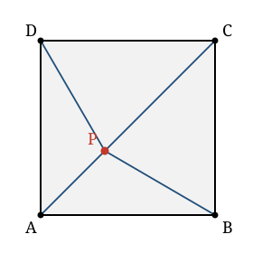

## Statement

$ABCD$ est un carré, les sommets étant nommés dans cet ordre. Un point $P$ situé à l'intérieur du carré vérifie

$$PA = 1, \qquad PB = \sqrt{2}, \qquad PC = \sqrt{3} .$$

1. Calculer $PD$.
2. Calculer la mesure de l'angle $\widehat{APB}$.
3. Calculer la longueur du côté du carré.

*Aucune de ces réponses ne doit être lue sur la figure.*

## Hints

1. Place-toi dans un repère dont l'origine est $A$ et dont les axes portent les côtés $[AB]$ et $[AD]$. Écris les quatre distances au carré.
2. Regarde la somme $PA^{2} + PC^{2}$ et la somme $PB^{2} + PD^{2}$. Que remarques-tu ?
3. Pour la question 2 : une fois $PD$ connue, compare les triangles $APB$ et $APD$. Combien de côtés égaux ont-ils ?
4. Tu obtiendras $\widehat{PAB} = 45°$. Appelle alors $M$ le pied de la perpendiculaire à $(AB)$ passant par $P$, et travaille dans les deux triangles rectangles $APM$ et $BPM$.

## Solution

### 1. La longueur $PD$

Plaçons-nous dans le repère orthonormé d'origine $A$ tel que

$$A(0\,;0), \qquad B(a\,;0), \qquad C(a\,;a), \qquad D(0\,;a),$$

où $a$ désigne le côté du carré, et notons $P(x\,;y)$.

Alors

$$PA^{2} = x^{2}+y^{2}, \qquad PB^{2} = (x-a)^{2}+y^{2}, \qquad PC^{2} = (x-a)^{2}+(y-a)^{2}, \qquad PD^{2} = x^{2}+(y-a)^{2} .$$

En additionnant les deux distances « opposées » :

$$PA^{2} + PC^{2} = x^{2}+y^{2}+(x-a)^{2}+(y-a)^{2} = PB^{2} + PD^{2} .$$

C'est une identité, vraie pour tout point $P$ du plan. Elle donne ici

$$PD^{2} = PA^{2} + PC^{2} - PB^{2} = 1 + 3 - 2 = 2, \qquad \text{donc} \qquad PD = \sqrt{2} .$$

### 2. L'angle $\widehat{APB}$

**Première étape : l'angle $\widehat{PAB}$.**

Comparons les triangles $APB$ et $APD$ :

* $AB = AD$, ce sont deux côtés du carré ;
* $PB = PD = \sqrt{2}$, d'après la question 1 ;
* $[AP]$ est un côté commun.

Ces deux triangles ont donc leurs trois côtés deux à deux de même longueur : ils sont égaux (ou « isométriques »). En particulier

$$\widehat{PAB} = \widehat{PAD} .$$

Comme $P$ est à l'intérieur du carré, la demi-droite $[AP)$ est à l'intérieur de l'angle $\widehat{BAD}$, donc

$$\widehat{PAB} + \widehat{PAD} = \widehat{BAD} = 90° , \qquad \text{d'où} \qquad \widehat{PAB} = 45° .$$

**Deuxième étape : l'angle $\widehat{PBA}$.**

Soit $M$ le pied de la perpendiculaire à $(AB)$ passant par $P$.

Dans le triangle $APM$, rectangle en $M$, l'angle en $A$ mesure $45°$, donc

$$PM = AP \times \sin 45° = 1 \times \frac{\sqrt{2}}{2} = \frac{\sqrt{2}}{2} .$$

Dans le triangle $BPM$, rectangle en $M$,

$$\sin \widehat{PBM} = \frac{PM}{PB} = \frac{\sqrt{2}/2}{\sqrt{2}} = \frac{1}{2} .$$

L'angle $\widehat{PBM}$ est aigu, puisqu'il appartient à un triangle rectangle en $M$. Donc

$$\widehat{PBM} = 30° .$$

Comme $M$ appartient au segment $[AB]$, l'angle $\widehat{PBA}$ est le même que $\widehat{PBM}$, soit $30°$.

**Conclusion.** Dans le triangle $APB$, la somme des angles vaut $180°$ :

$$\widehat{APB} = 180° - 45° - 30° = 105° .$$

### 3. Le côté du carré

Reprenons le point $M$. Dans le triangle $APM$ rectangle et isocèle en $M$ (ses angles aigus valent tous deux $45°$),

$$AM = PM = \frac{\sqrt{2}}{2} .$$

Dans le triangle $BPM$, rectangle en $M$, le théorème de Pythagore donne

$$MB^{2} = PB^{2} - PM^{2} = 2 - \frac{1}{2} = \frac{3}{2}, \qquad \text{donc} \qquad MB = \sqrt{\frac{3}{2}} = \frac{\sqrt{6}}{2} .$$

Comme $M$ est entre $A$ et $B$,

$$a = AB = AM + MB = \frac{\sqrt{2}}{2} + \frac{\sqrt{6}}{2} = \frac{\sqrt{2}+\sqrt{6}}{2} \approx \text{1,932} .$$

*Vérification.* Avec $a \approx \text{1,932}$, le point $P$ a pour coordonnées $\left(\tfrac{\sqrt2}{2}\,;\tfrac{\sqrt2}{2}\right) \approx (\text{0,707}\,;\text{0,707})$, qui est bien à l'intérieur du carré. On retrouve $PC^2 = 2(a - \text{0,707})^2 \approx 2 \times \text{1,5} = 3$.

## Going further

1. L'identité $PA^{2} + PC^{2} = PB^{2} + PD^{2}$ reste-t-elle vraie si $ABCD$ est un rectangle ? Si $P$ est à l'extérieur ? Et si $ABCD$ est un parallélogramme quelconque ?
2. Calculer de même l'angle $\widehat{DPC}$.
3. Reprendre les trois questions avec $PA = 1$, $PB = 2$ et $PC = 3$. *(Les réponses sont $PD = \sqrt{6}$, $\widehat{APB} = 135°$ et un côté valant $\sqrt{5+2\sqrt{2}} \approx \text{2,80}$ ; pour l'angle, passer par la formule d'Al-Kashi dans le triangle $APB$.)*
