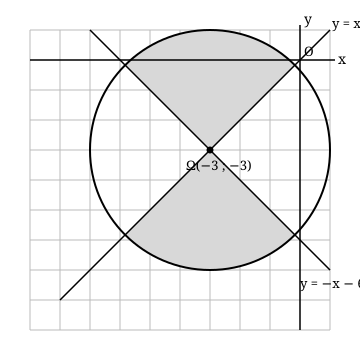

## Statement

On pose $f(x) = x^2 + 6x + 1$.

Soit $\mathcal{P}$ l'ensemble des points $M(x\,;\,y)$ du plan qui vérifient **les deux** conditions
$$f(x) + f(y) \leq 0 \qquad \text{et} \qquad f(x) - f(y) \leq 0 .$$

Calculer l'aire de $\mathcal{P}$.

## Hints

1. Traite les deux conditions séparément, puis regarde ce que donne leur intersection.
2. Pour la première : écris $f(x) + f(y)$ en entier et mets chacune des deux variables sous forme canonique. Tu devrais reconnaître une figure très familière.
3. Pour la seconde : dans $f(x) - f(y)$, les termes constants disparaissent. Factorise ce qui reste. Souviens-toi que $x^2 - y^2 = (x-y)(x+y)$.
4. Tu obtiens un produit de deux facteurs qui doit être négatif ou nul. Chaque facteur s'annule sur une droite. Où ces deux droites se coupent-elles ?
5. Une fois le dessin fait, tu n'as plus besoin de calculer : cherche une symétrie qui échange les deux parties.

## Solution

**Première condition : un disque.**

$$f(x) + f(y) = x^2 + 6x + 1 + y^2 + 6y + 1 = x^2 + 6x + y^2 + 6y + 2 .$$

Mettons chaque variable sous forme canonique : $x^2 + 6x = (x+3)^2 - 9$ et $y^2 + 6y = (y+3)^2 - 9$. Donc
$$f(x) + f(y) = (x+3)^2 + (y+3)^2 - 16 .$$

La première condition s'écrit donc
$$(x+3)^2 + (y+3)^2 \leq 16 .$$

**C'est le disque $\mathcal{D}$ de centre $\Omega(-3\,;\,-3)$ et de rayon $4$.**

**Deuxième condition : deux droites.**

$$f(x) - f(y) = (x^2 + 6x + 1) - (y^2 + 6y + 1) = (x^2 - y^2) + 6(x - y).$$

Factorisons :
$$f(x) - f(y) = (x-y)(x+y) + 6(x-y) = (x-y)\,(x + y + 6).$$

La deuxième condition s'écrit donc
$$(x - y)(x + y + 6) \leq 0 .$$

Les deux facteurs s'annulent sur les droites
$$d_1 : y = x \qquad \text{et} \qquad d_2 : y = -x - 6 .$$

Ces deux droites ont pour coefficients directeurs $1$ et $-1$ : leur produit vaut $-1$, donc **elles sont perpendiculaires**. Et elles passent toutes les deux par le point $(-3\,;\,-3)$, c'est-à-dire **exactement par le centre $\Omega$ du disque**.

Les deux droites découpent le disque en quatre quarts. La condition « le produit est négatif ou nul » sélectionne les points où les deux facteurs sont de signes contraires : ce sont **deux quarts opposés** du disque.

**L'aire, par symétrie.**

Notons $s$ la symétrie axiale d'axe $d_1 : y = x$, qui échange les coordonnées : $s(x\,;\,y) = (y\,;\,x)$.

- $s$ **laisse le disque $\mathcal{D}$ inchangé**, car son centre $\Omega(-3\,;\,-3)$ est sur l'axe $d_1$.
- $s$ **échange les deux régions**. En effet, en remplaçant $(x\,;\,y)$ par $(y\,;\,x)$, le produit $(x-y)(x+y+6)$ devient $(y-x)(y+x+6) = -(x-y)(x+y+6)$ : il change de signe.

Notons $\mathcal{P}$ la partie du disque où le produit est $\leq 0$ et $\mathcal{P}'$ celle où il est $\geq 0$. La symétrie $s$ conserve les aires et envoie $\mathcal{P}$ sur $\mathcal{P}'$, donc
$$\text{aire}(\mathcal{P}) = \text{aire}(\mathcal{P}') .$$

Or $\mathcal{P} \cup \mathcal{P}' = \mathcal{D}$, et leur partie commune est formée des deux droites, qui sont d'aire nulle. Donc
$$\text{aire}(\mathcal{P}) = \frac{1}{2}\,\text{aire}(\mathcal{D}) = \frac{1}{2} \times \pi \times 4^2 = 8\pi .$$

$$\boxed{\text{L'aire de } \mathcal{P} \text{ vaut } 8\pi \approx \text{25,1}.}$$

## Going further

On peut contrôler ce résultat en tirant au hasard un grand nombre de points dans le carré $[-7\,;\,1] \times [-7\,;\,1]$, qui contient tout le disque, et en comptant la proportion de ceux qui vérifient les deux conditions. Sur deux millions de tirages on trouve une aire voisine de $\text{25,15}$, ce qui colle bien avec $8\pi \approx \text{25,13}$.
