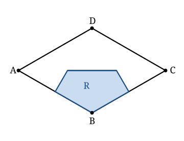

## Statement

$ABCD$ est un losange de côté $2$ dont l'angle en $B$ mesure $120°$.

On note $R$ l'ensemble des points situés à l'intérieur du losange qui sont **strictement plus proches du sommet $B$ que de chacun des trois autres sommets**.

Quelle est l'aire de $R$ ?

## Hints

1. Pour deux points $B$ et $A$ donnés, quel est l'ensemble des points du plan aussi éloignés de $B$ que de $A$ ? Et l'ensemble de ceux qui sont plus proches de $B$ ?
2. $R$ est donc l'intersection du losange avec **trois** demi-plans. Lequel des trois est le plus facile à écrire ?
3. Place-toi dans un repère bien choisi : les diagonales d'un losange sont perpendiculaires et se coupent en leur milieu. Prends-les comme axes.
4. Calcule d'abord les longueurs des deux diagonales. Le triangle $ABD$ est isocèle, et son angle en $A$ vaut $60°$ : que peut-on en dire ?
5. Une fois les coordonnées posées, la condition « plus proche de $B$ que de $A$ » s'écrit $PB^2 < PA^2$. Développe : les termes en $x^2$ et $y^2$ disparaissent, il reste une inégalité du premier degré.
6. La zone $R$ est un pentagone. Trouve ses cinq sommets, puis découpe-le en morceaux simples.

## Solution

**L'outil de base : la médiatrice.**

Un point $P$ est à égale distance de $B$ et de $A$ si et seulement s'il appartient à la médiatrice du segment $[AB]$. Cette médiatrice coupe le plan en deux demi-plans : celui qui contient $B$ est formé des points plus proches de $B$, l'autre des points plus proches de $A$.

La zone $R$ est donc l'intersection de quatre régions : l'intérieur du losange, et les trois demi-plans « côté $B$ » des médiatrices de $[AB]$, $[BC]$ et $[BD]$.

**Un repère adapté.**

Les diagonales d'un losange sont perpendiculaires et se coupent en leur milieu. Prenons ce point d'intersection comme origine, et les diagonales comme axes.

Calculons d'abord les diagonales. L'angle en $B$ vaut $120°$, donc l'angle en $A$ vaut $60°$ (angles consécutifs d'un parallélogramme). Le triangle $ABD$ est isocèle en $A$ (car $AB = AD = 2$) avec un angle de $60°$ au sommet $A$ : il est donc **équilatéral**, d'où

$$BD = 2 .$$

Pour l'autre diagonale, le triangle $ABC$ est isocèle en $B$ avec $BA = BC = 2$ et $\widehat{ABC} = 120°$. La hauteur issue de $B$ le coupe en deux triangles rectangles d'angle $60°$ au sommet $B$, d'où $\dfrac{AC}{2} = 2\sin(60°) = \sqrt{3}$, et

$$AC = 2\sqrt{3} .$$

On pose alors

$$A(-\sqrt3\,;0), \qquad B(0\,;-1), \qquad C(\sqrt3\,;0), \qquad D(0\,;1).$$

*Contrôle :* $AB = \sqrt{3 + 1} = 2$, c'est bien le côté du losange.

**Les trois conditions.**

Soit $P(x\,;y)$.

*Plus proche de $B$ que de $D$.* $PB^2 < PD^2$ s'écrit

$$x^2 + (y+1)^2 < x^2 + (y-1)^2 \iff 2y < -2y \iff y < 0 .$$

C'est simplement le demi-plan situé sous l'axe des abscisses, ce qui était prévisible : la médiatrice de $[BD]$ est l'autre diagonale.

*Plus proche de $B$ que de $A$.* $PB^2 < PA^2$ s'écrit

$$x^2 + (y+1)^2 < (x+\sqrt3)^2 + y^2 \iff 2y + 1 < 2\sqrt3\,x + 3 \iff y < \sqrt3\,x + 1 .$$

*Plus proche de $B$ que de $C$.* Par symétrie par rapport à l'axe des ordonnées, on obtient

$$y < -\sqrt3\,x + 1 .$$

**La forme de $R$.**

La condition $y < 0$ nous place dans la moitié basse du losange, qui est le triangle $ABC$ de sommets $A(-\sqrt3\,;0)$, $B(0\,;-1)$, $C(\sqrt3\,;0)$.

Dans ce triangle, la droite $y = \sqrt3\,x + 1$ coupe :

- l'axe des abscisses en $P_1\left(-\dfrac{\sqrt3}{3}\,;0\right)$ (on résout $0 = \sqrt3 x + 1$) ;
- le côté $[AB]$, porté par la droite $y = -\dfrac{x}{\sqrt3} - 1$, au point $P_2\left(-\dfrac{\sqrt3}{2}\,;-\dfrac12\right)$, qui n'est autre que le **milieu de $[AB]$** — et c'est normal, la médiatrice de $[AB]$ passe par ce milieu.

Symétriquement, la droite $y = -\sqrt3\,x + 1$ coupe l'axe des abscisses en $P_4\left(\dfrac{\sqrt3}{3}\,;0\right)$ et le côté $[BC]$ en son milieu $P_3\left(\dfrac{\sqrt3}{2}\,;-\dfrac12\right)$.

La zone $R$ est donc le **pentagone** de sommets

$$P_1\left(-\tfrac{\sqrt3}{3}\,;0\right), \quad P_2\left(-\tfrac{\sqrt3}{2}\,;-\tfrac12\right), \quad B(0\,;-1), \quad P_3\left(\tfrac{\sqrt3}{2}\,;-\tfrac12\right), \quad P_4\left(\tfrac{\sqrt3}{3}\,;0\right).$$

**Le calcul de l'aire.**

Découpons le pentagone par le segment vertical joignant $B(0\,;-1)$ à l'origine $O(0\,;0)$. Il se sépare en deux quadrilatères symétriques l'un de l'autre ; calculons l'aire de celui de droite, $O P_4 P_3 B$.

Ce quadrilatère a pour sommets $O(0\,;0)$, $P_4\left(\tfrac{\sqrt3}{3}\,;0\right)$, $P_3\left(\tfrac{\sqrt3}{2}\,;-\tfrac12\right)$, $B(0\,;-1)$. Coupons-le par la diagonale $[O P_3]$ en deux triangles.

*Triangle $O P_4 P_3$ :* on prend $[OP_4]$ comme base, de longueur $\dfrac{\sqrt3}{3}$, portée par l'axe des abscisses. La hauteur issue de $P_3$ est la distance de $P_3$ à cet axe, soit $\dfrac12$. Son aire vaut

$$\frac12 \times \frac{\sqrt3}{3} \times \frac12 = \frac{\sqrt3}{12}.$$

*Triangle $O P_3 B$ :* on prend $[OB]$ comme base, de longueur $1$, portée par l'axe des ordonnées. La hauteur issue de $P_3$ est la distance de $P_3$ à cet axe, soit $\dfrac{\sqrt3}{2}$. Son aire vaut

$$\frac12 \times 1 \times \frac{\sqrt3}{2} = \frac{\sqrt3}{4}.$$

La moitié droite a donc pour aire

$$\frac{\sqrt3}{12} + \frac{\sqrt3}{4} = \frac{\sqrt3}{12} + \frac{3\sqrt3}{12} = \frac{4\sqrt3}{12} = \frac{\sqrt3}{3}.$$

En doublant :

$$\text{aire}(R) = \frac{2\sqrt3}{3}.$$

**Conclusion.** L'aire de la zone $R$ vaut

$$\frac{2\sqrt3}{3} \approx \text{1,15}.$$

**Un contrôle de bon sens.** L'aire du losange entier vaut $\dfrac{AC \times BD}{2} = \dfrac{2\sqrt3 \times 2}{2} = 2\sqrt3 \approx \text{3,46}$. La zone $R$ en occupe donc exactement le tiers. C'est cohérent : $B$ est un sommet « obtus » du losange, plus entouré d'espace que $A$ et $C$, mais les quatre zones (une par sommet) ne se partagent pas équitablement le losange.

## Going further

1. Quelles sont les aires des trois autres zones, celle des points plus proches de $A$, de $C$, de $D$ ? Vérifier que les quatre aires ont bien pour somme $2\sqrt3$.
2. Que devient l'aire de $R$ si l'angle en $B$ vaut $90°$, c'est-à-dire si le losange est un carré ?
3. Reprendre le problème avec un triangle équilatéral de côté $2$ au lieu d'un losange : quelle est l'aire de la zone des points plus proches d'un sommet donné ?
