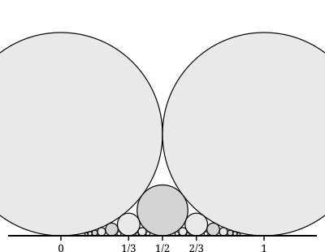

## Statement

On travaille dans un repère orthonormé. À chaque fraction irréductible $\dfrac{p}{q}$, avec
$q \geqslant 1$, on associe le **cercle de Ford** $C(\dfrac{p}{q})$ :

- il est tangent à l'axe des abscisses au point d'abscisse $\dfrac{p}{q}$ ;
- il est situé au-dessus de cet axe ;
- son rayon vaut $\dfrac{1}{2q^2}$.

Autrement dit, son centre est le point de coordonnées $(\dfrac{p}{q} ; \dfrac{1}{2q^2})$.
Plus le dénominateur est grand, plus le cercle est petit.

Le dessin suggère quelque chose de remarquable : ces cercles se touchent souvent, et ne se
coupent jamais. On va le démontrer.

1. Deux cercles $\mathcal{C}$ et $\mathcal{C}'$ sont tangents à l'axe des abscisses en
   $a$ et $b$, du même côté, et ont pour rayons $\rho$ et $\sigma$. Montre que
   $$\mathcal{C} \text{ et } \mathcal{C}' \text{ sont tangents extérieurement} \text{ si et seulement si } (b-a)^2 = 4\rho\sigma ,$$
   et qu'ils sont extérieurs l'un à l'autre, sans point commun, si et seulement si
   $(b-a)^2 > 4\rho\sigma$.
2. Vérifie que $C(0)$ et $C(1)$ sont tangents, et que $C(\dfrac{1}{2})$ est tangent aux
   deux.
3. Soient $\dfrac{p}{q}$ et $\dfrac{r}{s}$ deux fractions irréductibles différentes. Montre que
   $$C(\frac{p}{q}) \text{ et } C(\frac{r}{s}) \text{ sont tangents} \text{ si et seulement si } |ps - qr| = 1 ,$$
   et que dans tous les autres cas ils n'ont aucun point commun. **Deux cercles de Ford ne se
   coupent donc jamais.**

## Hints

1. Pour la question 1, écris les coordonnées des deux centres. Un cercle tangent à l'axe des
   abscisses en $a$, au-dessus, et de rayon $\rho$, a son centre en $(a ; \rho)$.
2. Calcule le carré de la distance des centres avec le théorème de Pythagore, puis compare-le
   à $(\rho + \sigma)^2$. Développe : beaucoup de choses se simplifient.
3. Pour la question 3, mets $\dfrac{r}{s} - \dfrac{p}{q}$ au même dénominateur avant de
   l'élever au carré.
4. Calcule aussi $4\rho\sigma$ : il apparaît un $q^2 s^2$ des deux côtés.
5. La clé de la fin : $ps - qr$ est un **entier**, et il n'est pas nul. Que peut-on dire de son
   carré ?

## Solution

**1. La condition de tangence.**

Le cercle $\mathcal{C}$, tangent à l'axe des abscisses en $a$ et situé au-dessus, a son centre
en $\Omega(a ; \rho)$ : le rayon aboutissant au point de contact est perpendiculaire à l'axe,
donc vertical. De même $\mathcal{C}'$ a son centre en $\Omega'(b ; \sigma)$.

Par le théorème de Pythagore,

$$(\Omega\Omega')^2 = (b - a)^2 + (\sigma - \rho)^2 .$$

Les deux cercles sont tangents extérieurement exactement lorsque
$\Omega\Omega' = \rho + \sigma$, c'est-à-dire, les deux membres étant positifs, lorsque
$(\Omega\Omega')^2 = (\rho+\sigma)^2$ :

$$(b-a)^2 + (\sigma - \rho)^2 = (\rho + \sigma)^2 .$$

Or $(\rho+\sigma)^2 - (\sigma-\rho)^2 = 4\rho\sigma$. La condition s'écrit donc

$$\boxed{(b-a)^2 = 4\rho\sigma}$$

Le même calcul avec une inégalité donne : $\Omega\Omega' > \rho + \sigma$, c'est-à-dire les
deux cercles extérieurs l'un à l'autre et sans point commun, équivaut à
$(b-a)^2 > 4\rho\sigma$.

*(Le troisième cas, $\Omega\Omega' < \rho+\sigma$, donnerait deux cercles sécants ou l'un dans
l'autre ; il correspond à $(b-a)^2 < 4\rho\sigma$.)*

**2. Les trois premiers cercles.**

$C(0)$ et $C(1)$ ont tous deux le dénominateur $q = 1$, donc le rayon
$\dfrac{1}{2 \times 1} = \dfrac{1}{2}$. Ici $a = 0$, $b = 1$ :

$$(b-a)^2 = 1 \qquad \text{et} \qquad 4\rho\sigma = 4 \times \frac{1}{2} \times \frac{1}{2} = 1 .$$

Ils sont tangents.

$C(\dfrac{1}{2})$ a pour rayon $\dfrac{1}{2 \times 2^2} = \dfrac{1}{8}$. Avec $C(0)$ :

$$(b-a)^2 = (\frac{1}{2})^2 = \frac{1}{4} \qquad \text{et} \qquad 4 \times \frac{1}{2} \times \frac{1}{8} = \frac{1}{4} .$$

Ils sont tangents. Par symétrie autour de $\dfrac{1}{2}$, il en va de même avec $C(1)$.

Ainsi, le cercle posé sur $\dfrac{1}{2}$ est exactement celui qui se glisse dans le creux entre
les deux gros cercles, en touchant les deux et l'axe. C'est le petit cercle du milieu sur le
dessin.

**3. Le cas général.**

Posons $a = \dfrac{p}{q}$, $b = \dfrac{r}{s}$, $\rho = \dfrac{1}{2q^2}$,
$\sigma = \dfrac{1}{2s^2}$.

*Le premier membre.* En mettant au même dénominateur,

$$b - a = \frac{r}{s} - \frac{p}{q} = \frac{rq - ps}{qs}, \qquad \text{donc} \qquad (b-a)^2 = \frac{(rq - ps)^2}{q^2 s^2} .$$

*Le second membre.*

$$4\rho\sigma = 4 \times \frac{1}{2q^2} \times \frac{1}{2s^2} = \frac{1}{q^2 s^2} .$$

*La comparaison.* Les deux quantités ont le même dénominateur $q^2s^2$, qui est strictement
positif. Donc

$$(b-a)^2 - 4\rho\sigma = \frac{(rq - ps)^2 - 1}{q^2 s^2} ,$$

et le signe de cette différence est celui de $(rq - ps)^2 - 1$.

*Le point décisif.* Le nombre $N = ps - qr$ est un **entier**, puisque $p$, $q$, $r$, $s$ le
sont. De plus $N \ne 0$ : si $ps = qr$, alors $\dfrac{p}{q} = \dfrac{r}{s}$, contrairement à
l'hypothèse. Donc $|N| \geqslant 1$, et $N^2 \geqslant 1$ : la différence ci-dessus n'est
**jamais strictement négative**. Deux cercles de Ford ne peuvent donc jamais être sécants, ni
l'un contenu dans l'autre.

Il ne reste que deux possibilités.

- Si $|N| = 1$, alors $N^2 - 1 = 0$, donc $(b-a)^2 = 4\rho\sigma$ : les deux cercles sont
  **tangents**.
- Si $|N| \geqslant 2$, alors $N^2 \geqslant 4$, donc $N^2 - 1 \geqslant 3 > 0$ et
  $(b-a)^2 > 4\rho\sigma$ : les deux cercles sont **extérieurs l'un à l'autre**, sans aucun
  point commun.

$$\boxed{C(\frac{p}{q}) \text{ et } C(\frac{r}{s}) \text{ sont tangents si et seulement si } |ps - qr| = 1 ; \text{ sinon ils sont disjoints.}}$$

**Vérifications.** Pour $\dfrac{0}{1}$ et $\dfrac{1}{1}$ : $|0 \times 1 - 1 \times 1| = 1$,
tangents. Pour $\dfrac{0}{1}$ et $\dfrac{1}{2}$ : $|0 \times 2 - 1 \times 1| = 1$, tangents.
Pour $\dfrac{1}{3}$ et $\dfrac{2}{3}$ : $|1 \times 3 - 3 \times 2| = 3$, disjoints, et c'est
bien ce que montre le dessin. Pour $\dfrac{1}{3}$ et $\dfrac{1}{2}$ :
$|1 \times 2 - 3 \times 1| = 1$, tangents.

**Ce que ce résultat raconte.** Le dessin est une image de l'arithmétique des fractions. Deux
fractions sont « voisines » au sens $|ps - qr| = 1$ exactement lorsque leurs cercles se
touchent. On peut lire sur la figure, sans calcul, quelles fractions sont voisines. C'est
Lester Ford qui a publié cette construction en 1938.

## Going further

1. Soient $\dfrac{p}{q}$ et $\dfrac{r}{s}$ deux fractions voisines, c'est-à-dire
   $|ps - qr| = 1$. Montre que leur **médiante** $\dfrac{p+r}{q+s}$ est irréductible et
   voisine de chacune des deux. Son cercle est donc tangent aux deux autres : c'est lui qui
   remplit le creux entre eux.
2. Applique la médiante à $\dfrac{0}{1}$ et $\dfrac{1}{1}$, puis à $\dfrac{0}{1}$ et
   $\dfrac{1}{2}$, puis encore. Quelle suite de fractions obtiens-tu ? *(On l'appelle l'arbre
   de Stern-Brocot, et il produit chaque fraction irréductible une fois et une seule.)*
3. Montre que le creux entre $C(\dfrac{p}{q})$, $C(\dfrac{r}{s})$ et l'axe est
   rempli exactement par le cercle de la médiante, et par aucun autre cercle de Ford.
4. Quel lien vois-tu entre ce dessin et le tamis d'Apollonius ?
