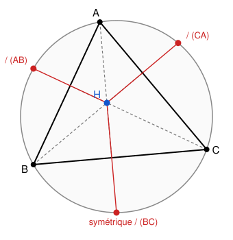

## Statement

Soit $ABC$ un triangle dont les trois angles sont aigus, et soit $H$ son **orthocentre**,
c'est-à-dire le point où se coupent les trois hauteurs.

Montrer que les symétriques de $H$ par rapport aux trois côtés du triangle appartiennent au
**cercle circonscrit** de $ABC$.

## Hints

1. Il suffit de le démontrer pour un côté, disons $(AC)$ : les deux autres se traitent de la
   même façon.
2. Appelle $B'$ le second point d'intersection de la hauteur issue de $B$ avec le cercle
   circonscrit. Montre que $B'$ est le symétrique de $H$ par rapport à $(AC)$.
3. Pour cela, il suffit de montrer que le pied de cette hauteur est le **milieu** du segment
   $[HB']$.
4. Chasse aux angles. Compare $\widehat{HAC}$ (où $H$ est vu depuis $A$) et
   $\widehat{B'AC}$ : s'ils sont égaux, les deux triangles rectangles qu'ils déterminent sont
   isométriques.
5. Utilise le théorème de l'angle inscrit : $\widehat{CBB'}$ et $\widehat{CAB'}$ interceptent
   le même arc.

## Solution

Il suffit de traiter le côté $(AC)$ ; les deux autres se traitent par le même raisonnement, en
permutant les noms.

**Le point candidat.**

Notons $K$ le pied de la hauteur issue de $B$ (donc $K$ est sur $(AC)$, et
$(BK) \perp (AC)$), et notons $B'$ le second point d'intersection de la droite $(BK)$ avec le
cercle circonscrit de $ABC$.

Comme $H$ est sur la hauteur $(BK)$, les trois points $H$, $K$, $B'$ sont alignés sur cette
droite, qui est perpendiculaire à $(AC)$.

Pour montrer que $B'$ est le symétrique de $H$ par rapport à $(AC)$, il suffit donc de
montrer que
$$KH = KB' .$$

**Chasse aux angles.**

Posons $\beta = \widehat{HAK}$, c'est-à-dire l'angle en $A$ dans le triangle rectangle $AKH$.

Notons aussi $\gamma = \widehat{BCA}$ l'angle du triangle en $C$.

*Premier calcul.* Soit $L$ le pied de la hauteur issue de $A$ : le point $H$ est sur le
segment $[AL]$, et $(AL) \perp (BC)$. Dans le triangle $ALC$, rectangle en $L$, on a
$$\widehat{LAC} = 90° - \gamma .$$
Or $H$ est sur le segment $[AL]$, donc $\widehat{HAC} = \widehat{LAC} = 90° - \gamma$, et
comme $K$ est sur $(AC)$, cela s'écrit
$$\beta = \widehat{HAK} = 90° - \gamma .$$

*Second calcul.* Le triangle $BKC$ est rectangle en $K$, donc
$$\widehat{CBB'} = \widehat{CBK} = 90° - \gamma .$$

Or les angles inscrits $\widehat{CBB'}$ et $\widehat{CAB'}$ interceptent le même arc
$\overset{\frown}{CB'}$ du cercle circonscrit. Ils sont donc égaux :
$$\widehat{CAB'} = \widehat{CBB'} = 90° - \gamma = \beta .$$

**Conclusion.**

Les deux triangles $AKH$ et $AKB'$ sont rectangles en $K$, ils partagent le côté $[AK]$, et
leurs angles en $A$ sont égaux (tous deux valent $\beta$). Ils sont donc isométriques, d'où
$$KH = KB' .$$

Comme $H$ et $B'$ sont de part et d'autre de $(AC)$ sur une même perpendiculaire à $(AC)$,
le point $B'$ est bien le **symétrique de $H$ par rapport à $(AC)$**.

Et $B'$ appartient au cercle circonscrit, par construction. $\blacksquare$

## Going further

Le résultat a une jolie conséquence : le cercle circonscrit au triangle $HBC$ est l'image du
cercle circonscrit à $ABC$ par la symétrie d'axe $(BC)$. En particulier, **ces deux cercles
ont le même rayon**.

Il en découle aussi une construction de l'orthocentre sans tracer deux hauteurs. On trace la
perpendiculaire à $(AC)$ passant par $B$, on note $B'$ son second point d'intersection avec le
cercle circonscrit, et on prend le symétrique de $B'$ par rapport à $(AC)$ : c'est $H$.

Retiens surtout la technique employée. Pour prouver qu'un point construit d'une certaine façon
appartient à une figure définie autrement, on définit un **troisième** point, celui-là
directement sur la figure voulue, et on montre qu'il coïncide avec le premier. Ici le point
$B'$ était sur le cercle par construction, et tout le travail a consisté à montrer qu'il était
aussi le symétrique de $H$.
