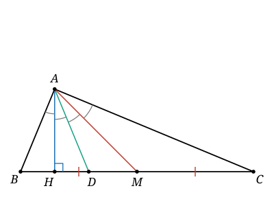

## Statement

Dans un triangle $ABC$, on trace les trois droites issues du sommet $A$ :

- la **hauteur**, qui coupe $(BC)$ perpendiculairement ;
- la **bissectrice**, qui partage l'angle $\widehat{BAC}$ en deux parts égales ;
- la **médiane**, qui va jusqu'au milieu de $[BC]$.

On suppose que ces trois droites découpent l'angle $\widehat{BAC}$ en quatre angles égaux, de mesure commune $\alpha$.

1. Exprimer les angles $\widehat{ABC}$ et $\widehat{ACB}$ en fonction de $\alpha$.
2. Calculer $\alpha$, puis donner les trois angles du triangle.

## Hints

1. La bissectrice coupe $\widehat{BAC}$ en deux parts égales, donc c'est forcément celle des trois demi-droites qui se trouve **au milieu**. La hauteur et la médiane sont donc les deux demi-droites extrêmes : l'une à $\alpha$ du côté $[AB)$, l'autre à $\alpha$ du côté $[AC)$. Quitte à échanger les noms de $B$ et de $C$, suppose que c'est la hauteur qui est du côté de $[AB)$.
2. Note $H$ le pied de la hauteur. Le triangle $ABH$ est rectangle en $H$. Que vaut $\widehat{BAH}$ en fonction de $\widehat{ABC}$ ?
3. La somme des angles du triangle te donne alors $\widehat{ACB}$. Additionne les trois expressions obtenues : que remarques-tu ? Conclusion : il manque encore une information, et c'est la **médiane** qui ne t'a pas encore servi.
4. Introduis $O$, le centre du cercle circonscrit à $ABC$. Le triangle $OAB$ est isocèle en $O$, et le théorème de l'angle au centre donne $\widehat{AOB} = 2\,\widehat{ACB}$. Calcule $\widehat{BAO}$.
5. Compare $\widehat{BAO}$ avec l'angle que fait la médiane avec $[AB)$. Que peux-tu dire de la position du point $O$ ?
6. Mais $O$ est aussi sur la médiatrice de $[BC]$, qui passe par le milieu $M$. Déduis-en que $O = M$, puis conclus avec le théorème de l'angle inscrit dans un demi-cercle.

## Solution

Notons $H$ le pied de la hauteur issue de $A$, $D$ le point où la bissectrice coupe $[BC]$, et $M$ le milieu de $[BC]$.

### Qui est où

La bissectrice partage $\widehat{BAC}$ en deux angles égaux, chacun valant $2\alpha$. Parmi les trois demi-droites tracées, c'est donc celle du milieu. Les deux autres, la hauteur et la médiane, sont les demi-droites extrêmes : l'une fait un angle $\alpha$ avec $[AB)$, l'autre fait un angle $\alpha$ avec $[AC)$.

Quitte à échanger les noms de $B$ et de $C$, supposons que c'est la hauteur qui est du côté de $[AB)$. Les quatre angles, en tournant de $[AB)$ vers $[AC)$, sont donc

$$\widehat{BAH} = \alpha, \qquad \widehat{HAD} = \alpha, \qquad \widehat{DAM} = \alpha, \qquad \widehat{MAC} = \alpha,$$

et en particulier

$$\widehat{BAC} = 4\alpha \qquad \text{et} \qquad \widehat{BAM} = 3\alpha.$$

Remarquons au passage que la demi-droite $[AH)$ est strictement à l'intérieur de l'angle $\widehat{BAC}$, donc $H$ est strictement entre $B$ et $C$. Les angles $\widehat{ABC}$ et $\widehat{ACB}$ sont donc tous les deux aigus.

### Question 1 : les deux autres angles

Le triangle $ABH$ est rectangle en $H$. La somme de ses angles donne

$$\widehat{BAH} + \widehat{ABH} = 90^\circ, \qquad \text{soit} \qquad \alpha + \widehat{ABC} = 90^\circ.$$

Donc

$$\widehat{ABC} = 90^\circ - \alpha.$$

La somme des angles du triangle $ABC$ donne ensuite

$$\widehat{ACB} = 180^\circ - 4\alpha - \left(90^\circ - \alpha\right) = 90^\circ - 3\alpha.$$

**Attention à un piège.** Additionnons les trois expressions trouvées :

$$4\alpha + \left(90^\circ - \alpha\right) + \left(90^\circ - 3\alpha\right) = 180^\circ.$$

L'égalité est vraie pour **toute** valeur de $\alpha$. Autrement dit, la question 1 n'impose aucune contrainte sur $\alpha$ : elle exploite la hauteur et la bissectrice, mais pas encore la médiane. C'est donc la médiane qui va fournir l'équation manquante.

### Question 2 : faire parler la médiane

Notons $O$ le centre du cercle circonscrit au triangle $ABC$.

**Le calcul de $\widehat{BAO}$.** L'angle $\widehat{ACB}$ est aigu, donc le théorème de l'angle au centre s'applique directement :

$$\widehat{AOB} = 2\,\widehat{ACB}.$$

Le triangle $OAB$ est isocèle en $O$, puisque $OA = OB$ est le rayon du cercle circonscrit. Ses deux angles à la base sont donc égaux, et leur somme vaut $180^\circ - \widehat{AOB}$ :

$$\widehat{BAO} = \frac{180^\circ - 2\,\widehat{ACB}}{2} = 90^\circ - \widehat{ACB} = 90^\circ - \left(90^\circ - 3\alpha\right) = 3\alpha.$$

**$O$ est sur la médiane.** Comme $\widehat{ACB}$ est aigu, le point $O$ est du même côté de la droite $(AB)$ que le point $C$. Or la demi-droite $[AM)$ est elle aussi de ce côté, et l'on a vu que $\widehat{BAM} = 3\alpha$.

Ainsi $[AO)$ et $[AM)$ sont deux demi-droites issues de $A$, situées du même côté de $(AB)$, et faisant le même angle $3\alpha$ avec $[AB)$. Elles sont donc confondues, et $O$ appartient à la droite $(AM)$.

**$O$ est le milieu de $[BC]$.** Le point $O$ est équidistant de $B$ et de $C$, donc il appartient à la médiatrice de $[BC]$, qui passe par $M$. Supposons un instant $O \neq M$. Alors la droite $(OM)$ est la médiatrice de $[BC]$ ; mais $O$ et $M$ sont tous deux sur la droite $(AM)$, donc $(AM)$ serait la médiatrice de $[BC]$. On aurait alors $AB = AC$, et dans un triangle isocèle en $A$ la hauteur, la bissectrice et la médiane issues de $A$ sont **une seule et même droite**. Elles ne découperaient pas l'angle en quatre parts. C'est exclu.

Donc

$$O = M.$$

**Conclusion.** Le centre du cercle circonscrit est le milieu de $[BC]$, donc $[BC]$ est un diamètre de ce cercle. Le point $A$ est sur le cercle, donc le théorème de l'angle inscrit dans un demi-cercle donne $\widehat{BAC} = 90^\circ$. Comme $\widehat{BAC} = 4\alpha$ :

$$4\alpha = 90^\circ, \qquad \text{donc} \qquad \boxed{\alpha = \text{22,5}^\circ.}$$

Les trois angles du triangle valent alors

$$\widehat{BAC} = 90^\circ, \qquad \widehat{ABC} = 90^\circ - \alpha = \text{67,5}^\circ, \qquad \widehat{ACB} = 90^\circ - 3\alpha = \text{22,5}^\circ.$$

### Vérification

Il reste à s'assurer qu'un tel triangle existe vraiment. Prenons donc un triangle $ABC$ rectangle en $A$ avec $\widehat{ABC} = \text{67,5}^\circ$ et $\widehat{ACB} = \text{22,5}^\circ$, et vérifions les quatre angles un par un.

- **La hauteur.** Dans le triangle $ABH$ rectangle en $H$, on a $\widehat{BAH} = 90^\circ - \widehat{ABC} = \text{22,5}^\circ$.
- **La bissectrice.** Elle partage l'angle droit en deux, donc $\widehat{BAD} = 45^\circ$, c'est-à-dire $\widehat{HAD} = 45^\circ - \text{22,5}^\circ = \text{22,5}^\circ$.
- **La médiane.** Comme le triangle est rectangle en $A$, le milieu $M$ de l'hypoténuse est le centre du cercle circonscrit, donc $MA = MB$. Le triangle $MAB$ est isocèle en $M$, d'où $\widehat{MAB} = \widehat{MBA} = \text{67,5}^\circ$. Donc $\widehat{DAM} = \text{67,5}^\circ - 45^\circ = \text{22,5}^\circ$, et $\widehat{MAC} = 90^\circ - \text{67,5}^\circ = \text{22,5}^\circ$.

Les quatre angles valent bien $\text{22,5}^\circ$ chacun.

## Going further

**Une autre route, par le calcul.** On peut remplacer tout le passage par le cercle circonscrit par un calcul de trigonométrie. La médiane partage le triangle $ABC$ en deux triangles $ABM$ et $ACM$ de même aire, puisque $BM = MC$ et que ces deux triangles ont la même hauteur issue de $A$. En écrivant chaque aire avec la formule $\tfrac12 \times$ produit de deux côtés $\times$ sinus de l'angle entre eux :

$$\frac12 \, AB \cdot AM \sin\left(3\alpha\right) = \frac12 \, AC \cdot AM \sin\left(\alpha\right), \qquad \text{donc} \qquad AB \, \sin 3\alpha = AC \, \sin \alpha.$$

La loi des sinus donne $AB = 2R \sin \widehat{ACB}$ et $AC = 2R \sin \widehat{ABC}$, avec $\widehat{ACB} = 90^\circ - 3\alpha$ et $\widehat{ABC} = 90^\circ - \alpha$. L'égalité devient

$$\cos 3\alpha \, \sin 3\alpha = \cos \alpha \, \sin \alpha,$$

et en utilisant $2 \sin x \cos x = \sin 2x$ des deux côtés :

$$\sin 6\alpha = \sin 2\alpha.$$

Comme $0 < \alpha < 30^\circ$, on a $0 < 2\alpha < 60^\circ$ et $0 < 6\alpha < 180^\circ$. Les deux angles $6\alpha$ et $2\alpha$ ont le même sinus sans être égaux, ils sont donc supplémentaires :

$$6\alpha = 180^\circ - 2\alpha, \qquad \text{soit} \qquad \alpha = \text{22,5}^\circ.$$

**Le lemme caché.** L'étape décisive de la première solution mérite d'être retenue toute seule, car elle resservira souvent. Dans n'importe quel triangle $ABC$ d'orthocentre $H_0$ et de centre du cercle circonscrit $O$, on a

$$\widehat{BAO} = \widehat{CAH_0}.$$

La démonstration tient en deux lignes, exactement celles écrites ci-dessus : $\widehat{BAO} = 90^\circ - \widehat{ACB}$ par le triangle isocèle $OAB$, et $\widehat{CAH_0} = 90^\circ - \widehat{ACB}$ par le triangle rectangle $ACH$. On dit que les droites $(AO)$ et $(AH_0)$ sont **isogonales** par rapport à l'angle $\widehat{A}$ : elles se déduisent l'une de l'autre par la symétrie d'axe la bissectrice issue de $A$.
