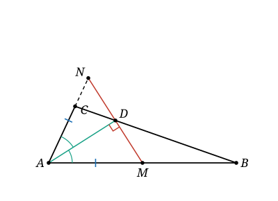

## Statement

Soit $ABC$ un triangle. La bissectrice intérieure de l'angle $\widehat{BAC}$ coupe le côté $[BC]$ en un point $D$, et on note $M$ le milieu du côté $[AB]$.

On suppose que les droites $(MD)$ et $(AD)$ sont perpendiculaires.

Démontrer que

$$DB = 3 \times DC.$$

![Le triangle ABC, la bissectrice AD, le milieu M de [AB], et l'angle droit en D entre (MD) et (AD).](7089-figure-1.svg)

## Hints

1. Une bissectrice qui est aussi une hauteur, cela rappelle quelque chose. Cherche un triangle isocèle caché.
2. Place sur la demi-droite $[AC)$ le point $N$ tel que $AN = AM$. Que devient la droite $(AD)$ pour le triangle $AMN$ ?
3. Montre que la droite $(MN)$ et la droite $(MD)$ sont en fait la même droite, et que $D$ est le milieu de $[MN]$.
4. Passe aux vecteurs. Prends $A$ comme origine et exprime tout dans la base $\left(\overrightarrow{AB}, \overrightarrow{AC}\right)$. Note $k$ le nombre tel que $\overrightarrow{AN} = k\,\overrightarrow{AC}$.
5. Exprime $\overrightarrow{AD}$ d'une première façon, en utilisant que $D$ est le milieu de $[MN]$.
6. Exprime $\overrightarrow{AD}$ d'une deuxième façon, en utilisant que $D$ est sur la droite $(BC)$ : il existe $t$ tel que $\overrightarrow{BD} = t\,\overrightarrow{BC}$.
7. Deux écritures dans la même base, ce sont deux équations. Résous, et lis le rapport cherché sur la valeur de $t$.

## Solution

### Étape 1 : faire apparaître un triangle isocèle

Plaçons sur la demi-droite $[AC)$ le point $N$ tel que

$$AN = AM = \frac{AB}{2}.$$

Le triangle $AMN$ est alors isocèle en $A$. De plus, $M$ est sur la demi-droite $[AB)$ et $N$ sur la demi-droite $[AC)$, donc l'angle $\widehat{MAN}$ est exactement l'angle $\widehat{BAC}$, et la droite $(AD)$ en est la bissectrice.

Dans un triangle isocèle, la bissectrice issue du sommet principal est aussi la médiatrice de la base. Donc $(AD)$ est la médiatrice de $[MN]$. Cela donne deux choses :

$$(MN) \perp (AD) \qquad \text{et} \qquad \text{le milieu de } [MN] \text{ est sur } (AD).$$

### Étape 2 : la droite $(MD)$ est la droite $(MN)$

Les droites $(MD)$ et $(MN)$ passent toutes les deux par $M$, et elles sont toutes les deux perpendiculaires à $(AD)$ : la première par hypothèse, la seconde d'après l'étape 1. Par un point donné il ne passe qu'une seule perpendiculaire à une droite donnée, donc

$$(MD) = (MN).$$

Le point $D$ est donc sur $(MN)$, et il est aussi sur $(AD)$. Or $(AD)$ et $(MN)$ sont perpendiculaires, donc elles se coupent en un seul point, et ce point est le milieu de $[MN]$ d'après l'étape 1. Conclusion :

$$D \text{ est le milieu du segment } [MN].$$

### Étape 3 : deux écritures du même vecteur

Prenons $A$ pour origine. Comme $A$, $B$ et $C$ ne sont pas alignés, le couple $\left(\overrightarrow{AB}, \overrightarrow{AC}\right)$ est une base du plan : tout vecteur s'écrit d'**une seule** façon $x\,\overrightarrow{AB} + y\,\overrightarrow{AC}$.

Comme $N$ est sur la demi-droite $[AC)$, il existe un nombre $k > 0$ tel que $\overrightarrow{AN} = k\,\overrightarrow{AC}$. Et comme $M$ est le milieu de $[AB]$, on a $\overrightarrow{AM} = \dfrac12 \overrightarrow{AB}$.

**Première écriture.** $D$ est le milieu de $[MN]$, donc

$$\overrightarrow{AD} = \frac12\left(\overrightarrow{AM} + \overrightarrow{AN}\right) = \frac{1}{4}\,\overrightarrow{AB} + \frac{k}{2}\,\overrightarrow{AC}.$$

**Deuxième écriture.** $D$ est sur la droite $(BC)$, donc il existe un nombre $t$ tel que $\overrightarrow{BD} = t\,\overrightarrow{BC}$. Alors

$$\overrightarrow{AD} = \overrightarrow{AB} + \overrightarrow{BD} = \overrightarrow{AB} + t\left(\overrightarrow{AC} - \overrightarrow{AB}\right) = \left(1 - t\right)\overrightarrow{AB} + t\,\overrightarrow{AC}.$$

### Étape 4 : identifier

Les coordonnées dans une base étant uniques, les deux écritures donnent

$$1 - t = \frac{1}{4} \qquad \text{et} \qquad t = \frac{k}{2}.$$

La première équation donne $t = \dfrac{3}{4}$, et la seconde donne alors $k = \dfrac{3}{2}$.

### Conclusion

De $t = \dfrac34$ on tire $\overrightarrow{BD} = \dfrac34\,\overrightarrow{BC}$, donc

$$DB = \frac34\,BC \qquad \text{et} \qquad DC = BC - DB = \frac14\,BC.$$

Le premier est bien le triple du second :

$$\boxed{DB = 3\,DC.}$$

## Going further

**L'hypothèse cachait une égalité de longueurs.** Le calcul a aussi livré $k = \dfrac32$, c'est-à-dire $AN = \dfrac32\,AC$. Or $AN = \dfrac{AB}{2}$ par construction. En égalant :

$$\frac{AB}{2} = \frac{3}{2}\,AC, \qquad \text{donc} \qquad AB = 3\,AC.$$

Autrement dit, l'hypothèse « $(MD)$ est perpendiculaire à $(AD)$ » est une façon déguisée de dire que le côté $[AB]$ est trois fois plus long que le côté $[AC]$. On peut vérifier que la réciproque est vraie aussi : dès que $AB = 3\,AC$, en refaisant les étapes à l'envers on retrouve la perpendicularité, et cela quel que soit l'angle $\widehat{BAC}$.

**Une deuxième solution, une fois qu'on sait cela.** Le théorème de la bissectrice dit que le pied $D$ de la bissectrice intérieure issue de $A$ partage $[BC]$ dans le rapport des côtés adjacents :

$$\frac{DB}{DC} = \frac{AB}{AC}.$$

Si l'on a d'abord établi $AB = 3\,AC$, la conclusion $DB = 3\,DC$ tombe immédiatement. La difficulté de l'exercice est donc entièrement concentrée dans la traduction de l'angle droit, c'est-à-dire dans les étapes 1 et 2.

**À essayer.** Que se passe-t-il si l'on remplace le milieu $M$ de $[AB]$ par le point $M'$ tel que $AM' = \dfrac{AB}{3}$, en gardant l'hypothèse $(M'D) \perp (AD)$ ? Reprends le calcul des étapes 3 et 4 : la première écriture devient $\overrightarrow{AD} = \dfrac16\,\overrightarrow{AB} + \dfrac{k}{2}\,\overrightarrow{AC}$, d'où $t = \dfrac56$, et l'on trouve $AB = 5\,AC$ puis $DB = 5\,DC$.

Plus généralement, avec $AM' = \dfrac{AB}{n}$ pour un entier $n \geq 2$, on obtient $t = \dfrac{2n-1}{2n}$, donc

$$AB = (2n-1)\,AC \qquad \text{et} \qquad DB = (2n-1)\,DC.$$

L'énoncé de départ est le cas $n = 2$, qui donne le facteur $3$.
