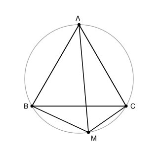

## Statement

Soit $ABC$ un triangle équilatéral et soit $\Gamma$ son cercle circonscrit. On place un point $M$ sur l'arc de $\Gamma$ qui joint $B$ à $C$ **sans passer par $A$**.

Montrer que
$$AM = BM + CM .$$

## Hints

1. Fais une figure propre et mesure : l'égalité est vraie quelle que soit la position de $M$ sur l'arc. Une longueur égale à la somme de deux autres, cela invite à **découper** le grand segment en deux morceaux.
2. Place donc sur le segment $[AM]$ le point $N$ tel que $MN = MB$. Il reste à montrer que $NA = MC$.
3. Que vaut l'angle $\widehat{AMB}$ ? Utilise le théorème de l'angle inscrit avec la corde $[AB]$.
4. Le triangle $BMN$ est isocèle et possède un angle de $60°$ : que peux-tu en dire ?
5. Pour montrer $NA = MC$, cherche deux triangles isométriques. Les candidats sont $ABN$ et $CBM$ : compare leurs côtés $BA$ et $BC$, puis $BN$ et $BM$, puis les angles entre eux.

## Solution

### Deux angles inscrits à 60 degrés

La corde $[AB]$ sépare le cercle en deux arcs. Les points $M$ et $C$ sont sur le même arc (celui qui ne contient pas le petit arc $AB$), donc les angles inscrits $\widehat{AMB}$ et $\widehat{ACB}$ interceptent le même arc et sont égaux :
$$\widehat{AMB} = \widehat{ACB} = 60° .$$

De la même façon, avec la corde $[AC]$ :
$$\widehat{AMC} = \widehat{ABC} = 60° .$$

En additionnant, $\widehat{BMC} = 120°$.

### La position de C vue depuis B

En parcourant le cercle, les quatre points se présentent dans l'ordre $A$, $B$, $M$, $C$. Le point $C$ se trouve donc sur l'arc $AM$ qui ne contient pas $B$, ce qui veut dire que la demi-droite $[BC)$ est **à l'intérieur** de l'angle $\widehat{ABM}$ :
$$\widehat{ABM} = \widehat{ABC} + \widehat{CBM} = 60° + \widehat{CBM} .$$

En particulier $\widehat{ABM} \geqslant 60°$.

### On peut découper [AM]

Dans le triangle $ABM$, les angles valent $\widehat{AMB} = 60°$, $\widehat{ABM} \geqslant 60°$ et donc
$$\widehat{BAM} = 180° - 60° - \widehat{ABM} \leqslant 60° \leqslant \widehat{ABM} .$$

Dans un triangle, au plus grand angle s'oppose le plus grand côté. Comme $\widehat{ABM} \geqslant \widehat{BAM}$, le côté $[AM]$ (opposé à $\widehat{ABM}$) est au moins aussi long que le côté $[BM]$ (opposé à $\widehat{BAM}$) :
$$BM \leqslant AM .$$

On peut donc placer sur le segment $[AM]$ le point $N$ tel que
$$MN = MB .$$

### Le triangle BMN est équilatéral

Le triangle $BMN$ est isocèle en $M$ (car $MN = MB$), et son angle au sommet vaut
$$\widehat{BMN} = \widehat{BMA} = 60°$$
puisque $N$ est sur le segment $[AM]$.

Un triangle isocèle dont l'angle au sommet vaut $60°$ a ses deux angles à la base égaux à $\frac{180° - 60°}{2} = 60°$ : il est **équilatéral**. Donc
$$BN = BM = MN \qquad \text{et} \qquad \widehat{NBM} = 60° .$$

### Deux triangles isométriques

Comparons les triangles $ABN$ et $CBM$.

- $BA = BC$, car $ABC$ est équilatéral.
- $BN = BM$, qu'on vient de démontrer.
- Les angles entre ces côtés sont égaux :
$$\widehat{ABN} = \widehat{ABM} - \widehat{NBM} = \big(60° + \widehat{CBM}\big) - 60° = \widehat{CBM} .$$

*(La soustraction est licite : comme $N$ appartient à $[AM]$, la demi-droite $[BN)$ est à l'intérieur de l'angle $\widehat{ABM}$.)*

Les triangles $ABN$ et $CBM$ ont donc deux côtés égaux et l'angle compris entre eux égal : ils sont **isométriques**. En particulier
$$AN = CM .$$

### Conclusion

Le point $N$ appartient au segment $[AM]$, donc
$$AM = AN + NM = CM + BM .$$

$$\boxed{AM = BM + CM .}$$

**Remarque.** L'égalité s'écrit aussi $AM \times BC = AB \times MC + AC \times MB$, puisque $AB = BC = CA$. Sous cette forme elle est un cas particulier du **théorème de Ptolémée**, qui vaut pour tout quadrilatère inscrit dans un cercle.

## Going further

1. Que devient l'égalité lorsque $M$ est en $B$ ? en $C$ ? au milieu de l'arc ?
2. Le rayon du cercle vaut $R$ et le côté du triangle vaut $a = R\sqrt{3}$. Calcule $BM$, $CM$ et $AM$ lorsque $M$ est le milieu de l'arc $BC$, et vérifie l'égalité numériquement.
3. Montre la réciproque : si un point $M$ du plan vérifie $AM = BM + CM$ et se trouve du côté de $(BC)$ opposé à $A$, alors $M$ est sur l'arc $BC$ du cercle circonscrit.
4. Écris le théorème de Ptolémée pour un carré $ABCD$ inscrit dans un cercle et un point $M$ de l'arc $AB$. Quelle relation obtiens-tu entre $MA$, $MB$, $MC$ et $MD$ ?
