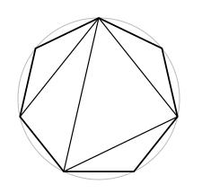

## Statement

Un polygone régulier convexe à $1997$ sommets est découpé en triangles par des diagonales qui ne se croisent pas à l'intérieur.

**Combien de ces triangles sont acutangles** (c'est-à-dire ont leurs trois angles aigus) ?

*La figure montre le cas d'un heptagone, plus facile à dessiner. Compte les triangles acutangles dessus avant de te lancer.*

## Hints

1. Il y a une chose que **tous** les triangles du découpage ont en commun : leurs sommets sont des sommets du polygone. Sur quel cercle sont-ils tous ?
2. Cherche donc un critère : un triangle inscrit dans un cercle est acutangle si et seulement si… quoi, par rapport au centre ?
3. Pour trouver ce critère, utilise le théorème de l'angle inscrit : un angle du triangle vaut la moitié de l'arc opposé. Quand un angle est-il droit ? obtus ?
4. Une fois le critère trouvé, la réponse tombe presque toute seule : où peut se trouver le centre par rapport au découpage ?
5. Reste un détail à régler : le centre pourrait-il tomber **sur** un côté d'un triangle, et non à l'intérieur ? C'est là que le nombre $1997$ sert.

## Solution

**Réponse : il y en a exactement un.**

### Le critère

Soit un triangle $XYZ$ inscrit dans un cercle de centre $O$. D'après le théorème de l'angle inscrit, l'angle $\widehat{X}$ vaut la moitié de l'angle au centre qui intercepte le même arc $YZ$, celui qui ne contient pas $X$. Donc

$$\widehat{X} < 90° \iff \text{l'arc } YZ \text{ ne contenant pas } X \text{ mesure moins de } 180° .$$

Les trois arcs découpés par $X$, $Y$, $Z$ totalisent $360°$.

- Si l'un de ces arcs dépasse $180°$, l'angle opposé est obtus, et le centre $O$ se trouve **hors** du triangle (du même côté de la corde que l'arc long n'est pas — plus simplement : $O$ et le sommet opposé sont de part et d'autre de la corde).
- Si l'un vaut exactement $180°$, la corde correspondante est un diamètre, l'angle opposé est droit, et $O$ est **sur** un côté.
- Si les trois arcs sont strictement inférieurs à $180°$, les trois angles sont aigus et $O$ est **strictement à l'intérieur** du triangle.

D'où le critère :

> **Un triangle inscrit dans un cercle est acutangle si et seulement si le centre du cercle est strictement à l'intérieur du triangle.**

### Tous les triangles ont le même cercle circonscrit

Chaque triangle du découpage a ses trois sommets parmi les $1997$ sommets du polygone. Ces $1997$ points sont sur le cercle circonscrit au polygone : donc **tous les triangles du découpage sont inscrits dans ce même cercle**, de centre $O$.

Par le critère, un triangle du découpage est acutangle si et seulement s'il contient $O$ à l'intérieur.

### Le centre n'est sur aucun des côtés

Les côtés des triangles sont soit des côtés du polygone, soit des diagonales : dans tous les cas, des cordes joignant deux sommets du polygone.

Une corde passe par $O$ exactement quand c'est un **diamètre**, donc quand ses deux extrémités sont diamétralement opposées. Or dans un polygone régulier à $1997$ sommets, deux sommets diamétralement opposés n'existent pas : le point diamétralement opposé à un sommet est le milieu du côté d'en face, car $1997$ est **impair**.

Aucune corde ne passe donc par $O$.

### On conclut

Les triangles du découpage pavent le polygone : leurs intérieurs sont disjoints et leur réunion, avec les côtés, est le polygone entier. Le centre $O$ est à l'intérieur du polygone et n'appartient à aucun côté de triangle. Il est donc à l'intérieur d'**exactement un** triangle.

$$\boxed{\text{Exactement un triangle du découpage est acutangle.}}$$

**Remarque.** La réponse ne dépend ni du découpage choisi, ni vraiment du nombre $1997$ : elle vaut pour tout polygone régulier ayant un nombre **impair** de sommets.

## Going further

1. Vérifie le résultat sur la figure : quel est le triangle acutangle de l'heptagone dessiné ? Recommence avec un autre découpage du même heptagone.
2. Que se passe-t-il pour un polygone régulier à un nombre **pair** de sommets ? Découpe un hexagone régulier de deux façons et compte.
3. Combien de triangles compte le découpage d'un polygone convexe à $n$ sommets par des diagonales qui ne se croisent pas ? Et combien de diagonales utilise-t-il ?
4. Le résultat vaut-il encore si le polygone est inscrit dans un cercle sans être régulier ? Où la démonstration utilise-t-elle la régularité ?
