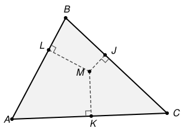

## Statement

Soit $ABC$ un triangle et soit $M$ un point à l'intérieur de ce triangle. On note $J$, $K$ et $L$ les pieds des perpendiculaires abaissées de $M$ sur les droites $(BC)$, $(AC)$ et $(AB)$ respectivement.

Pour quel point $M$ le produit

$$MJ \times MK \times ML$$

est-il le plus grand possible ?

**On pourra utiliser** l'inégalité arithmético-géométrique pour trois nombres : pour tous réels $x, y, z \geqslant 0$,

$$xyz \;\leqslant\; \left(\frac{x+y+z}{3}\right)^{3},$$

avec égalité si et seulement si $x = y = z$.

## Hints

1. Les trois distances $MJ$, $MK$, $ML$ varient toutes quand $M$ bouge, et rien ne les relie a priori. Cherche une quantité qui, elle, ne bouge pas.
2. Les segments $[MA]$, $[MB]$, $[MC]$ découpent le triangle en trois petits triangles. Que vaut la somme de leurs aires ?
3. Exprime l'aire de chaque petit triangle avec un côté et la distance correspondante. Tu obtiendras une somme constante.
4. Tu as donc $a \cdot MJ + b \cdot MK + c \cdot ML = 2\mathcal{A}$, où $a$, $b$, $c$ sont les longueurs des côtés et $\mathcal{A}$ l'aire de $ABC$. Applique l'inégalité donnée aux trois nombres $a \cdot MJ$, $b \cdot MK$, $c \cdot ML$.
5. Le maximum est atteint quand les trois produits sont égaux, c'est-à-dire quand les trois petits triangles ont la même aire. Quel point a cette propriété ?

## Solution

**Réponse : le maximum est atteint exactement au centre de gravité $G$ du triangle**, et il vaut

$$\frac{8\,\mathcal{A}^3}{27\,abc},$$

où $a = BC$, $b = CA$, $c = AB$ et $\mathcal{A}$ est l'aire de $ABC$.

**Étape 1. Une quantité qui ne dépend pas de $M$.**

Traçons $[MA]$, $[MB]$, $[MC]$. Comme $M$ est à l'intérieur, ces trois segments découpent $ABC$ en trois triangles $MBC$, $MCA$, $MAB$ qui ne se chevauchent pas et recouvrent tout, donc

$$\mathcal{A}(MBC) + \mathcal{A}(MCA) + \mathcal{A}(MAB) = \mathcal{A}.$$

Or $MJ$ est exactement la hauteur du triangle $MBC$ issue de $M$, relative à la base $[BC]$ de longueur $a$. Donc

$$\mathcal{A}(MBC) = \frac{1}{2}\, a \cdot MJ, \qquad \mathcal{A}(MCA) = \frac{1}{2}\, b \cdot MK, \qquad \mathcal{A}(MAB) = \frac{1}{2}\, c \cdot ML .$$

En additionnant et en multipliant par $2$ :

$$(\star) \qquad a \cdot MJ \;+\; b \cdot MK \;+\; c \cdot ML \;=\; 2\mathcal{A}.$$

Voilà la quantité cherchée : cette somme vaut $2\mathcal{A}$ **quel que soit** le point $M$ intérieur.

**Étape 2. On majore le produit.**

Appliquons l'inégalité arithmético-géométrique aux trois nombres positifs $x = a \cdot MJ$, $y = b \cdot MK$, $z = c \cdot ML$, dont la somme vaut $2\mathcal{A}$ d'après $(\star)$ :

$$(a \cdot MJ)(b \cdot MK)(c \cdot ML) \;\leqslant\; \left(\frac{2\mathcal{A}}{3}\right)^{3} = \frac{8\,\mathcal{A}^3}{27}.$$

Le membre de gauche vaut $abc \times MJ \times MK \times ML$, donc

$$MJ \times MK \times ML \;\leqslant\; \frac{8\,\mathcal{A}^3}{27\,abc}.$$

Ce majorant ne dépend que du triangle, pas de $M$.

**Étape 3. Quand y a-t-il égalité ?**

D'après le cas d'égalité de l'inégalité, il y a égalité si et seulement si

$$a \cdot MJ = b \cdot MK = c \cdot ML,$$

c'est-à-dire, en revenant aux aires de l'étape 1, si et seulement si

$$\mathcal{A}(MBC) = \mathcal{A}(MCA) = \mathcal{A}(MAB) = \frac{\mathcal{A}}{3}.$$

**Étape 4. Ce point est le centre de gravité, et lui seul.**

*Le centre de gravité convient.* Les trois médianes découpent $ABC$ en six petits triangles de même aire (chaque médiane coupe le triangle en deux moitiés d'aires égales, puis $G$ coupe chaque médiane dans le rapport $2:1$). En les regroupant deux par deux, on obtient

$$\mathcal{A}(GBC) = \mathcal{A}(GCA) = \mathcal{A}(GAB) = \frac{\mathcal{A}}{3}.$$

*C'est le seul.* L'ensemble des points $M$ intérieurs vérifiant $\mathcal{A}(MBC) = \mathcal{A}/3$ est l'ensemble des points dont la distance à $(BC)$ vaut $\tfrac{2\mathcal{A}}{3a}$, du côté de $A$ : c'est un segment porté par une droite parallèle à $(BC)$. De même, $\mathcal{A}(MCA) = \mathcal{A}/3$ décrit un segment porté par une droite parallèle à $(CA)$.

Ces deux droites ne sont pas parallèles entre elles, puisque $(BC)$ et $(CA)$ ne le sont pas. Elles se coupent donc en **un seul** point. Comme $G$ vérifie les deux conditions, ce point est $G$.

**Conclusion.** Le produit $MJ \times MK \times ML$ est maximal pour $M = G$, le centre de gravité du triangle, et sa valeur maximale est $\dfrac{8\,\mathcal{A}^3}{27\,abc}$.

## Going further

**Un contrôle sur le triangle équilatéral.** Si $ABC$ est équilatéral de côté $1$, alors $\mathcal{A} = \tfrac{\sqrt{3}}{4}$ et $abc = 1$, donc le maximum annoncé vaut $\tfrac{8}{27} \times \tfrac{3\sqrt{3}}{64} = \tfrac{\sqrt{3}}{72}$. Par symétrie, le centre de gravité est aussi le centre du cercle inscrit, de rayon $r = \tfrac{\sqrt{3}}{6}$, et les trois distances valent $r$. Le produit vaut donc $r^3 = \tfrac{3\sqrt{3}}{216} = \tfrac{\sqrt{3}}{72}$. Les deux calculs concordent.

**D'où vient l'inégalité utilisée ?** Pour $u, v, w \geqslant 0$, on a l'identité

$$u^3 + v^3 + w^3 - 3uvw = (u+v+w)\,(u^2+v^2+w^2-uv-vw-wu).$$

Le second facteur vaut la moitié de $(u-v)^2 + (v-w)^2 + (w-u)^2$, donc il est positif ou nul, et nul seulement si $u = v = w$. Ainsi $u^3+v^3+w^3 \geqslant 3uvw$. En posant $u = \sqrt[3]{x}$, $v = \sqrt[3]{y}$, $w = \sqrt[3]{z}$, on obtient exactement $x + y + z \geqslant 3\sqrt[3]{xyz}$, c'est-à-dire l'inégalité de l'énoncé.

**Et la somme ?** L'étape 1 montre que $a \cdot MJ + b \cdot MK + c \cdot ML$ est constante. Que peut-on dire de la somme toute simple $MJ + MK + ML$ ? Cherche pour quel $M$ elle est minimale, puis maximale, et compare avec le cas équilatéral.
