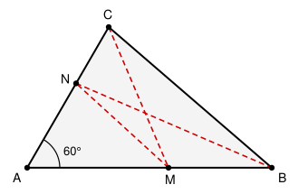

## Statement

Soit $ABC$ un triangle dont les trois angles sont aigus, et dont l'angle en $A$ mesure $60^\circ$.

On choisit un point $M$ sur la droite $(AB)$ et un point $N$ sur la droite $(AC)$, puis on suit le chemin brisé qui va de $C$ à $M$, puis de $M$ à $N$, puis de $N$ à $B$.

Déterminer les positions de $M$ et de $N$ qui rendent la longueur

$$CM + MN + NB$$

la plus petite possible, et calculer cette longueur minimale.

## Hints

1. Devant un chemin qui rebondit sur une droite, le réflexe est de **déplier** le chemin par une symétrie axiale : la longueur ne change pas, mais le chemin devient plus droit.
2. Ici il y a deux rebonds, donc deux symétries. Appelez $C'$ le symétrique de $C$ par rapport à la droite $(AB)$, et $B'$ le symétrique de $B$ par rapport à la droite $(AC)$.
3. Réécrivez $CM + MN + NB$ avec $C'$ et $B'$. Que devient la quantité à minimiser ?
4. Le plus court chemin de $C'$ à $B'$ est le segment $[C'B']$. Où se trouve ce segment ? Calculez l'angle $\widehat{C'AB'}$.
5. La réponse est surprenante. Faites confiance au calcul d'angles.

## Solution

### Déplier le chemin

Notons
- $C'$ le symétrique de $C$ par rapport à la droite $(AB)$,
- $B'$ le symétrique de $B$ par rapport à la droite $(AC)$.

Comme $M$ est sur $(AB)$, axe de la première symétrie, on a $C'M = CM$.
Comme $N$ est sur $(AC)$, axe de la seconde symétrie, on a $B'N = BN$.

Donc, quels que soient $M$ et $N$,

$$CM + MN + NB = C'M + MN + NB' .$$

Le membre de droite est la longueur d'un chemin allant de $C'$ à $B'$ en passant par $M$ puis $N$. Par l'inégalité triangulaire appliquée deux fois, il est au moins égal à la distance directe :

$$C'M + MN + NB' \;\geqslant\; C'B' ,$$

avec égalité exactement lorsque $C'$, $M$, $N$, $B'$ sont alignés **dans cet ordre**.

### L'angle en A

Calculons l'angle $\widehat{C'AB'}$ en additionnant trois angles autour de $A$ :

- la symétrie d'axe $(AB)$ conserve les longueurs et les angles, donc $\widehat{C'AB} = \widehat{CAB} = 60^\circ$ ;
- l'angle du triangle vaut $\widehat{BAC} = 60^\circ$ ;
- la symétrie d'axe $(AC)$ donne $\widehat{CAB'} = \widehat{CAB} = 60^\circ$.

Ces trois angles se succèdent sans se chevaucher, donc

$$\widehat{C'AB'} = 60^\circ + 60^\circ + 60^\circ = 180^\circ .$$

Autrement dit : **le point $A$ appartient au segment $[C'B']$**, et ce segment est porté par une droite passant par $A$.

De plus, comme les symétries conservent les distances,

$$C'B' = C'A + AB' = CA + AB .$$

### Où sont alors $M$ et $N$ ?

Le minimum $C'B'$ est atteint lorsque $M$ et $N$ sont sur le segment $[C'B']$.

Or $M$ doit aussi être sur la droite $(AB)$. La droite $(C'B')$ et la droite $(AB)$ se coupent en $A$, et en ce seul point : si elles étaient confondues, le point $C'$ serait sur $(AB)$, donc $C$ aussi, et le triangle serait plat. Donc $M = A$.

Le même raisonnement avec la droite $(AC)$ donne $N = A$.

### Conclusion

$$\boxed{\text{Le minimum est atteint pour } M = N = A, \text{ et vaut } AB + AC .}$$

Le chemin optimal est donc le chemin dégénéré $C \to A \to A \to B$, c'est-à-dire simplement $C \to A \to B$, de longueur $CA + AB$.

**Vérification sur un exemple.** Prenons $AB = \text{4,5}$ et $AC = 3$, avec $\widehat{A} = 60^\circ$. Le minimum annoncé vaut $\text{7,5}$. Essayons le chemin dessiné sur la figure, avec $AM = \text{2,6}$ et $AN = \text{1,8}$ : on trouve $CM \approx \text{2,82}$, $MN \approx \text{2,31}$, $NB \approx \text{3,92}$, soit un total d'environ $\text{9,05}$, effectivement plus grand que $\text{7,5}$.

## Going further

**Pourquoi $60^\circ$ ?** C'est la valeur exacte qui fait de $\widehat{C'AB'}$ un angle plat. Si l'angle en $A$ vaut $\alpha$, le même calcul donne $\widehat{C'AB'} = 3\alpha$, et trois cas se présentent.

- Si $\alpha < 60^\circ$, alors $3\alpha < 180^\circ$ : le segment $[C'B']$ ne passe pas par $A$, il coupe réellement les deux droites en des points $M$ et $N$ distincts de $A$, et le minimum vaut, par la loi des cosinus dans le triangle $AC'B'$,
$$C'B' = \sqrt{AB^2 + AC^2 - 2 \cdot AB \cdot AC \cdot \cos(3\alpha)} ,$$
ce qui est **strictement plus petit** que $AB + AC$.
- Si $\alpha = 60^\circ$, c'est notre exercice.
- Si $\alpha > 60^\circ$, alors $3\alpha > 180^\circ$ et le segment $[C'B']$ passe « de l'autre côté » : le chemin déplié ne peut plus être rendu droit en restant sur les bonnes demi-droites, et il faut reprendre l'étude.

**Le cousin le plus connu.** Avec un seul rebond, le même dépliage résout le problème du maître nageur ou du billard : pour aller de $P$ à $Q$ en touchant une droite $d$, on réfléchit $Q$ en $Q'$ et le chemin optimal est celui qui passe par l'intersection de $[PQ']$ avec $d$. C'est aussi la raison pour laquelle un rayon lumineux se réfléchit avec des angles égaux : il suit le chemin le plus court.

**Le cousin le plus difficile.** Avec trois rebonds sur les trois côtés d'un triangle acutangle, le chemin fermé le plus court est le **triangle orthique**, formé par les pieds des trois hauteurs. La démonstration repose encore sur des dépliages successifs.
