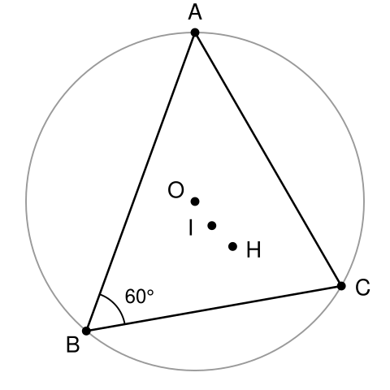

## Statement

Soit $ABC$ un triangle **acutangle** (ses trois angles sont aigus) dont l'angle en $B$ mesure $60^\circ$. On note :

- $O$ le centre de son cercle circonscrit ;
- $H$ son orthocentre, le point où se coupent ses trois hauteurs ;
- $I$ le centre de son cercle inscrit, le point où se coupent ses trois bissectrices.

Montrer que les cinq points $A$, $C$, $O$, $H$ et $I$ sont sur un même cercle.

## Hints

1. Cinq points, c'est beaucoup. Mais deux d'entre eux, $A$ et $C$, jouent un rôle à part : ce sont les deux points fixes. Que faudrait-il montrer sur les trois autres ?
2. Rappelle-toi le critère : si trois points $P$, $Q$, $R$ sont du même côté d'une droite $(AC)$ et voient le segment $[AC]$ sous le même angle, alors $A$, $C$, $P$, $Q$, $R$ sont cocycliques.
3. Calcule donc $\widehat{AOC}$, puis $\widehat{AHC}$, puis $\widehat{AIC}$, chacun en fonction de l'angle $\widehat{ABC}$ seul.
4. Pour $\widehat{AOC}$ : c'est l'angle au centre qui intercepte le même arc que l'angle inscrit $\widehat{ABC}$.
5. Pour $\widehat{AHC}$ : considère le quadrilatère formé par $B$, $H$ et les pieds de deux hauteurs. La somme de ses angles vaut $360^\circ$.
6. Pour $\widehat{AIC}$ : dans le triangle $AIC$, les angles en $A$ et en $C$ sont des demi-angles du triangle $ABC$. Utilise que la somme des trois angles de $ABC$ vaut $180^\circ$.

## Solution

**Les trois angles $\widehat{AOC}$, $\widehat{AHC}$ et $\widehat{AIC}$ valent tous $120^\circ$. Les points $O$, $H$ et $I$ voient donc $[AC]$ sous le même angle, du même côté, et les cinq points sont cocycliques.**

Notons $\alpha = \widehat{BAC}$, $\beta = \widehat{ABC} = 60^\circ$ et $\gamma = \widehat{BCA}$, avec $\alpha + \beta + \gamma = 180^\circ$, donc

$$\alpha + \gamma = 120^\circ .$$

Le triangle étant acutangle, $O$, $H$ et $I$ sont tous trois à l'intérieur du triangle, donc du même côté de la droite $(AC)$ que $B$. Ce point est important et sera réutilisé à la fin.

### L'angle en O

$\widehat{ABC}$ est l'angle inscrit interceptant l'arc $AC$ qui ne contient pas $B$, et $\widehat{AOC}$ est l'angle au centre interceptant ce même arc. Le théorème de l'angle inscrit donne

$$\widehat{AOC} = 2\,\widehat{ABC} = 2 \times 60^\circ = 120^\circ .$$

(Le triangle est acutangle, donc cet angle au centre est bien inférieur à $180^\circ$ et il n'y a pas d'ambiguïté.)

### L'angle en H

Notons $P$ le pied de la hauteur issue de $A$, situé sur $[BC]$, et $Q$ le pied de la hauteur issue de $C$, situé sur $[AB]$. Le point $H$ est l'intersection de $(AP)$ et $(CQ)$.

Considérons le quadrilatère $BPHQ$. Ses quatre angles sont :

- en $B$ : l'angle $\beta = 60^\circ$ ;
- en $P$ : $90^\circ$, car $(AP)$ est perpendiculaire à $(BC)$ ;
- en $Q$ : $90^\circ$, car $(CQ)$ est perpendiculaire à $(AB)$ ;
- en $H$ : l'angle $\widehat{PHQ}$.

Leur somme vaut $360^\circ$, donc

$$\widehat{PHQ} = 360^\circ - 60^\circ - 90^\circ - 90^\circ = 120^\circ .$$

Or $\widehat{AHC}$ et $\widehat{PHQ}$ sont opposés par le sommet : $A$ et $P$ sont de part et d'autre de $H$ sur la droite $(AP)$, et de même $C$ et $Q$ sur $(CQ)$. Donc

$$\widehat{AHC} = \widehat{PHQ} = 120^\circ .$$

### L'angle en I

Le point $I$ est sur la bissectrice issue de $A$ et sur celle issue de $C$, donc dans le triangle $AIC$ :

$$\widehat{IAC} = \frac{\alpha}{2}, \qquad \widehat{ICA} = \frac{\gamma}{2} .$$

La somme des angles du triangle $AIC$ vaut $180^\circ$, d'où

$$\widehat{AIC} = 180^\circ - \frac{\alpha}{2} - \frac{\gamma}{2} = 180^\circ - \frac{\alpha + \gamma}{2} = 180^\circ - \frac{120^\circ}{2} = 120^\circ .$$

### On recolle

Les trois points $O$, $H$ et $I$ sont du même côté de $(AC)$, et chacun voit le segment $[AC]$ sous un angle de $120^\circ$.

D'après la réciproque du théorème de l'angle inscrit (l'arc capable), l'ensemble des points d'un côté donné de $(AC)$ qui voient $[AC]$ sous l'angle $120^\circ$ est **un arc de cercle**, un seul. Les points $O$, $H$ et $I$ appartiennent donc tous les trois à cet arc, dont les extrémités sont $A$ et $C$.

**Conclusion : les cinq points $A$, $C$, $O$, $H$ et $I$ sont sur un même cercle.**

## Going further

Le calcul montre plus que l'énoncé : les trois angles valent $120^\circ$ **parce que** $\beta = 60^\circ$, et rien d'autre n'a servi.

On peut se demander quel est ce cercle. Son centre est le milieu $M$ de l'arc $AC$ ne contenant pas $B$, autrement dit le second point d'intersection de la bissectrice issue de $B$ avec le cercle circonscrit. Et on peut calculer son rayon : l'arc de $A$ à $M$ mesure $\beta = 60^\circ$, donc la corde $MA$ vaut $2R \sin 30^\circ = R$, où $R$ est le rayon du cercle circonscrit.

**Le cercle qui porte les cinq points a donc exactement le même rayon que le cercle circonscrit.** C'est une coïncidence propre à l'angle de $60^\circ$.

Le fait que $MA = MC = MI$ est lui-même un résultat classique, appelé parfois lemme du trident ou lemme du pôle sud : le milieu de l'arc $AC$ est à égale distance de $A$, de $C$ et du centre du cercle inscrit.
