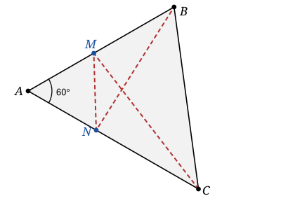

## Statement

Soit $ABC$ un triangle dont les trois angles sont aigus et dont l'angle en $A$ mesure exactement $60°$.

On choisit un point $M$ sur la droite $(AB)$ et un point $N$ sur la droite $(AC)$, et on regarde la longueur de la ligne brisée qui va de $C$ à $B$ en passant par $M$ puis par $N$ :

$$L = CM + MN + NB .$$

Déterminer les positions de $M$ et de $N$ pour lesquelles $L$ est la plus petite possible, et calculer cette valeur minimale.

## Hints

1. Une ligne brisée est courte quand elle est « presque droite ». Quel outil permet de redresser une ligne brisée qui rebondit sur une droite ?
2. Note $C'$ le symétrique de $C$ par rapport à la droite $(AB)$. Que vaut $CM$ en fonction de $C'$ ?
3. Fais de même avec $B$ et la droite $(AC)$. Récris alors $L$ entièrement en fonction de $C'$, $M$, $N$ et $B'$.
4. Une ligne brisée de $C'$ à $B'$ est toujours plus longue que le segment $[C'B']$. Quand y a-t-il égalité ?
5. Calcule l'angle $\widehat{C'AB'}$. Que vaut-il exactement quand $\widehat{BAC} = 60°$ ? Quelle est alors la surprise ?

## Solution

Notons $b = AC$ et $c = AB$.

**Déplier la ligne brisée.**

Soit $C'$ le symétrique de $C$ par rapport à la droite $(AB)$. La symétrie axiale conserve les longueurs, donc pour **tout** point $M$ de la droite $(AB)$ on a

$$CM = C'M .$$

De même, soit $B'$ le symétrique de $B$ par rapport à la droite $(AC)$ ; pour tout point $N$ de $(AC)$,

$$NB = NB' .$$

Par conséquent

$$L = CM + MN + NB = C'M + MN + NB' .$$

Le membre de droite est la longueur de la ligne brisée qui va de $C'$ à $B'$ en passant par $M$ puis par $N$. Elle est toujours supérieure ou égale à la distance directe :

$$L \geqslant C'B',$$

avec égalité exactement lorsque $M$ et $N$ sont sur le segment $[C'B']$, dans l'ordre $C'$, $M$, $N$, $B'$.

**Où se trouve $B'$ par rapport à $C'$ ?**

La symétrie par rapport à $(AB)$ conserve les distances au point $A$, qui est sur l'axe : donc $AC' = AC = b$. De plus elle envoie la demi-droite $[AC)$ sur une demi-droite $[AC')$ qui fait avec $[AB)$ le même angle de $60°$, mais de l'autre côté. Autrement dit

$$\widehat{C'AB} = \widehat{BAC} = 60° .$$

Symétriquement, $AB' = AB = c$ et $\widehat{CAB'} = \widehat{BAC} = 60°$.

Les trois angles $\widehat{C'AB}$, $\widehat{BAC}$ et $\widehat{CAB'}$ sont adjacents et se suivent, donc

$$\widehat{C'AB'} = 60° + 60° + 60° = 180° .$$

Un angle plat : **les points $C'$, $A$ et $B'$ sont alignés**, et $A$ est entre $C'$ et $B'$. On en déduit

$$C'B' = C'A + AB' = b + c = AC + AB .$$

**La position de $M$ et de $N$.**

On sait maintenant que $L \geqslant AB + AC$, avec égalité lorsque $M$ et $N$ sont sur le segment $[C'B']$. Mais ce segment est porté par une droite qui passe par $A$, et qui n'est ni $(AB)$ ni $(AC)$, puisqu'elle fait un angle de $60°$ avec chacune d'elles.

Or $M$ doit être à la fois sur cette droite et sur $(AB)$ : deux droites distinctes ne se coupent qu'en un point, donc $M = A$. De même $N = A$.

Et réciproquement, si $M = N = A$, alors

$$L = CA + 0 + AB = AB + AC ,$$

la valeur minimale est bien atteinte.

$$\boxed{\ L \text{ est minimale pour } M = N = A, \text{ et vaut alors } AB + AC.\ }$$

## Going further

Ce résultat un peu déroutant tient au fait que $60°$ est exactement la valeur limite : c'est elle qui rend l'angle $\widehat{C'AB'} = 3\widehat{A}$ égal à un angle plat.

Si l'angle en $A$ mesure $\alpha < 60°$, la même construction donne $\widehat{C'AB'} = 3\alpha < 180°$ : les points $C'$, $A$, $B'$ ne sont plus alignés, le segment $[C'B']$ coupe vraiment les deux côtés de l'angle, et le minimum vaut cette fois, par la loi des cosinus dans le triangle $AC'B'$,

$$C'B' = \sqrt{b^2 + c^2 - 2bc\cos(3\alpha)} ,$$

atteint en deux points $M$ et $N$ bien distincts de $A$. C'est le même dépliage qui sert à résoudre la question classique du triangle de périmètre minimal inscrit dans un triangle donné.
