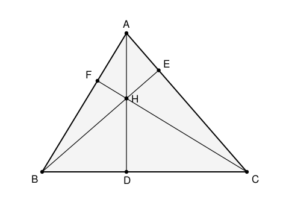

## Statement

$ABC$ est un triangle **acutangle** (ses trois angles sont aigus). On note $D$, $E$, $F$ les pieds des hauteurs issues respectivement de $A$, $B$, $C$, et $H$ l'orthocentre, c'est-à-dire le point commun aux trois hauteurs.

1. Montrer que $\ BD \times DC = AD \times HD$.
2. Montrer que $\ AH \times HD = BH \times HE = CH \times HF$.

## Hints

1. Quand une égalité s'écrit comme « un produit $=$ un produit », il est presque toujours utile de la réécrire comme une **égalité de rapports**, puis de chercher deux triangles semblables.
2. Pour la question 1, écris $\dfrac{BD}{AD} = \dfrac{HD}{DC}$. Quels sont les deux triangles dont ces quatre longueurs sont des côtés ?
3. Les triangles $ABD$ et $CHD$ ont tous les deux un angle droit en $D$. Il suffit donc de trouver **un** autre angle commun.
4. Dans le triangle rectangle $ABD$, que vaut l'angle $\widehat{DAB}$ en fonction de $\widehat{ABC}$ ? Et dans le triangle rectangle $BFC$, que vaut $\widehat{FCB}$ ?
5. Pour la question 2, applique la même méthode aux triangles $AHE$ et $BHD$ : ils partagent un angle (lequel ?) et ont chacun un angle droit.

## Solution

**Question 1.**

Réécrivons ce qu'on veut sous forme de rapports :

$$BD \times DC = AD \times HD \qquad \Longleftrightarrow \qquad \frac{BD}{AD} = \frac{HD}{DC} .$$

Cela invite à comparer les triangles $ABD$ (dont deux côtés sont $BD$ et $AD$) et $CHD$ (dont deux côtés sont $HD$ et $DC$).

*Ils ont chacun un angle droit en $D$.* Le point $D$ est le pied de la hauteur issue de $A$, donc $(AD) \perp (BC)$. Comme $H$ est sur la hauteur $(AD)$, le segment $[HD]$ est porté par la même droite : les angles $\widehat{ADB}$ et $\widehat{HDC}$ sont tous deux droits.

*Ils ont un second angle égal.* Notons $\beta = \widehat{ABC}$.

- Dans le triangle $ABD$, rectangle en $D$, les deux angles aigus sont complémentaires, donc $\widehat{DAB} = 90° - \beta$.
- Le point $H$ est aussi sur la hauteur issue de $C$, c'est-à-dire sur la droite $(CF)$. Dans le triangle $BFC$, rectangle en $F$, on a de même $\widehat{FCB} = 90° - \beta$. Or l'angle $\widehat{HCD}$ est exactement l'angle $\widehat{FCB}$ (c'est le même angle, en $C$, entre les droites $(CF)$ et $(CB)$, le triangle étant acutangle et $H$ intérieur). Donc $\widehat{HCD} = 90° - \beta$.

Les triangles $ABD$ et $CHD$ ont donc deux angles égaux deux à deux : ils sont **semblables**, avec la correspondance

$$A \leftrightarrow C, \qquad B \leftrightarrow H, \qquad D \leftrightarrow D .$$

Les rapports des côtés correspondants sont donc égaux :

$$\frac{AD}{CD} = \frac{BD}{HD} ,$$

c'est-à-dire, en multipliant en croix,

$$\boxed{BD \times DC = AD \times HD .}$$

**Question 2.**

Montrons que $AH \times HD = BH \times HE$ ; le troisième produit se traite exactement de la même manière.

Cette fois, réécrivons

$$AH \times HD = BH \times HE \qquad \Longleftrightarrow \qquad \frac{AH}{BH} = \frac{HE}{HD} .$$

Les quatre longueurs sont des côtés des triangles $AHE$ et $BHD$.

*Un angle droit dans chacun.* $E$ est le pied de la hauteur issue de $B$, donc $(BE) \perp (AC)$ et le triangle $AHE$ est rectangle en $E$. De même $(AD) \perp (BC)$ donne $BHD$ rectangle en $D$.

*Un angle égal.* Les angles $\widehat{AHE}$ et $\widehat{BHD}$ sont opposés par le sommet $H$ : en effet $A$, $H$, $D$ sont alignés (hauteur issue de $A$) et $B$, $H$, $E$ sont alignés (hauteur issue de $B$). Donc $\widehat{AHE} = \widehat{BHD}$.

Les triangles $AHE$ et $BHD$ ont donc deux angles égaux deux à deux : ils sont semblables, avec la correspondance $A \leftrightarrow B$, $H \leftrightarrow H$, $E \leftrightarrow D$. Donc

$$\frac{AH}{BH} = \frac{HE}{HD} , \qquad \text{soit} \qquad AH \times HD = BH \times HE .$$

En recommençant avec les hauteurs issues de $A$ et de $C$, on obtient de même $AH \times HD = CH \times HF$. D'où

$$\boxed{AH \times HD = BH \times HE = CH \times HF .}$$

**Ce que dit la question 2.** La quantité commune $AH \times HD$ ne dépend pas de la hauteur choisie. C'est la **puissance du point $H$** par rapport au cercle circonscrit, au signe près : les six points $A, D, B, E, C, F$ se répartissent sur trois droites passant par $H$, et le produit des distances de $H$ à deux points d'une même droite est le même pour les trois. Ici, cela traduit simplement le fait que $A$, $B$, $D$, $E$ sont cocycliques (sur le cercle de diamètre $[AB]$), et de même pour les autres paires.

## Going further

Dans un triangle acutangle, montrer que les quatre points $B$, $C$, $E$, $F$ sont cocycliques, puis retrouver l'égalité $AH \times HD = BH \times HE$ comme conséquence directe de la cocyclicité de $A$, $B$, $D$, $E$.
