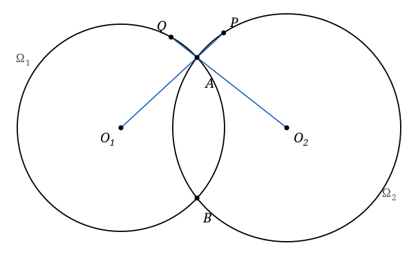

## Statement

Deux cercles $\Omega_1$ et $\Omega_2$ se coupent en deux points $A$ et $B$. On note $O_1$ le
centre de $\Omega_1$ et $O_2$ celui de $\Omega_2$.

La droite $(O_1 A)$ recoupe le cercle $\Omega_2$ en un point $P$, et la droite $(O_2 A)$
recoupe le cercle $\Omega_1$ en un point $Q$.

Montrer que les cinq points $O_1$, $O_2$, $P$, $Q$ et $B$ sont sur un même cercle.

## Hints

1. Repère d'abord les longueurs égales. Quels segments de la figure sont des rayons de
   $\Omega_1$ ? Et de $\Omega_2$ ?
2. Les triangles $O_1 A Q$ et $O_2 A P$ sont isocèles. En quel sommet ?
3. Les angles $\widehat{QAO_1}$ et $\widehat{PAO_2}$ sont opposés par le sommet en $A$. Pourquoi ?
   Regarde quels points sont alignés.
4. Deux triangles isocèles qui ont le même angle à la base ont aussi le même angle au sommet.
   Écris ce que cela donne pour $\widehat{QO_1A}$ et $\widehat{AO_2P}$.
5. Tu obtiens alors que $Q$, $P$, $O_1$, $O_2$ sont cocycliques. Il reste à y ajouter $B$.
   Pour cela, décompose $\widehat{QBP}$ en $\widehat{QBA} + \widehat{ABP}$ et utilise le théorème
   de l'angle au centre, une fois dans chaque cercle.

## Solution

Tous les raisonnements ci-dessous se lisent sur la figure de l'énoncé.

**Étape 1 : deux triangles isocèles.**

Les points $A$ et $Q$ appartiennent tous les deux à $\Omega_1$, donc
$$O_1 A = O_1 Q = \text{rayon de } \Omega_1 ,$$
et le triangle $O_1 A Q$ est isocèle en $O_1$.

De même, $A$ et $P$ appartiennent à $\Omega_2$, donc
$$O_2 A = O_2 P = \text{rayon de } \Omega_2 ,$$
et le triangle $O_2 A P$ est isocèle en $O_2$.

**Étape 2 : ces deux triangles ont le même angle à la base.**

Par construction, $P$ est sur la droite $(O_1 A)$ : les points $O_1$, $A$, $P$ sont alignés.
De même $Q$ est sur la droite $(O_2 A)$ : les points $O_2$, $A$, $Q$ sont alignés.

En $A$ se croisent donc deux droites, $(O_1 P)$ et $(O_2 Q)$. Les angles $\widehat{QAO_1}$ et
$\widehat{PAO_2}$ sont formés par ces deux droites et sont opposés par le sommet. Ils sont donc
égaux.

**Étape 3 : les angles au sommet sont égaux.**

Dans le triangle $O_1 A Q$, isocèle en $O_1$, les deux angles à la base sont égaux à
$\widehat{QAO_1}$, et la somme des angles vaut $180°$ :
$$\widehat{QO_1A} = 180° - 2\,\widehat{QAO_1} .$$

Dans le triangle $O_2 A P$, isocèle en $O_2$, de la même façon :
$$\widehat{AO_2P} = 180° - 2\,\widehat{PAO_2} .$$

Comme les deux angles à la base sont égaux (étape 2), les deux angles au sommet le sont aussi :
$$(\star) \qquad \widehat{QO_1A} = \widehat{AO_2P} .$$

**Étape 4 : $Q$, $P$, $O_1$ et $O_2$ sont cocycliques.**

Comme $O_1$, $A$, $P$ sont alignés dans cet ordre, la demi-droite $[O_1 P)$ est la demi-droite
$[O_1 A)$, donc
$$\widehat{QO_1P} = \widehat{QO_1A} .$$
De même, comme $O_2$, $A$, $Q$ sont alignés dans cet ordre,
$$\widehat{QO_2P} = \widehat{AO_2P} .$$

En reportant dans $(\star)$ :
$$\widehat{QO_1P} = \widehat{QO_2P} .$$

Les points $O_1$ et $O_2$ sont du même côté de la droite $(PQ)$ et voient le segment $[QP]$ sous
le même angle. Ils sont donc cocycliques avec $Q$ et $P$ : les quatre points $Q$, $P$, $O_1$,
$O_2$ sont sur un même cercle, appelons-le $\Gamma$.

**Étape 5 : le point $B$ est lui aussi sur $\Gamma$.**

Le point $B$ est du même côté de $(PQ)$ que $O_1$ et $O_2$. Il suffit donc de montrer que $B$
voit $[QP]$ sous le même angle, c'est-à-dire que $\widehat{QBP} = \widehat{QO_2P}$.

Comme la demi-droite $[BA)$ est à l'intérieur de l'angle $\widehat{QBP}$, on décompose :
$$\widehat{QBP} = \widehat{QBA} + \widehat{ABP} .$$

Dans le cercle $\Omega_1$, les points $Q$, $A$ et $B$ sont sur le cercle et $O_1$ en est le
centre. Le théorème de l'angle au centre donne
$$\widehat{QBA} = \frac{1}{2}\,\widehat{QO_1A} .$$

Dans le cercle $\Omega_2$, de la même façon avec les points $A$, $P$, $B$ et le centre $O_2$ :
$$\widehat{ABP} = \frac{1}{2}\,\widehat{AO_2P} .$$

En additionnant et en utilisant $(\star)$, qui dit que ces deux angles au centre sont égaux :
$$\widehat{QBP} = \frac{1}{2}\,\widehat{QO_1A} + \frac{1}{2}\,\widehat{AO_2P} = \frac{1}{2}\,\widehat{AO_2P} + \frac{1}{2}\,\widehat{AO_2P} = \widehat{AO_2P} = \widehat{QO_2P} .$$

Donc $B$ appartient lui aussi à $\Gamma$.

**Conclusion.** Les cinq points $O_1$, $O_2$, $P$, $Q$ et $B$ sont sur un même cercle.

## Going further

1. Le cercle $\Gamma$ passe par $O_1$, $O_2$ et $B$. Que devient-il lorsque les deux cercles ont
   le même rayon ? Fais la figure dans ce cas et décris la symétrie que tu observes.
2. Le point $A$ appartient-il à $\Gamma$ ? Justifie ta réponse à partir de la figure, puis
   démontre-la.
3. Montre que la droite $(O_1 O_2)$ est la médiatrice du segment $[AB]$. C'est un fait général
   sur deux cercles sécants, indépendant de tout le reste de l'exercice. *Indication : $O_1$ et
   $O_2$ sont chacun à égale distance de $A$ et de $B$.*
