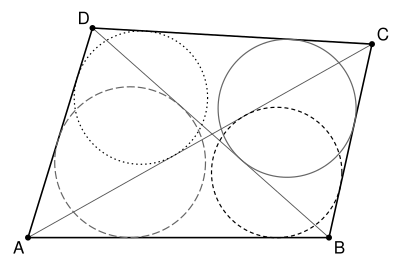

## Statement

Soit $ABCD$ un quadrilatère convexe. On suppose que les cercles inscrits aux quatre triangles $ABC$, $BCD$, $CDA$ et $DAB$ ont un point commun.

Montrer que $ABCD$ est un losange.

## Hints

1. Le cercle inscrit à $ABC$ et celui inscrit à $CDA$ sont de part et d'autre de la diagonale $(AC)$. Où peut se trouver leur point commun ? Déduis-en que le point commun $X$ est le point d'intersection des diagonales.
2. Dans un triangle, la distance d'un sommet au point de contact du cercle inscrit s'exprime avec les trois côtés. Déduis-en que les cercles inscrits aux quatre petits triangles $AXB$, $BXC$, $CXD$, $DXA$ touchent les demi-diagonales $[XA]$, $[XB]$, $[XC]$, $[XD]$ à la même distance $t$ de $X$.
3. Dans un triangle de rayon inscrit $\rho$, la distance d'un sommet d'angle $\widehat{V}$ aux points de contact vaut $\dfrac{\rho}{\tan(\widehat{V}/2)}$. Exprime les quatre rayons avec $t$ et l'angle $\varphi = \widehat{AXB}$.
4. Compare, au sommet $A$, les angles $\widehat{XAB}$ et $\widehat{XAD}$ selon que $\varphi$ est plus petit ou plus grand que $90°$. Additionne.

## Solution

**Rappel.** La tangente à un cercle en un point $T$ est perpendiculaire au rayon. Deux tangentes menées d'un même point $M$ à un cercle ont la même longueur : si elles touchent le cercle de centre $O$ et de rayon $r$ en $T$ et $T'$, le théorème de Pythagore donne $MT^2 = MO^2 - r^2 = MT'^2$.

Une conséquence : si le cercle inscrit à un triangle $UVW$ touche $[VW]$ en $K$, alors
$$VK = \frac{VU + VW - UW}{2} .$$
En effet, si $u$, $v$, $w$ sont les longueurs des tangentes issues de $U$, $V$, $W$, on a $UV = u + v$, $VW = v + w$, $WU = w + u$, et $VU + VW - UW = 2v$.

On note $\omega_B$, $\omega_C$, $\omega_D$, $\omega_A$ les cercles inscrits aux triangles $ABC$, $BCD$, $CDA$, $DAB$ (chacun porte le nom du sommet du milieu).

### Étape 1 : le point commun est le point d'intersection des diagonales

Le quadrilatère est convexe, donc les triangles $ABC$ et $CDA$ sont de part et d'autre de la diagonale $(AC)$, et ils n'ont en commun que le segment $[AC]$. Le cercle $\omega_B$ est dans le triangle $ABC$ et $\omega_D$ est dans le triangle $CDA$. Leur point commun $X$ est donc sur $[AC]$. Or $\omega_B$ ne rencontre la droite $(AC)$ qu'en un seul point, son point de contact avec $[AC]$. Donc $X$ est le point où $\omega_B$ touche $[AC]$, et aussi le point où $\omega_D$ touche $[AC]$.

De même, $\omega_A$ et $\omega_C$ sont de part et d'autre de $(BD)$, donc $X$ est le point où $\omega_A$ et $\omega_C$ touchent $[BD]$.

Le point $X$ est sur les deux diagonales : c'est leur point d'intersection. On pose $\varphi = \widehat{AXB} = \widehat{CXD}$, et alors $\widehat{BXC} = \widehat{DXA} = 180° - \varphi$.

### Étape 2 : les quatre petits cercles inscrits

On s'intéresse maintenant aux cercles inscrits aux quatre petits triangles $AXB$, $BXC$, $CXD$, $DXA$, de rayons $\rho_1$, $\rho_2$, $\rho_3$, $\rho_4$.

Le cercle $\omega_B$ touche $[AC]$ en $X$. D'après la conséquence du rappel, dans le triangle $ABC$,
$$AX = \frac{AB + AC - BC}{2}, \qquad CX = \frac{CB + CA - AB}{2}, \qquad \text{donc} \qquad AX - CX = AB - CB .$$
Autrement dit $XA - AB = XC - CB$. Dans le triangle $AXB$, le cercle inscrit touche $[XB]$ à la distance $\frac{XA + XB - AB}{2}$ de $X$. Dans le triangle $CXB$, il touche $[XB]$ à la distance $\frac{XC + XB - CB}{2}$ de $X$. Ces deux distances sont égales : **les cercles inscrits à $AXB$ et à $CXB$ touchent $[XB]$ au même point.**

De la même façon :

- $\omega_C$ touche $[BD]$ en $X$, donc $BX - DX = BC - DC$, et les cercles inscrits à $BXC$ et à $DXC$ touchent $[XC]$ au même point ;
- $\omega_D$ touche $[AC]$ en $X$, donc $AX - CX = AD - CD$, et les cercles inscrits à $AXD$ et à $CXD$ touchent $[XD]$ au même point ;
- $\omega_A$ touche $[BD]$ en $X$, donc $BX - DX = BA - DA$, et les cercles inscrits à $AXB$ et à $AXD$ touchent $[XA]$ au même point.

Soit $t$ la distance de $X$ au point où le cercle inscrit à $AXB$ touche $[XB]$. Les deux tangentes issues de $X$ ont la même longueur, donc ce cercle touche aussi $[XA]$ à la distance $t$ de $X$. Le cercle inscrit à $BXC$ touche $[XB]$ au même point, donc il touche $[XB]$ et $[XC]$ à la distance $t$ de $X$. En continuant autour de $X$, **les quatre petits cercles touchent les demi-diagonales à la même distance $t$ de $X$.**

En particulier, au sommet $A$, les cercles inscrits à $AXB$ et à $AXD$ touchent $[XA]$ au même point, à la distance $AX - t$ de $A$. Les tangentes issues de $A$ à ces deux cercles ont donc la même longueur. Il en est de même en $B$, en $C$ et en $D$.

### Étape 3 : une formule avec la tangente

Dans un triangle de rayon inscrit $\rho$, soit $V$ un sommet et $T$ un point de contact sur un côté issu de $V$. Le centre $I$ du cercle inscrit est sur la bissectrice issue de $V$, et le triangle $VTI$ est rectangle en $T$, avec un angle $\frac{\widehat{V}}{2}$ en $V$. Donc
$$\tan \frac{\widehat{V}}{2} = \frac{IT}{VT}, \qquad \text{c'est-à-dire} \qquad VT = \frac{\rho}{\tan(\widehat{V}/2)} .$$

Appliquons-la au sommet $X$ des quatre petits triangles, où la longueur des tangentes vaut $t$. On pose $k = \tan \frac{\varphi}{2}$. Dans un triangle rectangle, la tangente d'un angle aigu est l'inverse de celle de l'autre angle aigu, donc $\tan\left(90° - \frac{\varphi}{2}\right) = \frac{1}{k}$. On obtient
$$\rho_1 = \rho_3 = t\,k, \qquad \rho_2 = \rho_4 = \frac{t}{k} .$$

On note les angles des petits triangles aux sommets du quadrilatère :
$$a_1 = \widehat{XAB}, \quad b_1 = \widehat{XBA}, \quad c_2 = \widehat{XCD}, \quad d_1 = \widehat{XDC}$$
dans les triangles $AXB$ et $CXD$, qui ont l'angle $\varphi$ en $X$, et
$$b_2 = \widehat{XBC}, \quad c_1 = \widehat{XCB}, \quad d_2 = \widehat{XDA}, \quad a_2 = \widehat{XAD}$$
dans les triangles $BXC$ et $DXA$, qui ont l'angle $180° - \varphi$ en $X$.

Au sommet $A$, la longueur des tangentes est la même pour les cercles inscrits à $AXB$ et à $AXD$ (étape 2), donc
$$\frac{\rho_1}{\tan(a_1/2)} = \frac{\rho_4}{\tan(a_2/2)}, \qquad \text{d'où} \qquad \tan \frac{a_2}{2} = \frac{\rho_4}{\rho_1}\,\tan \frac{a_1}{2} = \frac{1}{k^2}\,\tan \frac{a_1}{2} .$$
De la même façon en $B$, en $C$ et en $D$ :
$$\tan \frac{b_2}{2} = \frac{1}{k^2}\,\tan \frac{b_1}{2}, \qquad \tan \frac{c_1}{2} = \frac{1}{k^2}\,\tan \frac{c_2}{2}, \qquad \tan \frac{d_2}{2} = \frac{1}{k^2}\,\tan \frac{d_1}{2} .$$

### Étape 4 : les diagonales sont perpendiculaires

La somme des angles des triangles donne
$$a_1 + b_1 = 180° - \varphi, \qquad c_2 + d_1 = 180° - \varphi, \qquad b_2 + c_1 = \varphi, \qquad d_2 + a_2 = \varphi .$$
Donc
$$a_2 + b_2 + c_1 + d_2 = 2\varphi \qquad \text{et} \qquad a_1 + b_1 + c_2 + d_1 = 360° - 2\varphi .$$

Supposons $\varphi < 90°$. Alors $\frac{\varphi}{2} < 45°$, donc $k < 1$ et $\frac{1}{k^2} > 1$. Les demi-angles sont aigus, et sur les angles aigus la tangente augmente quand l'angle augmente. L'étape 3 donne donc $a_2 > a_1$, $b_2 > b_1$, $c_1 > c_2$ et $d_2 > d_1$. En additionnant, $2\varphi > 360° - 2\varphi$, soit $\varphi > 90°$ : c'est absurde.

Si $\varphi > 90°$, on a $k > 1$, toutes les inégalités changent de sens, et on trouve $\varphi < 90°$ : c'est absurde aussi.

Donc $\varphi = 90°$, puis $k = 1$, et l'étape 3 donne
$$a_1 = a_2, \qquad b_1 = b_2, \qquad c_1 = c_2, \qquad d_1 = d_2 .$$

### Étape 5 : le losange

Les triangles $AXB$ et $AXD$ sont rectangles en $X$ et ont le même angle en $A$, donc $AB = \dfrac{AX}{\cos a_1} = \dfrac{AX}{\cos a_2} = AD$. De la même façon, avec $b_1 = b_2$ dans les triangles $BXA$ et $BXC$, on obtient $BA = BC$, et avec $c_1 = c_2$, on obtient $CB = CD$.

**Conclusion.** On a $AB = BC = CD = DA$ : le quadrilatère $ABCD$ est un losange.

## Going further

- Réciproquement, dans un losange, les diagonales sont perpendiculaires et se coupent en leur milieu $X$. Le triangle $ABC$ est isocèle en $B$, donc son cercle inscrit touche $[AC]$ en son milieu $X$. Il en va de même pour les trois autres triangles : les quatre cercles inscrits passent par $X$.
- Le corrigé passe par un autre chemin. Il montre d'abord que $AB + CD = AD + BC$, ce qui donne un cercle tangent aux quatre côtés de $ABCD$, puis il utilise des homothéties pour montrer que la diagonale $(AC)$ est un axe de symétrie du quadrilatère.
