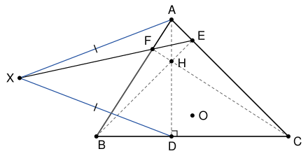

## Statement

Soit $ABC$ un triangle tel que $AB \neq AC$ et dont l'angle en $A$ n'est pas droit. On note $D$, $E$, $F$ les pieds des hauteurs issues de $A$, $B$, $C$, puis $H$ l'orthocentre du triangle et $O$ le centre de son cercle circonscrit.

Soit $X$ un point de la droite $(EF)$ tel que $XA = XD$.

Montrer que les droites $(AX)$ et $(OH)$ sont perpendiculaires.

## Hints

1. Soient $B'$ et $C'$ les milieux de $[AC]$ et $[AB]$. Montre que $X$ est sur la droite $(B'C')$.
2. Les points $A$, $E$, $F$ sont sur le cercle de diamètre $[AH]$, et les points $A$, $B'$, $C'$ sur le cercle de diamètre $[AO]$.
3. Pour un cercle de centre $\Omega$ et de rayon $\rho$, et une droite passant par $M$ qui coupe ce cercle en $U$ et $V$, montre que $\overrightarrow{MU} \cdot \overrightarrow{MV} = M\Omega^2 - \rho^2$.
4. Les quatre points $B'$, $C'$, $E$, $F$ sont sur un même cercle. Pour le montrer, prends $O$ comme origine et vérifie d'abord que $\overrightarrow{OH} = \overrightarrow{OA} + \overrightarrow{OB} + \overrightarrow{OC}$.

## Solution

On note $R$ le rayon du cercle circonscrit, $B'$ et $C'$ les milieux de $[AC]$ et $[AB]$, $H_0$ le milieu de $[AH]$ et $O_0$ le milieu de $[AO]$.

### Étape 1 : un outil, la puissance d'un point

**Lemme.** Soit $\mathcal{C}$ un cercle de centre $\Omega$ et de rayon $\rho$, et $M$ un point. Si une droite passant par $M$ coupe $\mathcal{C}$ en deux points $U$ et $V$, alors
$$\overrightarrow{MU} \cdot \overrightarrow{MV} = M\Omega^2 - \rho^2 .$$

*Preuve.* Soit $I$ le milieu de $[UV]$. Comme $\overrightarrow{IV} = -\overrightarrow{IU}$,
$$\overrightarrow{MU} \cdot \overrightarrow{MV} = (\overrightarrow{MI} + \overrightarrow{IU}) \cdot (\overrightarrow{MI} - \overrightarrow{IU}) = MI^2 - IU^2 .$$
Le centre $\Omega$ est sur la médiatrice de $[UV]$, donc $(\Omega I)$ est perpendiculaire à la droite $(UV)$, qui contient $M$ (si $\Omega = I$, il n'y a rien à faire). Le théorème de Pythagore donne $M\Omega^2 = MI^2 + I\Omega^2$ et $\rho^2 = IU^2 + I\Omega^2$. En faisant la différence, $MI^2 - IU^2 = M\Omega^2 - \rho^2$. $\square$

### Étape 2 : le point $X$ est sur $(B'C')$

D'après le théorème des milieux, $(B'C')$ est parallèle à $(BC)$. Dans le triangle $ABD$, la droite qui passe par le milieu $C'$ de $[AB]$, parallèlement à $(BD)$, coupe $[AD]$ en son milieu. Donc $(B'C')$ passe par le milieu de $[AD]$, et elle est perpendiculaire à $(AD)$, car $(AD) \perp (BC)$. C'est la médiatrice de $[AD]$.

Comme $XA = XD$, le point $X$ est sur cette médiatrice, donc sur $(B'C')$. Il est différent de $A$, car $A$ n'est pas sur $(B'C')$.

### Étape 3 : deux cercles qui passent par $A$

- **Le cercle $\omega_1$ de diamètre $[AH]$**, de centre $H_0$ et de rayon $r_1 = \frac{AH}{2}$. Il existe, car $H \neq A$ : sinon $A$ serait sur la hauteur issue de $B$, et l'angle en $A$ serait droit. Le point $E$ est sur la droite $(AC)$, qui passe par $A$, et sur la hauteur issue de $B$, qui passe par $H$. Ces deux droites sont perpendiculaires, donc $E = A$, ou $E = H$, ou $\widehat{AEH} = 90°$. Dans tous les cas, $E$ est sur $\omega_1$. De même, $F$ est sur $\omega_1$.
- **Le cercle $\omega_2$ de diamètre $[AO]$**, de centre $O_0$ et de rayon $r_2 = \frac{R}{2}$. Le point $O$ est sur la médiatrice de $[AC]$, donc $(OB') \perp (AC)$ ou $O = B'$, et $B'$ est sur $\omega_2$. De même, $C'$ est sur $\omega_2$.

### Étape 4 : le cercle d'Euler

On prend $O$ comme origine des vecteurs. Soit $H'$ le point tel que $\overrightarrow{OH'} = \overrightarrow{OA} + \overrightarrow{OB} + \overrightarrow{OC}$, et $A'$ le milieu de $[BC]$. Alors
$$\overrightarrow{AH'} = \overrightarrow{OB} + \overrightarrow{OC} = 2\,\overrightarrow{OA'} .$$
Comme $(OA') \perp (BC)$ ou $O = A'$, le point $H'$ est sur la hauteur issue de $A$. De même, il est sur la hauteur issue de $B$. Donc $H' = H$, et
$$\overrightarrow{OH} = \overrightarrow{OA} + \overrightarrow{OB} + \overrightarrow{OC} .$$

Soit $N$ le milieu de $[OH]$, de sorte que $\overrightarrow{ON} = \frac{1}{2}(\overrightarrow{OA} + \overrightarrow{OB} + \overrightarrow{OC})$. Montrons que $B'$, $C'$, $E$, $F$ sont sur le cercle $\omega_9$ de centre $N$ et de rayon $\frac{R}{2}$.

- $\overrightarrow{NB'} = \frac{1}{2}(\overrightarrow{OA} + \overrightarrow{OC}) - \overrightarrow{ON} = -\frac{1}{2}\,\overrightarrow{OB}$, donc $NB' = \frac{R}{2}$. De même, $NC' = \frac{R}{2}$.
- Soit $K$ le milieu de $[BH]$. Alors $\overrightarrow{OK} = \frac{1}{2}(\overrightarrow{OB} + \overrightarrow{OH}) = \frac{1}{2}(\overrightarrow{OA} + 2\,\overrightarrow{OB} + \overrightarrow{OC})$, donc
$$\frac{1}{2}(\overrightarrow{OB'} + \overrightarrow{OK}) = \overrightarrow{ON} \qquad \text{et} \qquad \overrightarrow{B'K} = \overrightarrow{OK} - \overrightarrow{OB'} = \overrightarrow{OB} .$$
Le point $N$ est le milieu de $[B'K]$, et $B'K = R$. Le point $E$ est sur la droite $(AC)$, qui passe par $B'$, et sur la hauteur issue de $B$, qui passe par $K$. Ces deux droites sont perpendiculaires, donc $E$ est sur le cercle de diamètre $[B'K]$, c'est-à-dire sur $\omega_9$.
- De la même façon, avec le milieu de $[CH]$ et le point $C'$, le point $F$ est sur $\omega_9$.

### Étape 5 : on applique le lemme

Les points $E$ et $F$ sont distincts : sinon ce point serait sur $(AC)$ et sur $(AB)$, donc égal à $A$, et l'angle en $A$ serait droit. La droite $(EF)$ passe par $X$ et coupe $\omega_1$ et $\omega_9$ en $E$ et $F$. La droite $(B'C')$ passe par $X$ et coupe $\omega_2$ et $\omega_9$ en $B'$ et $C'$. Le lemme donne
$$XH_0^2 - r_1^2 = \overrightarrow{XE} \cdot \overrightarrow{XF} = XN^2 - \frac{R^2}{4} = \overrightarrow{XB'} \cdot \overrightarrow{XC'} = XO_0^2 - r_2^2 .$$

### Étape 6 : conclusion

Pour un point $M$, on pose $f(M) = MH_0^2 - MO_0^2 - r_1^2 + r_2^2$. D'après l'étape 5, $f(X) = 0$. Et $f(A) = 0$, car $AH_0 = r_1$ et $AO_0 = r_2$.

Pour tout point $M$,
$$MH_0^2 - MO_0^2 = (\overrightarrow{MH_0} - \overrightarrow{MO_0}) \cdot (\overrightarrow{MH_0} + \overrightarrow{MO_0}) = \overrightarrow{O_0H_0} \cdot (\overrightarrow{MH_0} + \overrightarrow{MO_0}) .$$
On écrit la même chose pour $A$ et on fait la différence :
$$f(M) - f(A) = \overrightarrow{O_0H_0} \cdot (\overrightarrow{MH_0} - \overrightarrow{AH_0} + \overrightarrow{MO_0} - \overrightarrow{AO_0}) = 2\,\overrightarrow{O_0H_0} \cdot \overrightarrow{MA} .$$
Avec $M = X$, on obtient $\overrightarrow{O_0H_0} \cdot \overrightarrow{XA} = 0$.

Enfin, $\overrightarrow{O_0H_0} = \overrightarrow{AH_0} - \overrightarrow{AO_0} = \frac{1}{2}(\overrightarrow{AH} - \overrightarrow{AO}) = \frac{1}{2}\,\overrightarrow{OH}$. Donc
$$\overrightarrow{OH} \cdot \overrightarrow{XA} = 0 .$$
Le vecteur $\overrightarrow{XA}$ n'est pas nul (étape 2). Le vecteur $\overrightarrow{OH}$ non plus : si $O = H$, la hauteur issue de $A$ passerait par $O$, ce serait la médiatrice de $[BC]$, et on aurait $AB = AC$. **Les droites $(AX)$ et $(OH)$ sont donc perpendiculaires.**

## Going further

- Le nombre $M\Omega^2 - \rho^2$ s'appelle la puissance du point $M$ par rapport au cercle. Les points qui ont la même puissance par rapport à deux cercles de centres distincts forment une droite perpendiculaire à la droite des centres : l'axe radical. L'étape 6 montre que $(AX)$ est l'axe radical de $\omega_1$ et $\omega_2$.
- Le cercle $\omega_9$ passe aussi par $A'$, $D$ et par les milieux de $[AH]$, $[BH]$, $[CH]$. On l'appelle le cercle d'Euler, ou cercle des neuf points.
- Que se passe-t-il si $AB = AC$ ? Montre qu'alors $(EF)$ et $(B'C')$ sont parallèles, ou confondues si le triangle est équilatéral.
